# Tamil Nadu Java User Group (TNJUG) — Complete Chronological Timeline (First to Last)

> **Order:** Chronological from **First (October 2025)** to **Last (October 2026 / January 2027)**
> **Official LinkedIn Page:** [https://www.linkedin.com/company/tamil-jug](https://www.linkedin.com/company/tamil-jug)
> **Total Events in Timeline:** **25** (`#1` to `#25`)
> **Total LinkedIn Posts in Timeline:** **83** (`#1` to `#83`)

---

## 🗓️ PART 1: Complete Events Timeline (First to Last — #1 to #25)

| Step | Date | Event ID | Event Title | Venue / City | LinkedIn Link | Posters & Photos |
| :--: | :--- | :------: | :---------- | :----------- | :------------ | :--------------: |
| **#1** | **2025-11-01** (November 1, 2025) | `E03` | Tamilnadu JUG November Meetup 2025 | Thoughtworks, Coimbatore | [LinkedIn Link](https://www.linkedin.com/company/tamil-jug/) | 1 Posters, 0 Photos |
| **#2** | **2025-11-04** (November 4, 2025) | `E01` | JavaFest 2024 — TNJUG community-ticket notice | Infosys Bangalore (JavaFest conference) | [LinkedIn Link](https://www.linkedin.com/company/tamil-jug/) | 1 Posters, 0 Photos |
| **#3** | **2025-11-08** (November 8, 2025) | `E02` | JAVAFEST’25 | Infosys Campus, Electronic City, Bangalore | [LinkedIn Link](https://www.linkedin.com/company/tamil-jug/) | 1 Posters, 1 Photos |
| **#4** | **2025-12-20** (December 20, 2025) | `E04` | December Online Meetup — Spring Boot 4 New Features | Online | [LinkedIn Link](https://www.linkedin.com/company/tamil-jug/) | 1 Posters, 0 Photos |
| **#5** | **2026-01-31** (January 31, 2026) | `E05` | Spring AI Hands-on Workshop — Chennai | Excelencia Office, Pinnacle Building, Taramani, Chennai | [LinkedIn Link](https://www.linkedin.com/company/tamil-jug/) | 1 Posters, 0 Photos |
| **#6** | **2026-02-07** (February 7, 2026) | `E06` | Modern Programming Paradigms with Venkat Subramaniam (plus AMA) | Sri Eshwar College of Engineering, Coimbatore | [LinkedIn Link](https://www.linkedin.com/company/tamil-jug/) | 1 Posters, 0 Photos |
| **#7** | **2026-03-02** (March 2, 2026) | `E08` | Open Source Lab — second round | Kongu Engineering College, Perundurai | [LinkedIn Link](https://www.linkedin.com/company/tamil-jug/) | 1 Posters, 3 Photos |
| **#8** | **2026-03-07** (March 7, 2026) | `E07` | Java AI Day — March Edition | EPAM Systems, Coimbatore | [LinkedIn Link](https://www.linkedin.com/company/tamil-jug/) | 1 Posters, 2 Photos |
| **#9** | **2026-05-04** (May 4, 2026) | `E10` | Rameswaram Tech Tour and Coding Camp | Rameswaram | [LinkedIn Link](https://www.linkedin.com/company/tamil-jug/) | 1 Posters, 0 Photos |
| **#10** | **2026-05-10** (May 10, 2026) | `E11` | 10-Day In-Person Workshop — DSA to Spring Boot AI | Rameswaram (Venue provided by Karthik S.) | [LinkedIn Link](https://www.linkedin.com/company/tamil-jug/) | 1 Posters, 0 Photos |
| **#11** | **2026-05-22** (May 22, 2026) | `E21` | JAVAFEST 2026 — event preparations | Bengaluru / Community Organizing | [LinkedIn Link](https://www.linkedin.com/company/tamil-jug/) | 1 Posters, 0 Photos |
| **#12** | **2026-05-30** (May 30, 2026) | `E14` | Tamilnadu JUG Chennai May Meetup — Java + AI | Contentstack Office, Chennai | [LinkedIn Link](https://www.linkedin.com/company/tamil-jug/) | 1 Posters, 1 Photos |
| **#13** | **2026-06-25** (June 25, 2026) | `E13` | Innovation ecosystem panel discussion at VET Institute | VET Institute of Arts and Science (Co-ed) College, Erode | [LinkedIn Link](https://www.linkedin.com/company/tamil-jug/) | 1 Posters, 1 Photos |
| **#14** | **2026-07-25** (July 25, 2026) | `E12` | Java AI Hackathon 2026 (Banfico-hosted) | Chennai (Hosted by Banfico) | [LinkedIn Link](https://www.linkedin.com/company/tamil-jug/) | 1 Posters, 0 Photos |
| **#15** | **2026-08-06** (August 6, 2026) | `E15` | Finding and Fixing Issues in Code Using AI-Based Tools | Thoughtworks, Coimbatore | [LinkedIn Link](https://www.linkedin.com/company/tamil-jug/) | 1 Posters, 0 Photos |
| **#16** | **2026-08-25** (August 25, 2026) | `E17` | Community discussion with Venkat Subramaniam on academia and industry | Online / Virtual Discussion | [LinkedIn Link](https://www.linkedin.com/company/tamil-jug/) | 1 Posters, 0 Photos |
| **#17** | **2026-08-26** (August 26–30, 2026) | `E16` | Five-Day Online Advanced Java Workshop with Anna University | Online | [LinkedIn Link](https://www.linkedin.com/company/tamil-jug/) | 1 Posters, 0 Photos |
| **#18** | **2026-09-05** (September 5, 2026) | `E18` | DevCarnival Kick-Off discussion | Ramakrishna Math, Chennai | [LinkedIn Link](https://www.linkedin.com/company/tamil-jug/) | 1 Posters, 0 Photos |
| **#19** | **2026-09-17** (September 17, 2026) | `E09` | Ken Fogel discussion and SQL Builder review | Online / Virtual Review | [LinkedIn Link](https://www.linkedin.com/company/tamil-jug/) | 0 Posters, 0 Photos |
| **#20** | **2026-09-19** (September 19, 2026) | `E19` | September Meetup — Modern Java Concurrency | Online | [LinkedIn Link](https://www.linkedin.com/company/tamil-jug/) | 1 Posters, 0 Photos |
| **#21** | **2026-10-02** (October 2, 2026) | `E20` | TNJUG Madurai Chapter Launch / first Madurai Meetup | Dot Com Infoway, Madurai | [LinkedIn Link](https://www.linkedin.com/company/tamil-jug/) | 5 Posters, 3 Photos |
| **#22** | **2026-10-14** (October 14, 2026) | `E23` | Global Dev Wednesdays — first session with Nitin Avula | Online (LinkedIn Live / Virtual) | [LinkedIn Link](https://www.linkedin.com/posts/tamil-jug_tamilnadujavausergroup-globaldevwednesdays-activity-7514886517358538754-YClq) | 1 Posters, 0 Photos |
| **#23** | **2026-10-25** (October 25, 2026) | `E24` | Hackathon at Kristu Jayanti University (Airport Road Campus) — Organizer & Project Jury | Kristu Jayanti University – Airport Road Campus, Bengaluru | [LinkedIn Link](https://www.linkedin.com/posts/tamil-jug_tnjug-tamilnadujug-java-activity-7520012068360503296-NMq1) | 1 Posters, 16 Photos |
| **#24** | **2026-10-28** (October 28, 2026) | `E25` | Global Dev Wednesdays — How to Become a Better Software Engineer in the Age of AI | Online (Hosted by Tamil Nadu JUG) | [LinkedIn Link](https://www.linkedin.com/posts/tamil-jug_globaldevwednesdays-tnjug-softwareengineering-activity-7521160082584207360-WiBr) | 2 Posters, 0 Photos |
| **#25** | **2027-01-08** (January 8–9, 2027) | `E22` | DevCarnival 2027 | Infosys Mahindra City, Chennai | [LinkedIn Link](https://www.linkedin.com/feed/update/urn:li:activity:7518292598546096130) | 6 Posters, 0 Photos |

---

### Milestone #1 — November 1, 2025 (`2025-11-01`)
#### E03: Tamilnadu JUG November Meetup 2025

- **📅 Date:** November 1, 2025 (`2025-11-01`)
- **📍 Venue / Location:** Thoughtworks, Coimbatore (In-Person)
- **🔗 LinkedIn Link:** [https://www.linkedin.com/company/tamil-jug/](https://www.linkedin.com/company/tamil-jug/)
- **🎙️ Speakers:** **Saravana** (Technical Speaker) • **Sathish Kumar Thiyagarajan** (Community Lead & Speaker)
- **📝 Overview:** In-person community meetup held at Thoughtworks Coimbatore focusing on Java architecture, reactive patterns, and enterprise best practices, featuring technical presentations and community networking.

**📸 Event Posters & Photos (1):**

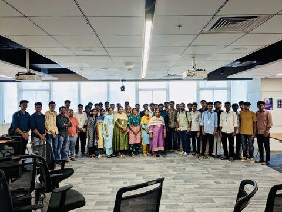
*🖼️ Poster: `output/assets/posters/E03-tamilnadu-jug-november-meetup-2025-poster.jpg` — E03: Tamilnadu JUG November Meetup 2025 (November 2025)*

---

### Milestone #2 — November 4, 2025 (`2025-11-04`)
#### E01: JavaFest 2024 — TNJUG community-ticket notice

- **📅 Date:** November 4, 2025 (`2025-11-04`)
- **📍 Venue / Location:** Infosys Bangalore (JavaFest conference) (In-Person)
- **🔗 LinkedIn Link:** [https://www.linkedin.com/company/tamil-jug/](https://www.linkedin.com/company/tamil-jug/)
- **📝 Overview:** Notice announcing that the limited community passes allocated to Tamilnadu JUG for JavaFest were sold out, with details on remaining conference tickets. Mentions strong engagement within the Tamil Nadu Java ecosystem.

**📸 Event Posters & Photos (1):**

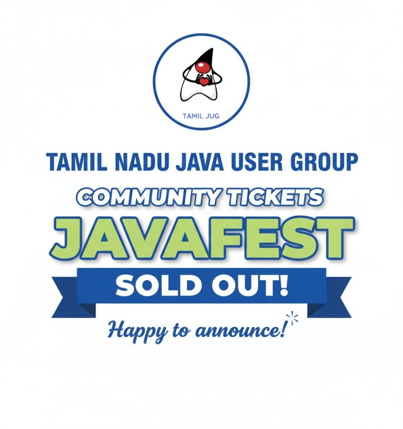
*🖼️ Poster: `output/assets/posters/E01-javafest-2024-tnjug-community-ticket-notice-poster.jpg` — E01: JavaFest 2024 — TNJUG community-ticket notice (Date not stated)*

---

### Milestone #3 — November 8, 2025 (`2025-11-08`)
#### E02: JAVAFEST’25

- **📅 Date:** November 8, 2025 (`2025-11-08`)
- **📍 Venue / Location:** Infosys Campus, Electronic City, Bangalore (In-Person)
- **🔗 LinkedIn Link:** [https://www.linkedin.com/company/tamil-jug/](https://www.linkedin.com/company/tamil-jug/)
- **📝 Overview:** India's largest Java conference, JAVAFEST'25, hosted at Infosys Bangalore. Tamilnadu JUG organized a dedicated community bus delegation from Coimbatore to Bangalore led by Hari Nikesh R and Kishore G. Sri Eshwar College of Engineering joined as a proud sponsor, alongside the 'Ink of Inspiration' collaborative initiative.

**📸 Event Posters & Photos (2):**

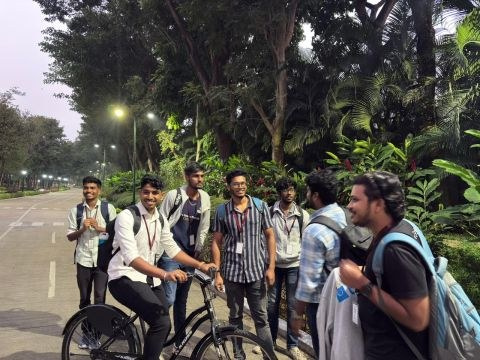
*🖼️ Poster: `output/assets/posters/E02-javafest-25-poster.jpg` — E02: JAVAFEST’25 (2025 (Date not stated))*

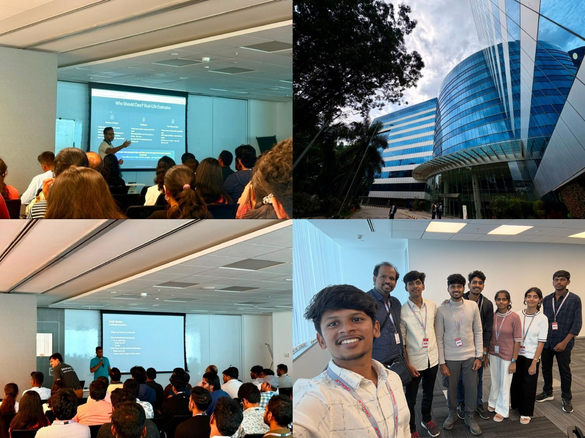
*📸 Photo: `output/assets/event-photos/E02-javafest-oracle-bengaluru-meetup-photo.jpg` — TNJUG Community at Oracle Bengaluru / JavaFest*

---

### Milestone #4 — December 20, 2025 (`2025-12-20`)
#### E04: December Online Meetup — Spring Boot 4 New Features

- **📅 Date:** December 20, 2025 (`2025-12-20`)
- **📍 Venue / Location:** Online (Online)
- **🔗 LinkedIn Link:** [https://www.linkedin.com/company/tamil-jug/](https://www.linkedin.com/company/tamil-jug/)
- **🎙️ Speakers:** **Siva Prasad Reddy K** (Developer Advocate, JetBrains)
- **📝 Overview:** Virtual deep dive into upcoming features, architectural changes, and developer productivity enhancements in Spring Boot 4, delivered live by Siva Prasad Reddy K.

**📸 Event Posters & Photos (1):**

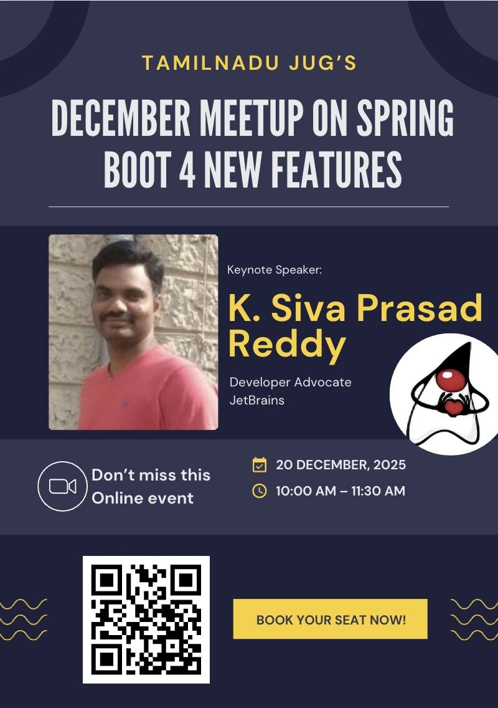
*🖼️ Poster: `output/assets/posters/E04-december-online-meetup-spring-boot-4-new-features-poster.jpg` — E04: December Online Meetup — Spring Boot 4 New Features (December 20, 2025)*

---

### Milestone #5 — January 31, 2026 (`2026-01-31`)
#### E05: Spring AI Hands-on Workshop — Chennai

- **📅 Date:** January 31, 2026 (`2026-01-31`)
- **📍 Venue / Location:** Excelencia Office, Pinnacle Building, Taramani, Chennai (In-Person)
- **🔗 LinkedIn Link:** [https://www.linkedin.com/company/tamil-jug/](https://www.linkedin.com/company/tamil-jug/)
- **🎙️ Speakers:** **Udayani V** (Broadcom) • **Thamaraikanni P** (Last Minute) • **Muthukumaran N** (KLA) • **SHAAMA M** (Software Engineer)
- **📝 Overview:** Intensive hands-on technical workshop kickstarting 2026 with practical Spring AI integration, prompt engineering from Java, and embedding local models, conducted at Excelencia Pinnacle Building in Taramani.

**📸 Event Posters & Photos (1):**

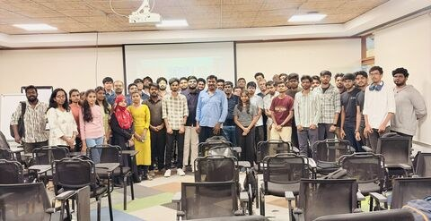
*🖼️ Poster: `output/assets/posters/E05-spring-ai-hands-on-workshop-chennai-poster.jpg` — E05: Spring AI Hands-on Workshop — Chennai (January 31, 2026)*

---

### Milestone #6 — February 7, 2026 (`2026-02-07`)
#### E06: Modern Programming Paradigms with Venkat Subramaniam (plus AMA)

- **📅 Date:** February 7, 2026 (`2026-02-07`)
- **📍 Venue / Location:** Sri Eshwar College of Engineering, Coimbatore (In-Person / Hybrid)
- **🔗 LinkedIn Link:** [https://www.linkedin.com/company/tamil-jug/](https://www.linkedin.com/company/tamil-jug/)
- **🎙️ Speakers:** **Dr. Venkat Subramaniam** (Award-winning Author, Founder Agile Developer Inc.)
- **📝 Overview:** Keynote and deep technical session on 'OOP vs. Data-Oriented Programming' followed by an interactive Ask Me Anything (AMA) session, hosted at Sri Eshwar College of Engineering Coimbatore and broadcast live on YouTube.

**📸 Event Posters & Photos (1):**

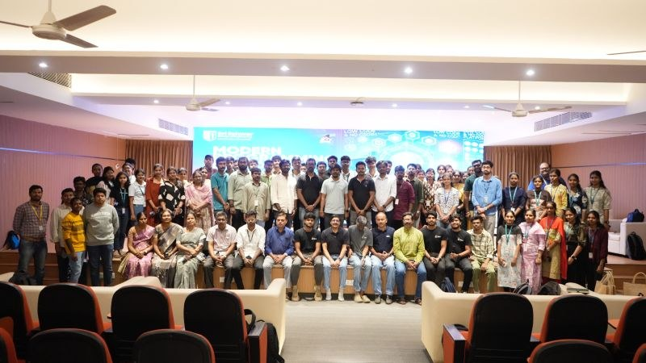
*🖼️ Poster: `output/assets/posters/E06-modern-programming-paradigms-with-venkat-subramaniam-pl-poster.jpg` — E06: Modern Programming Paradigms with Venkat Subramaniam (plus AMA) (February 7, 2026)*

---

### Milestone #7 — March 2, 2026 (`2026-03-02`)
#### E08: Open Source Lab — second round

- **📅 Date:** March 2, 2026 (`2026-03-02`)
- **📍 Venue / Location:** Kongu Engineering College, Perundurai (In-Person)
- **🔗 LinkedIn Link:** [https://www.linkedin.com/company/tamil-jug/](https://www.linkedin.com/company/tamil-jug/)
- **📝 Overview:** Successful completion of the second round of Tamilnadu JUG's Open Source Lab initiative at Kongu Engineering College, promoting real-world Java open-source development and Git workflows among undergraduate students.

**📸 Event Posters & Photos (4):**

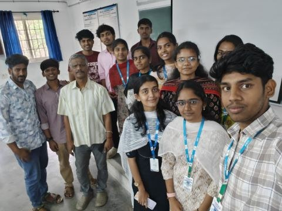
*🖼️ Poster: `output/assets/posters/E08-open-source-lab-second-round-poster.jpg` — E08: Open Source Lab — second round (Date not stated)*

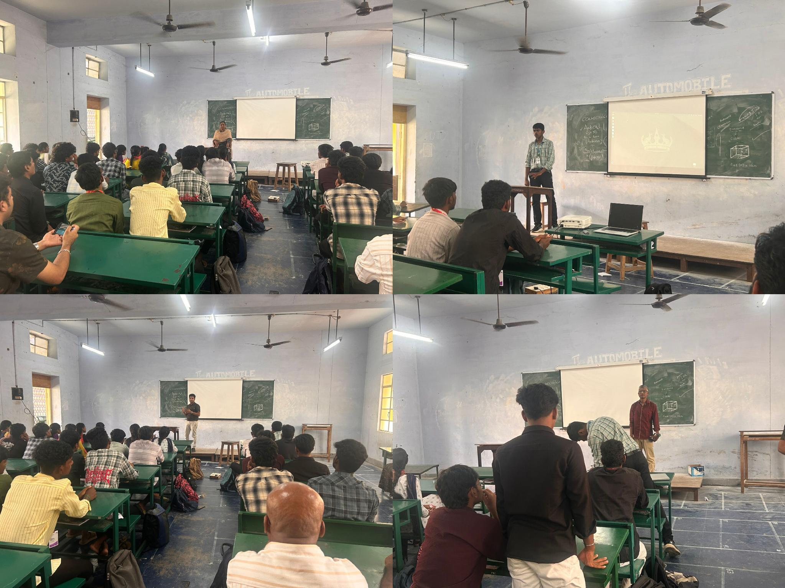
*📸 Photo: `output/assets/event-photos/E08-oslab-inauguration-gce-erode-photo.jpg` — Open Source Lab Inauguration at GCE Erode*

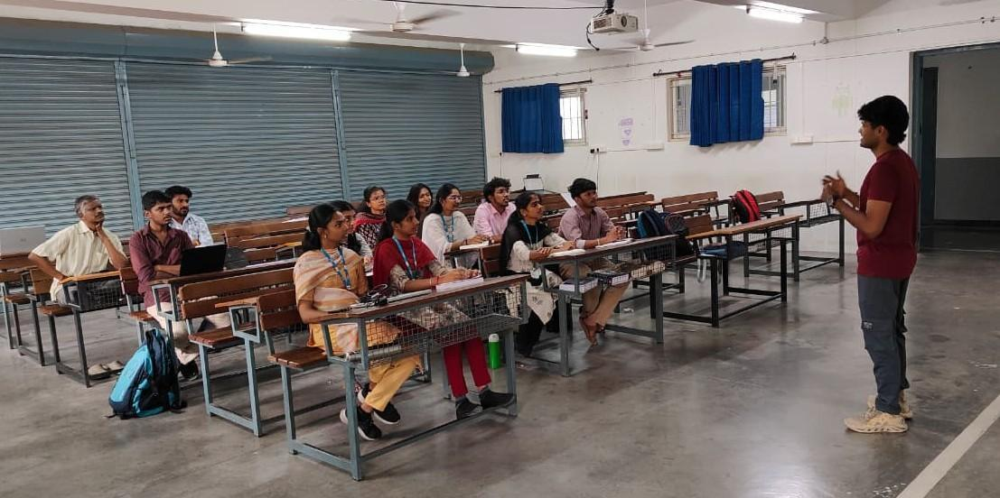
*📸 Photo: `output/assets/event-photos/E08-oslab-phase2-session-photo.jpg` — Open Source Lab Phase 2 Training Session*

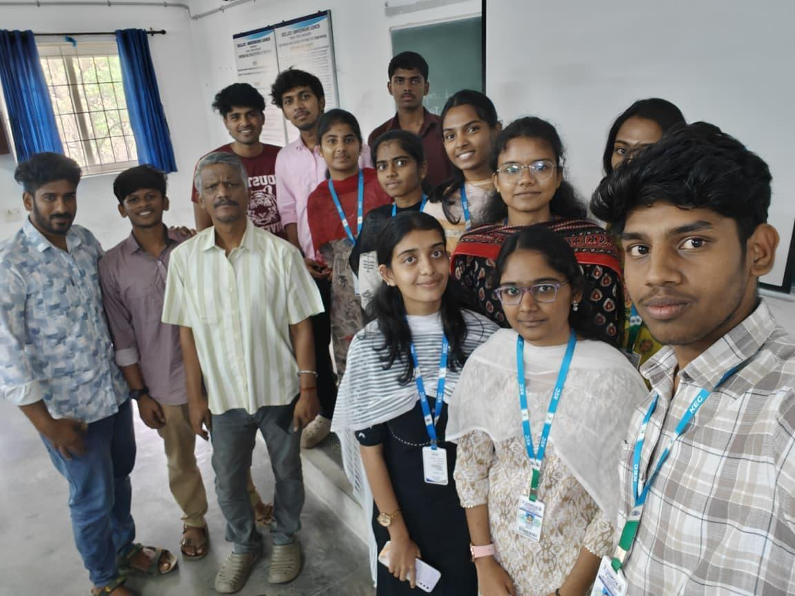
*📸 Photo: `output/assets/event-photos/E08-oslab-phase2-team-photo.jpg` — Open Source Lab Phase 2 Student & Mentor Team*

---

### Milestone #8 — March 7, 2026 (`2026-03-07`)
#### E07: Java AI Day — March Edition

- **📅 Date:** March 7, 2026 (`2026-03-07`)
- **📍 Venue / Location:** EPAM Systems, Coimbatore (In-Person)
- **🔗 LinkedIn Link:** [https://www.linkedin.com/company/tamil-jug/](https://www.linkedin.com/company/tamil-jug/)
- **🎙️ Speakers:** **Samir Kamerkar** (Canonical) • **Dinesh Kumar Ilangovan** (Senior Engineer) • **Gireesh Punathil** (IBM Master Inventor) • **Muthukumaran N** (KLA) • **SHAAMA M** (Software Engineer)
- **📝 Overview:** Full-day immersion in enterprise Java and AI hosted at EPAM Systems Coimbatore with speaker support from Bangalore JUG. Covered open-source contributions, autonomous engineering agents, Java's JEP evolution, and hands-on Spring AI exercises. Featured a 'Java 25 in Practice' quiz and community book distribution of engineering titles.

**📸 Event Posters & Photos (3):**

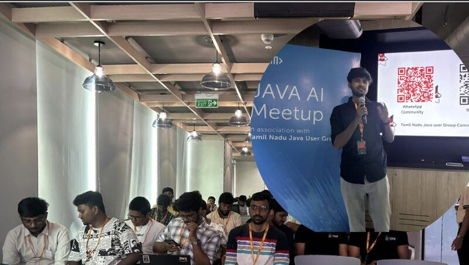
*🖼️ Poster: `output/assets/posters/E07-java-ai-day-march-edition-poster.jpg` — E07: Java AI Day — March Edition (March 7, 2026)*

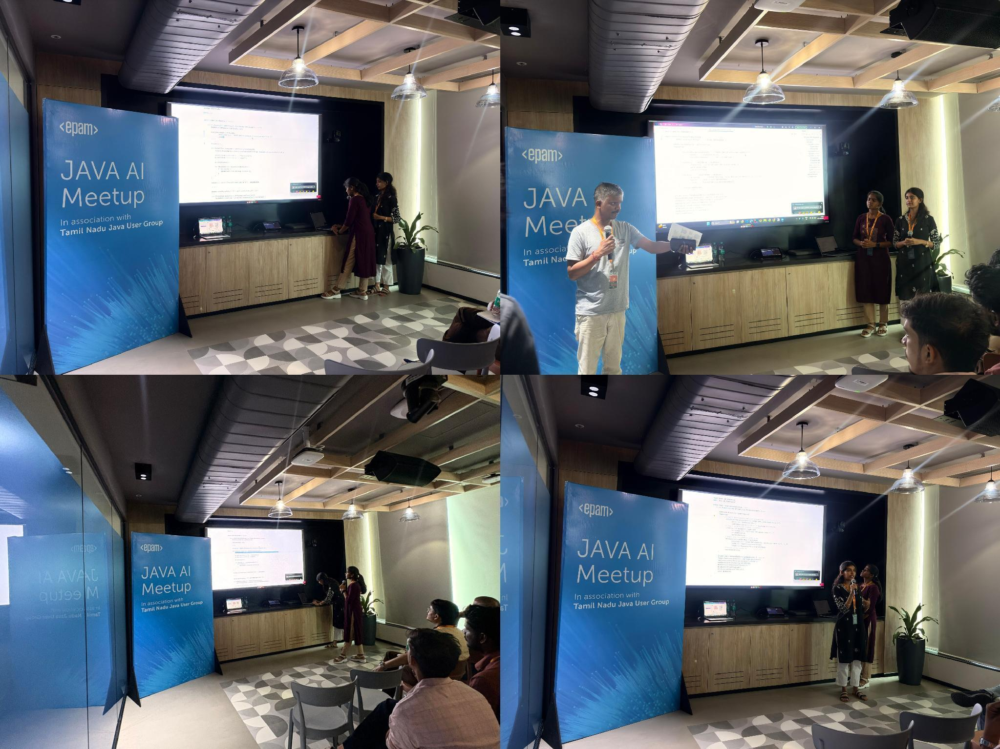
*📸 Photo: `output/assets/event-photos/E07-coimbatore-meetup-epam-sqlbuilder-photo.jpg` — TNJUG Coimbatore Meetup at EPAM Systems — SQLBuilder Session*

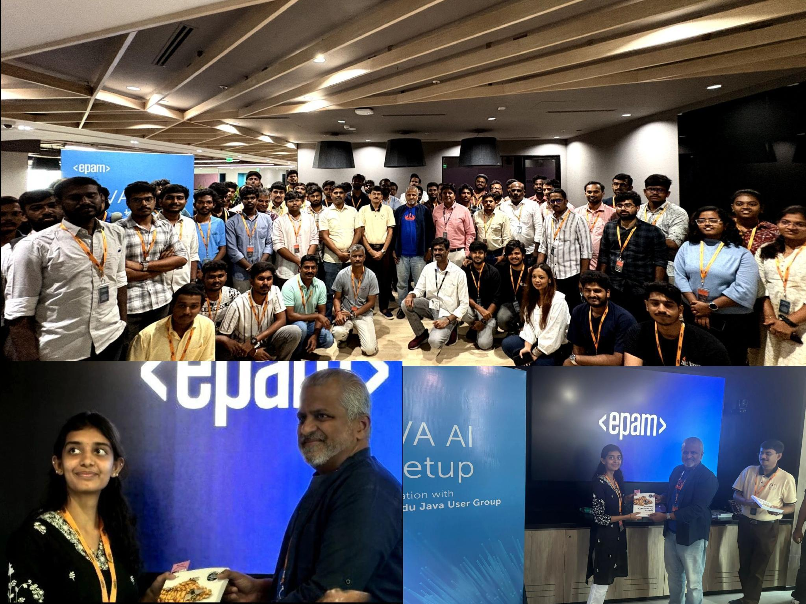
*📸 Photo: `output/assets/event-photos/E07-coimbatore-epam-appreciation-photo.jpg` — Book of Appreciation at EPAM Systems Coimbatore Meetup*

---

### Milestone #9 — May 4, 2026 (`2026-05-04`)
#### E10: Rameswaram Tech Tour and Coding Camp

- **📅 Date:** May 4, 2026 (`2026-05-04`)
- **📍 Venue / Location:** Rameswaram (In-Person)
- **🔗 LinkedIn Link:** [https://www.linkedin.com/company/tamil-jug/](https://www.linkedin.com/company/tamil-jug/)
- **📝 Overview:** Immersive community retreat, tech tour, and coding camp bringing a cohort of passionate volunteers and engineering students to Rameswaram for hands-on programming, collaboration, and mentor sessions outside urban hubs.

**📸 Event Posters & Photos (1):**

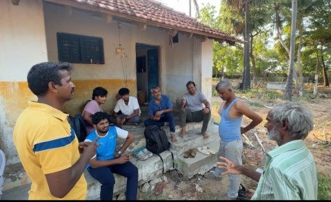
*🖼️ Poster: `output/assets/posters/E10-rameswaram-tech-tour-and-coding-camp-poster.jpg` — E10: Rameswaram Tech Tour and Coding Camp (Date not stated)*

---

### Milestone #10 — May 10, 2026 (`2026-05-10`)
#### E11: 10-Day In-Person Workshop — DSA to Spring Boot AI

- **📅 Date:** May 10, 2026 (`2026-05-10`)
- **📍 Venue / Location:** Rameswaram (Venue provided by Karthik S.) (In-Person)
- **🔗 LinkedIn Link:** [https://www.linkedin.com/company/tamil-jug/](https://www.linkedin.com/company/tamil-jug/)
- **🎙️ Speakers:** **Hari Nikesh R** (Volunteer Lead) • **Rohan J** (Volunteer Lead) • **Sai Mounik** (Volunteer Lead)
- **📝 Overview:** Announced intensive 10-day hands-on workshop in Rameswaram limited to 10 seats, designed to transition students from foundational data structures & algorithms into production backend development with Spring Boot AI.

**📸 Event Posters & Photos (1):**

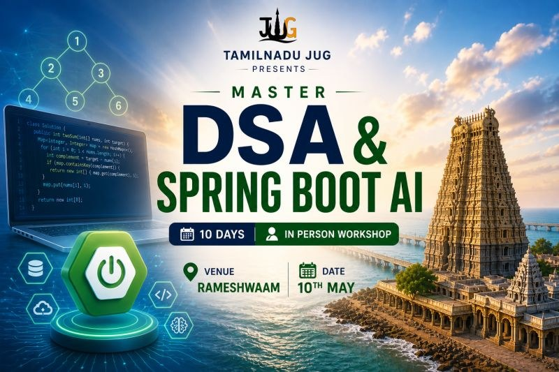
*🖼️ Poster: `output/assets/posters/E11-10-day-in-person-workshop-dsa-to-spring-boot-ai-poster.jpg` — E11: 10-Day In-Person Workshop — DSA to Spring Boot AI (Starting May 10 (Year not stated))*

---

### Milestone #11 — May 22, 2026 (`2026-05-22`)
#### E21: JAVAFEST 2026 — event preparations

- **📅 Date:** May 22, 2026 (`2026-05-22`)
- **📍 Venue / Location:** Bengaluru / Community Organizing (In-Person)
- **🔗 LinkedIn Link:** [https://www.linkedin.com/company/tamil-jug/](https://www.linkedin.com/company/tamil-jug/)
- **📝 Overview:** Official kickstart announcement and organizing preparations for JAVAFEST 2026, driven by community organizers Tejesh R, Aditya Sharma, Hari Nikesh R, and Rohan J.

**📸 Event Posters & Photos (1):**

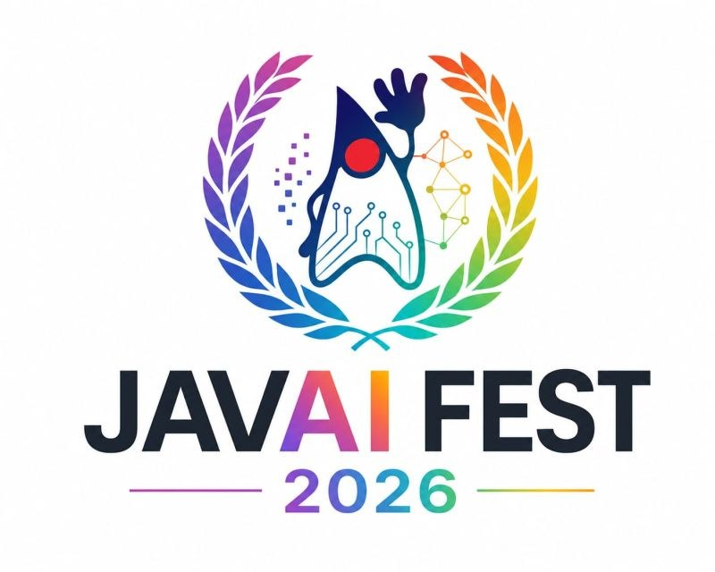
*🖼️ Poster: `output/assets/posters/E21-javafest-2026-event-preparations-poster.jpg` — E21: JAVAFEST 2026 — event preparations (Date not stated (Planning for 2026))*

---

### Milestone #12 — May 30, 2026 (`2026-05-30`)
#### E14: Tamilnadu JUG Chennai May Meetup — Java + AI

- **📅 Date:** May 30, 2026 (`2026-05-30`)
- **📍 Venue / Location:** Contentstack Office, Chennai (In-Person)
- **🔗 LinkedIn Link:** [https://www.linkedin.com/company/tamil-jug/](https://www.linkedin.com/company/tamil-jug/)
- **🎙️ Speakers:** **Sai Mounik** (Software Engineer) • **Yagapriyan G** (SDE II, Arcadia)
- **📝 Overview:** In-person meetup at Contentstack Chennai featuring sessions on running local LLMs with Java + Ollama for privacy-focused AI applications, followed by production engineering lessons in Spring Boot.

**📸 Event Posters & Photos (2):**

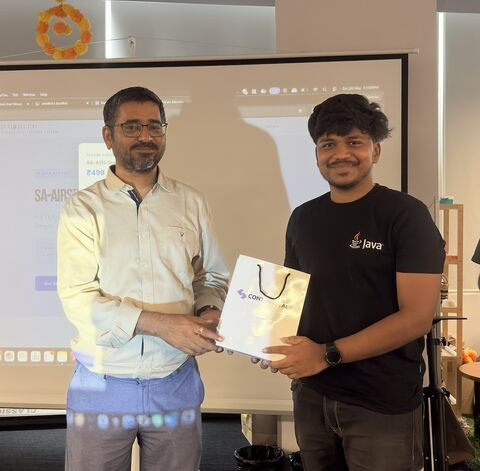
*🖼️ Poster: `output/assets/posters/E14-tamilnadu-jug-chennai-may-meetup-java-ai-poster.jpg` — E14: Tamilnadu JUG Chennai May Meetup — Java + AI (May 30, 2026)*

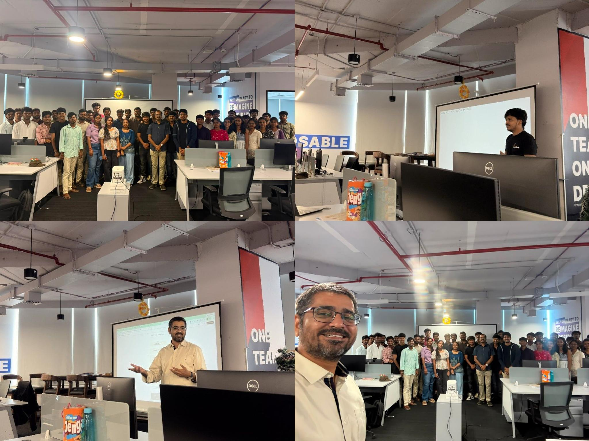
*📸 Photo: `output/assets/event-photos/E14-chennai-meetup-contentstack-photo.jpg` — TNJUG Chennai Meetup at Contentstack*

---

### Milestone #13 — June 25, 2026 (`2026-06-25`)
#### E13: Innovation ecosystem panel discussion at VET Institute

- **📅 Date:** June 25, 2026 (`2026-06-25`)
- **📍 Venue / Location:** VET Institute of Arts and Science (Co-ed) College, Erode (In-Person)
- **🔗 LinkedIn Link:** [https://www.linkedin.com/company/tamil-jug/](https://www.linkedin.com/company/tamil-jug/)
- **🎙️ Speakers:** **Hari Nikesh R** (Panelist, TNJUG) • **Thiru Murugan** (Panelist) • **Sathish Kumar Thiyagarajan** (Panelist, TNJUG)
- **📝 Overview:** Collaborative panel discussion organized alongside TN Startup Thiruvizha and Nanuri Labs at VET Institute in Erode, exploring how hackathons and developer ecosystems bridge academia and startup innovation.

**📸 Event Posters & Photos (2):**

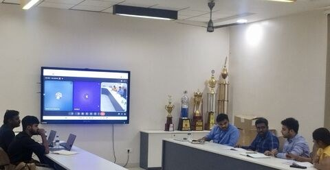
*🖼️ Poster: `output/assets/posters/E13-innovation-ecosystem-panel-discussion-at-vet-institute-poster.jpg` — E13: Innovation ecosystem panel discussion at VET Institute (Date not stated)*

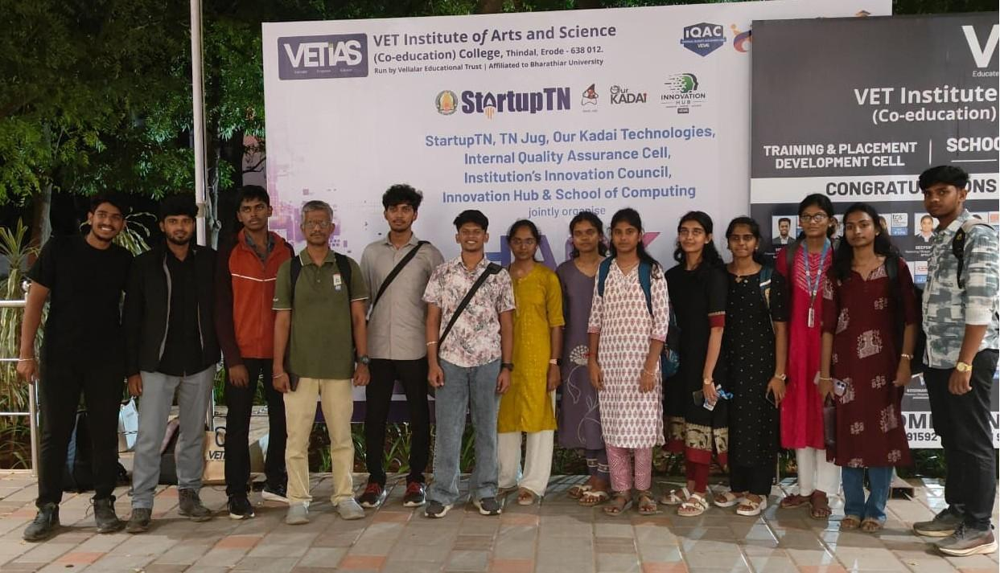
*📸 Photo: `output/assets/event-photos/E13-vetias-hackfusion-team-photo.jpg` — HackFusion & Innovation Session at VET Institute of Arts and Science*

---

### Milestone #14 — July 25, 2026 (`2026-07-25`)
#### E12: Java AI Hackathon 2026 (Banfico-hosted)

- **📅 Date:** July 25, 2026 (`2026-07-25`)
- **📍 Venue / Location:** Chennai (Hosted by Banfico) (In-Person)
- **🔗 LinkedIn Link:** [https://www.linkedin.com/company/tamil-jug/](https://www.linkedin.com/company/tamil-jug/)
- **📝 Overview:** FinTech and AI hackathon hosted by Banfico with a ₹85,000 prize pool, challenging builders to create banking solutions using Banking APIs, Java, Spring Boot, and AI. Promoted by Tamilnadu JUG as community partner.

**📸 Event Posters & Photos (1):**

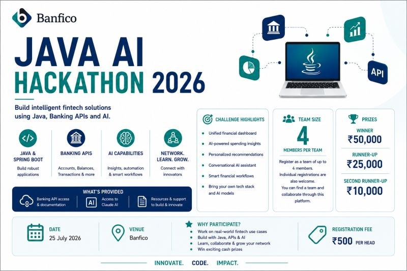
*🖼️ Poster: `output/assets/posters/E12-java-ai-hackathon-2026-banfico-hosted-poster.jpg` — E12: Java AI Hackathon 2026 (Banfico-hosted) (July 25, 2026)*

---

### Milestone #15 — August 6, 2026 (`2026-08-06`)
#### E15: Finding and Fixing Issues in Code Using AI-Based Tools

- **📅 Date:** August 6, 2026 (`2026-08-06`)
- **📍 Venue / Location:** Thoughtworks, Coimbatore (In-Person)
- **🔗 LinkedIn Link:** [https://www.linkedin.com/company/tamil-jug/](https://www.linkedin.com/company/tamil-jug/)
- **🎙️ Speakers:** **Dr. Venkat Subramaniam** (Founder, Agile Developer Inc.)
- **📝 Overview:** Evening meetup at Thoughtworks Coimbatore exploring static analysis, race conditions, memory leaks, and leveraging AI tools to inspect and refactor legacy codebases.

**📸 Event Posters & Photos (1):**

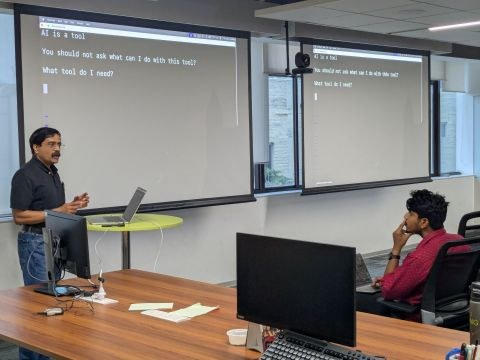
*🖼️ Poster: `output/assets/posters/E15-finding-and-fixing-issues-in-code-using-ai-based-tools-poster.jpg` — E15: Finding and Fixing Issues in Code Using AI-Based Tools (August 6 (Year not stated))*

---

### Milestone #16 — August 25, 2026 (`2026-08-25`)
#### E17: Community discussion with Venkat Subramaniam on academia and industry

- **📅 Date:** August 25, 2026 (`2026-08-25`)
- **📍 Venue / Location:** Online / Virtual Discussion (Online)
- **🔗 LinkedIn Link:** [https://www.linkedin.com/company/tamil-jug/](https://www.linkedin.com/company/tamil-jug/)
- **🎙️ Speakers:** **Dr. Venkat Subramaniam** (Educator & Software Architect)
- **📝 Overview:** Special community roundtable with Dr. Venkat Subramaniam, joined by senior engineers and university faculty, addressing actionable ways to bridge curricula and real-world software engineering practices.

**📸 Event Posters & Photos (1):**

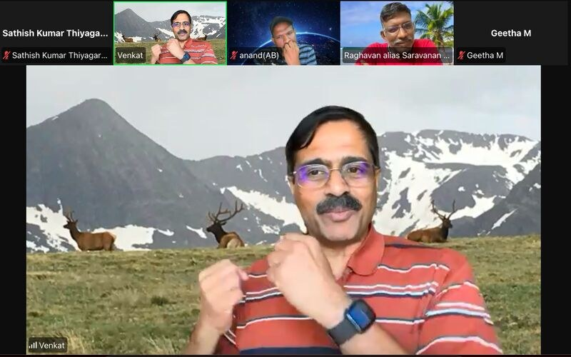
*🖼️ Poster: `output/assets/posters/E17-community-discussion-with-venkat-subramaniam-on-academi-poster.jpg` — E17: Community discussion with Venkat Subramaniam on academia and industry (Date not stated)*

---

### Milestone #17 — August 26–30, 2026 (`2026-08-26`)
#### E16: Five-Day Online Advanced Java Workshop with Anna University

- **📅 Date:** August 26–30, 2026 (`2026-08-26`)
- **📍 Venue / Location:** Online (Online)
- **🔗 LinkedIn Link:** [https://www.linkedin.com/company/tamil-jug/](https://www.linkedin.com/company/tamil-jug/)
- **🎙️ Speakers:** **Raghavan alias Saravanan Muthu** (Big Data Engineer & Academic Coordinator)
- **📝 Overview:** Marathon 5-day state-wide online technical workshop conducted in partnership with Anna University Chennai, training students across affiliated colleges on advanced Java concepts and modern application design.

**📸 Event Posters & Photos (1):**

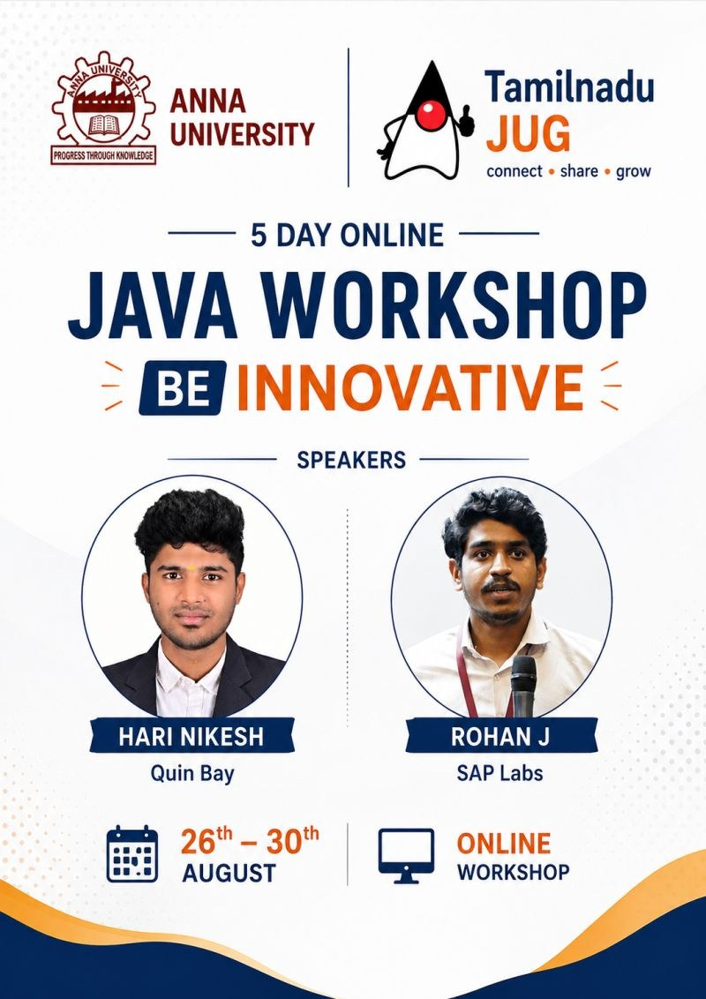
*🖼️ Poster: `output/assets/posters/E16-five-day-online-advanced-java-workshop-with-anna-univer-poster.jpg` — E16: Five-Day Online Advanced Java Workshop with Anna University (August 26–30 (Year not stated))*

---

### Milestone #18 — September 5, 2026 (`2026-09-05`)
#### E18: DevCarnival Kick-Off discussion

- **📅 Date:** September 5, 2026 (`2026-09-05`)
- **📍 Venue / Location:** Ramakrishna Math, Chennai (In-Person)
- **🔗 LinkedIn Link:** [https://www.linkedin.com/company/tamil-jug/](https://www.linkedin.com/company/tamil-jug/)
- **🎙️ Speakers:** **Arun Prakash M** (Community Lead) • **Dr. Baskaran Ramachandran** (Professor, Anna University) • **Shyam Siddarth** (Industry Leader)
- **📝 Overview:** Collaborative kick-off meeting at Ramakrishna Math Chennai aligning volunteers, educators, and industry leaders on making technology accessible to everyone ahead of DevCarnival.

**📸 Event Posters & Photos (1):**

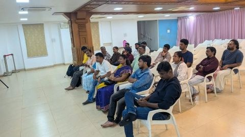
*🖼️ Poster: `output/assets/posters/E18-devcarnival-kick-off-discussion-poster.jpg` — E18: DevCarnival Kick-Off discussion (Date not stated (Teacher's Day / September))*

---

### Milestone #19 — September 17, 2026 (`2026-09-17`)
#### E09: Ken Fogel discussion and SQL Builder review

- **📅 Date:** September 17, 2026 (`2026-09-17`)
- **📍 Venue / Location:** Online / Virtual Review (Online)
- **🔗 LinkedIn Link:** [https://www.linkedin.com/company/tamil-jug/](https://www.linkedin.com/company/tamil-jug/)
- **🎙️ Speakers:** **Ken Fogel** (Java Champion & Academic Leader)
- **📝 Overview:** In-depth project review and mentorship discussion with Java Champion Ken Fogel, reviewing TNJUG's student-built open-source project SQL Builder alongside community students, professors, and organizers.

---

### Milestone #20 — September 19, 2026 (`2026-09-19`)
#### E19: September Meetup — Modern Java Concurrency

- **📅 Date:** September 19, 2026 (`2026-09-19`)
- **📍 Venue / Location:** Online (Online)
- **🔗 LinkedIn Link:** [https://www.linkedin.com/company/tamil-jug/](https://www.linkedin.com/company/tamil-jug/)
- **🎙️ Speakers:** **A N M 'Bazlur' Rahman** (Java Champion & Author)
- **📝 Overview:** Two-hour online masterclass by Java Champion A N M 'Bazlur' Rahman delving into Java 21+ virtual threads, Structured Concurrency, Scoped Values, and modern multi-threading design.

**📸 Event Posters & Photos (1):**

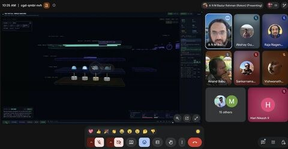
*🖼️ Poster: `output/assets/posters/E19-september-meetup-modern-java-concurrency-poster.jpg` — E19: September Meetup — Modern Java Concurrency (September 19, 2026)*

---

### Milestone #21 — October 2, 2026 (`2026-10-02`)
#### E20: TNJUG Madurai Chapter Launch / first Madurai Meetup

- **📅 Date:** October 2, 2026 (`2026-10-02`)
- **📍 Venue / Location:** Dot Com Infoway, Madurai (In-Person)
- **🔗 LinkedIn Link:** [https://www.linkedin.com/company/tamil-jug/](https://www.linkedin.com/company/tamil-jug/)
- **🎙️ Speakers:** **Vaibhav Choudhary** (Principal Engineer, JVM Engineering) • **Pawan Chawdhary** (Principal Engineer, Java Engineering) • **Abdul Salam Mohamed Kani** (Engineering Director, Financial Services)
- **📝 Overview:** Inaugural offline meetup marking the official launch of the TNJUG Madurai Chapter, organized in association with the Tamil Nadu AI Association (TNAIA) at Dot Com Infoway in the Temple City.

**📸 Event Posters & Photos (8):**


*🖼️ Poster: `output/assets/posters/E20-tnjug-madurai-chapter-launch-first-madurai-meetup-poster.jpg` — E20: TNJUG Madurai Chapter Launch / first Madurai Meetup (October 2, 2026)*

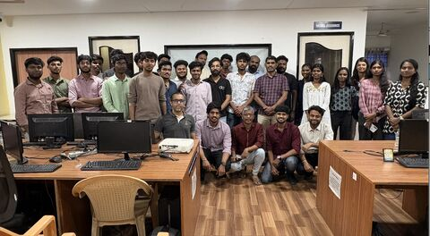
*🖼️ Poster: `output/assets/posters/E20-madurai-chapter-launch-banner.jpg` — TNJUG Madurai Chapter Launch — Official Event Banner*

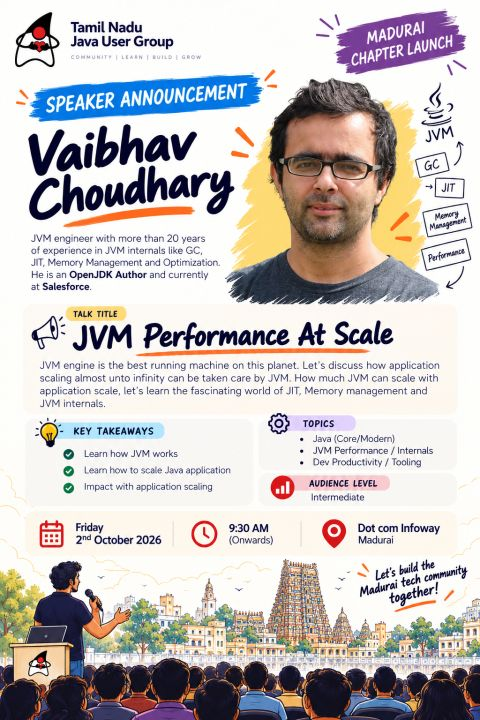
*🖼️ Poster: `output/assets/posters/E20-madurai-speaker-vaibhav-choudhary-poster.jpg` — TNJUG Madurai Launch Speaker Poster — Vaibhav Choudhary*

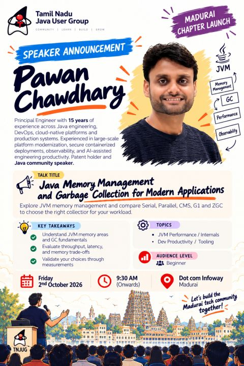
*🖼️ Poster: `output/assets/posters/E20-madurai-speaker-pawan-chawdhary-poster.jpg` — TNJUG Madurai Launch Speaker Poster — Pawan Chawdhary*

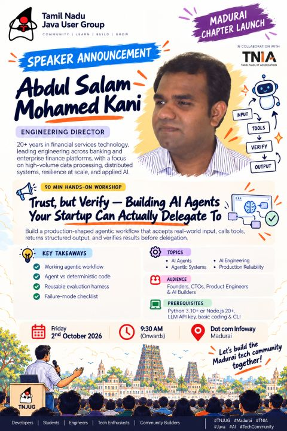
*🖼️ Poster: `output/assets/posters/E20-madurai-speaker-abdul-salam-poster.jpg` — TNJUG Madurai Launch Speaker Poster — Abdul Salam Mohamed Kani*


*📸 Photo: `output/assets/event-photos/E20-madurai-chapter-launch-photo-community-group.jpg` — TNJUG Madurai Chapter Launch — Community Group Photo at Dot Com Infoway*

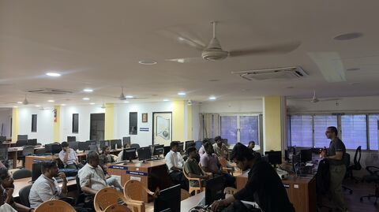
*📸 Photo: `output/assets/event-photos/E20-madurai-chapter-launch-photo-session-in-progress.jpg` — TNJUG Madurai Chapter Launch — Technical Session in Progress*

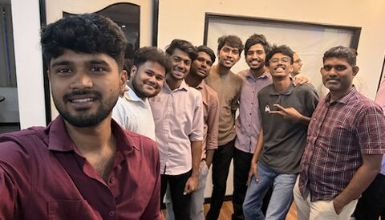
*📸 Photo: `output/assets/event-photos/E20-madurai-chapter-launch-photo-organizers-volunteers.jpg` — TNJUG Madurai Chapter Launch — Organizers and Volunteers*

---

### Milestone #22 — October 14, 2026 (`2026-10-14`)
#### E23: Global Dev Wednesdays — first session with Nitin Avula

- **📅 Date:** October 14, 2026 (`2026-10-14`)
- **📍 Venue / Location:** Online (LinkedIn Live / Virtual) (Online)
- **🔗 LinkedIn Link:** [https://www.linkedin.com/posts/tamil-jug_tamilnadujavausergroup-globaldevwednesdays-activity-7514886517358538754-YClq](https://www.linkedin.com/posts/tamil-jug_tamilnadujavausergroup-globaldevwednesdays-activity-7514886517358538754-YClq)
- **🎙️ Speakers:** **Nitin Avula** (Featured Global Speaker)
- **📝 Overview:** Inaugural session of the Global Dev Wednesdays series by Tamilnadu JUG, featuring Nitin Avula for an interactive virtual discussion accessible directly to community members.

**📸 Event Posters & Photos (1):**

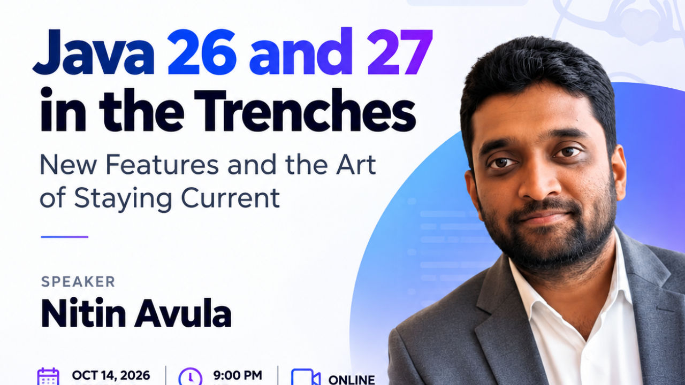
*🖼️ Poster: `output/assets/posters/E23-global-dev-wednesdays-nitin-avula-banner.jpg` — Global Dev Wednesdays #1 — Nitin Avula LinkedIn Live Event Banner*

---

### Milestone #23 — October 25, 2026 (`2026-10-25`)
#### E24: Hackathon at Kristu Jayanti University (Airport Road Campus) — Organizer & Project Jury

- **📅 Date:** October 25, 2026 (`2026-10-25`)
- **📍 Venue / Location:** Kristu Jayanti University – Airport Road Campus, Bengaluru (In-Person)
- **🔗 LinkedIn Link:** [https://www.linkedin.com/posts/tamil-jug_tnjug-tamilnadujug-java-activity-7520012068360503296-NMq1](https://www.linkedin.com/posts/tamil-jug_tnjug-tamilnadujug-java-activity-7520012068360503296-NMq1)
- **🎙️ Speakers:** **Hari Nikesh R** (Community Lead & Jury, Tamil Nadu JUG) • **Rohan J** (Organizer & Jury, Tamil Nadu JUG) • **Geetha M** (Head of Chapters, Tamil Nadu JUG) • **Tejesh R** (Community Organizer, Bangalore Java User Group)
- **📝 Overview:** Tamil Nadu JUG joined as an Organizer and Project Jury at the Kristu Jayanti University Hackathon, delivering a community keynote on developer ecosystems, introducing DevCarnival and JavaFest, and shortlisting standout student projects for the DevCarnival Tech Pavilion.

**📸 Event Posters & Photos (17):**

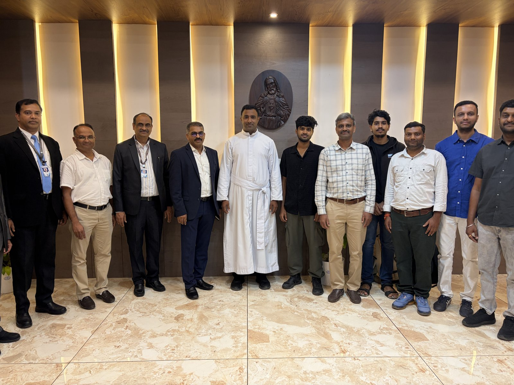
*🖼️ Poster: `output/assets/posters/E24-kristu-jayanti-hackathon-banner.jpg` — Kristu Jayanti University Hackathon — Event Banner*

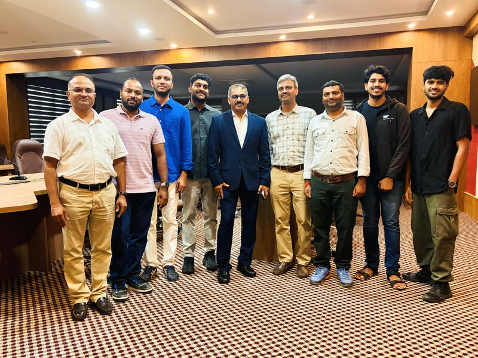
*📸 Photo: `output/assets/event-photos/E24-kristu-jayanti-linkedin-photo-01.jpg` — Kristu Jayanti University Hackathon — Organizer & Jury Recap (5 LinkedIn Photos) (Photo 1)*


*📸 Photo: `output/assets/event-photos/E24-kristu-jayanti-linkedin-photo-02.jpg` — Kristu Jayanti University Hackathon — Organizer & Jury Recap (5 LinkedIn Photos) (Photo 2)*

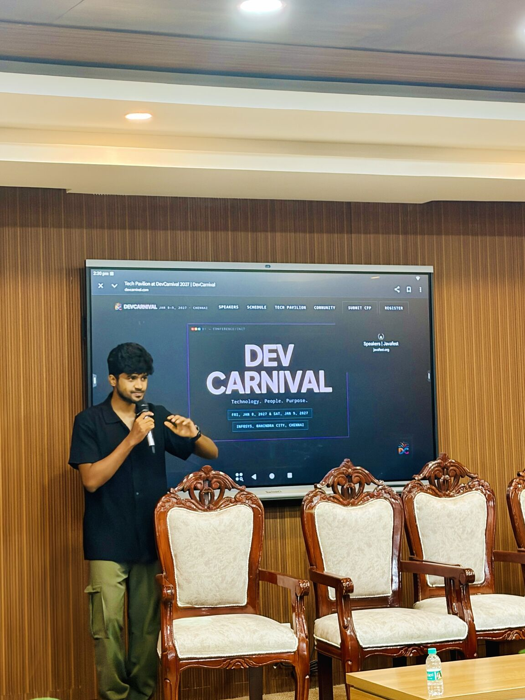
*📸 Photo: `output/assets/event-photos/E24-kristu-jayanti-linkedin-photo-03.jpg` — Kristu Jayanti University Hackathon — Organizer & Jury Recap (5 LinkedIn Photos) (Photo 3)*


*📸 Photo: `output/assets/event-photos/E24-kristu-jayanti-linkedin-photo-04.jpg` — Kristu Jayanti University Hackathon — Organizer & Jury Recap (5 LinkedIn Photos) (Photo 4)*

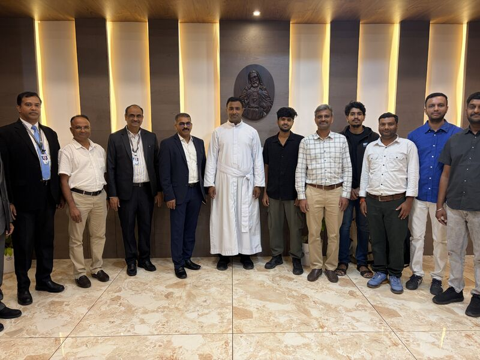
*📸 Photo: `output/assets/event-photos/E24-kristu-jayanti-linkedin-photo-05.jpg` — Kristu Jayanti University Hackathon — Organizer & Jury Recap (5 LinkedIn Photos) (Photo 5)*


*📸 Photo: `output/assets/event-photos/E24-kristu-jayanti-hackathon-gallery-01.jpg` — Kristu Jayanti University Hackathon — Event Photo 01*

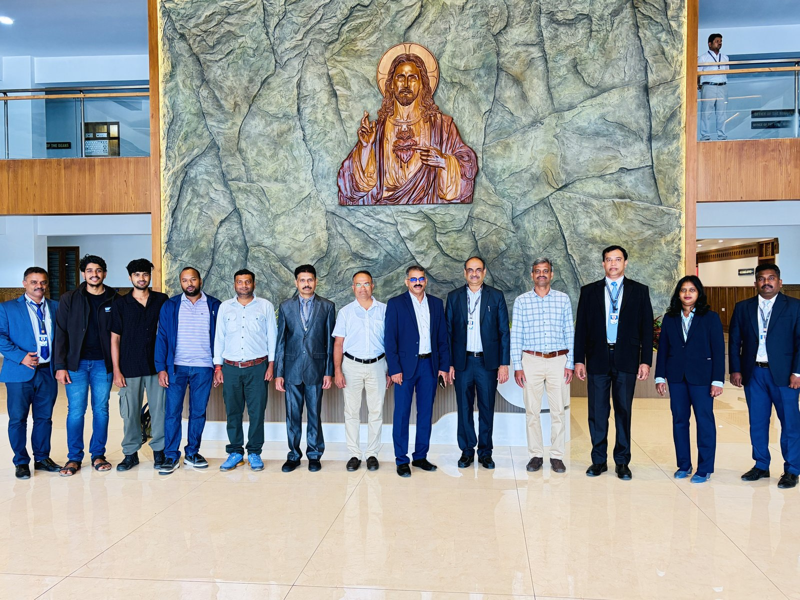
*📸 Photo: `output/assets/event-photos/E24-kristu-jayanti-hackathon-gallery-02.jpg` — Kristu Jayanti University Hackathon — Event Photo 02*

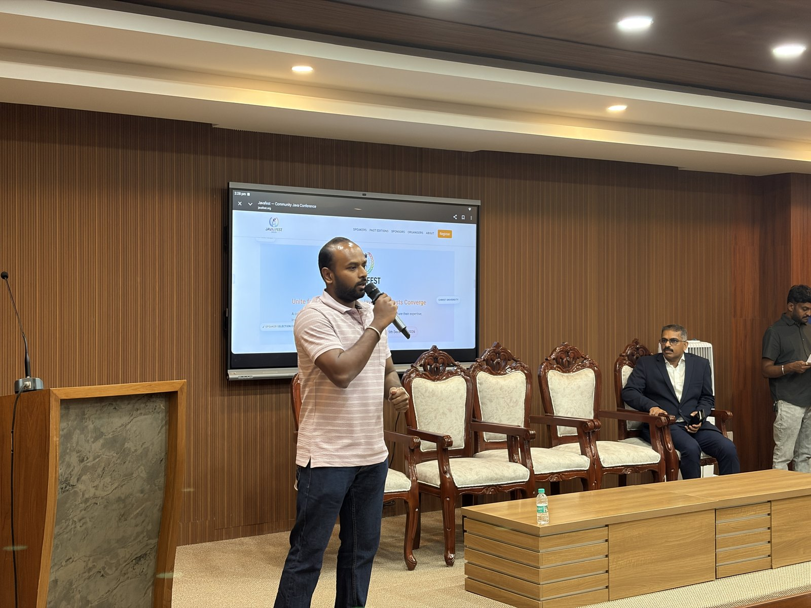
*📸 Photo: `output/assets/event-photos/E24-kristu-jayanti-hackathon-gallery-03.jpg` — Kristu Jayanti University Hackathon — Event Photo 03*

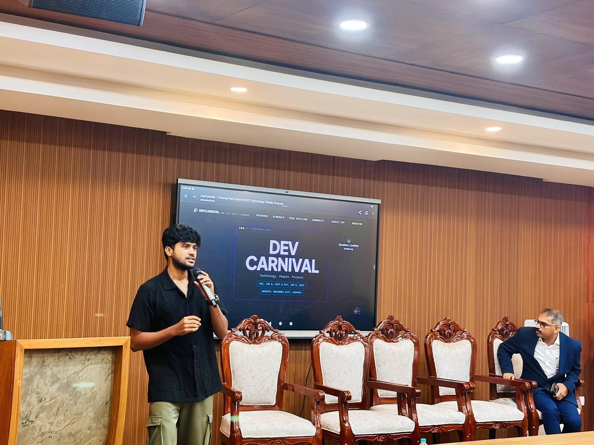
*📸 Photo: `output/assets/event-photos/E24-kristu-jayanti-hackathon-gallery-04.jpg` — Kristu Jayanti University Hackathon — Event Photo 04*


*📸 Photo: `output/assets/event-photos/E24-kristu-jayanti-hackathon-gallery-05.jpg` — Kristu Jayanti University Hackathon — Event Photo 05*

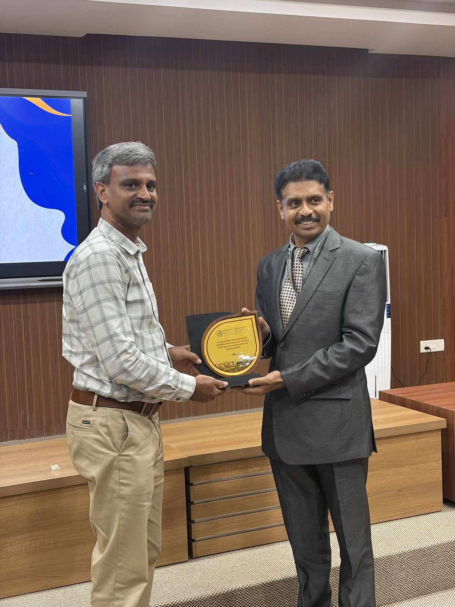
*📸 Photo: `output/assets/event-photos/E24-kristu-jayanti-hackathon-gallery-06.jpg` — Kristu Jayanti University Hackathon — Event Photo 06*

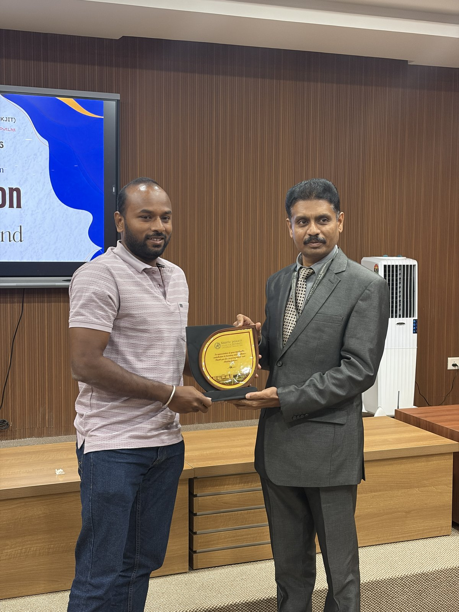
*📸 Photo: `output/assets/event-photos/E24-kristu-jayanti-hackathon-gallery-07.jpg` — Kristu Jayanti University Hackathon — Event Photo 07*

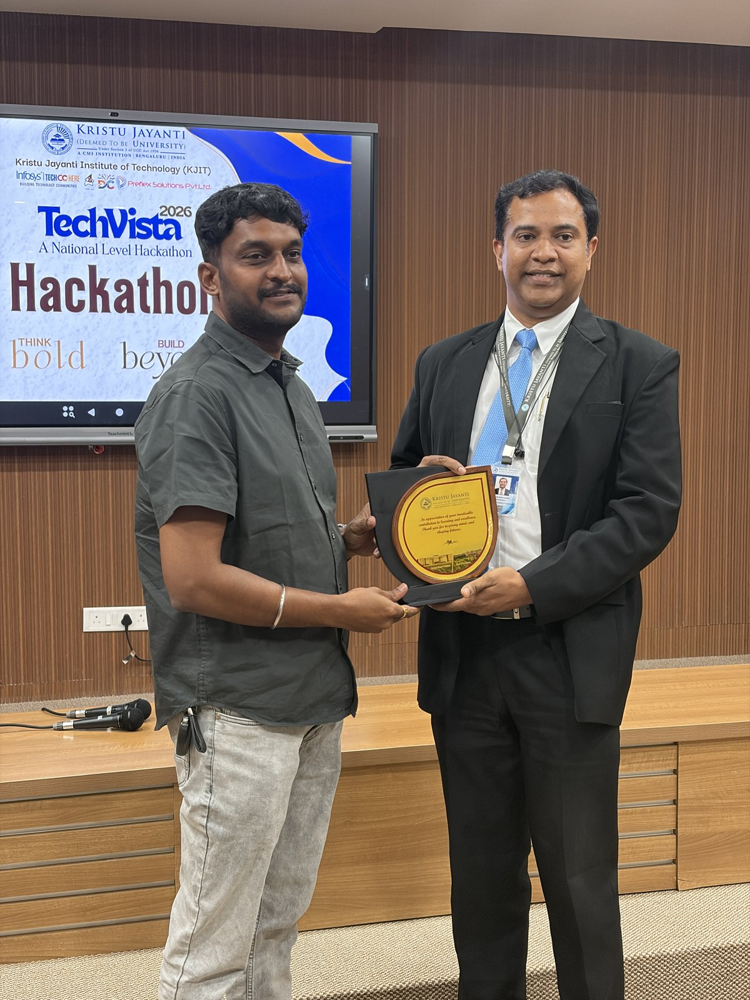
*📸 Photo: `output/assets/event-photos/E24-kristu-jayanti-hackathon-gallery-08.jpg` — Kristu Jayanti University Hackathon — Event Photo 08*

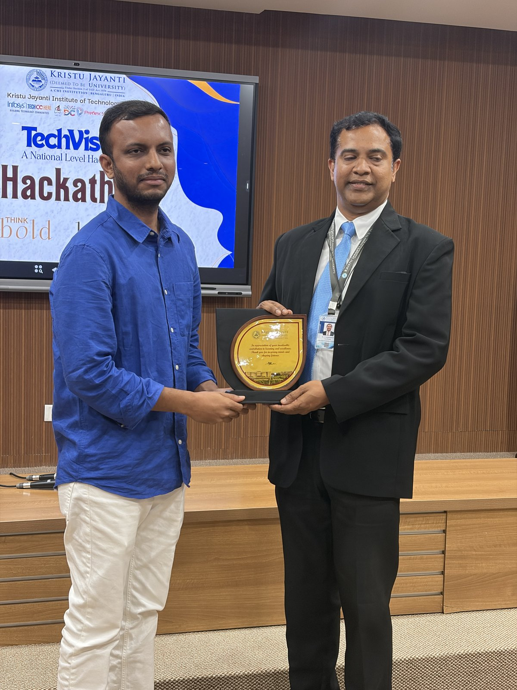
*📸 Photo: `output/assets/event-photos/E24-kristu-jayanti-hackathon-gallery-09.jpg` — Kristu Jayanti University Hackathon — Event Photo 09*

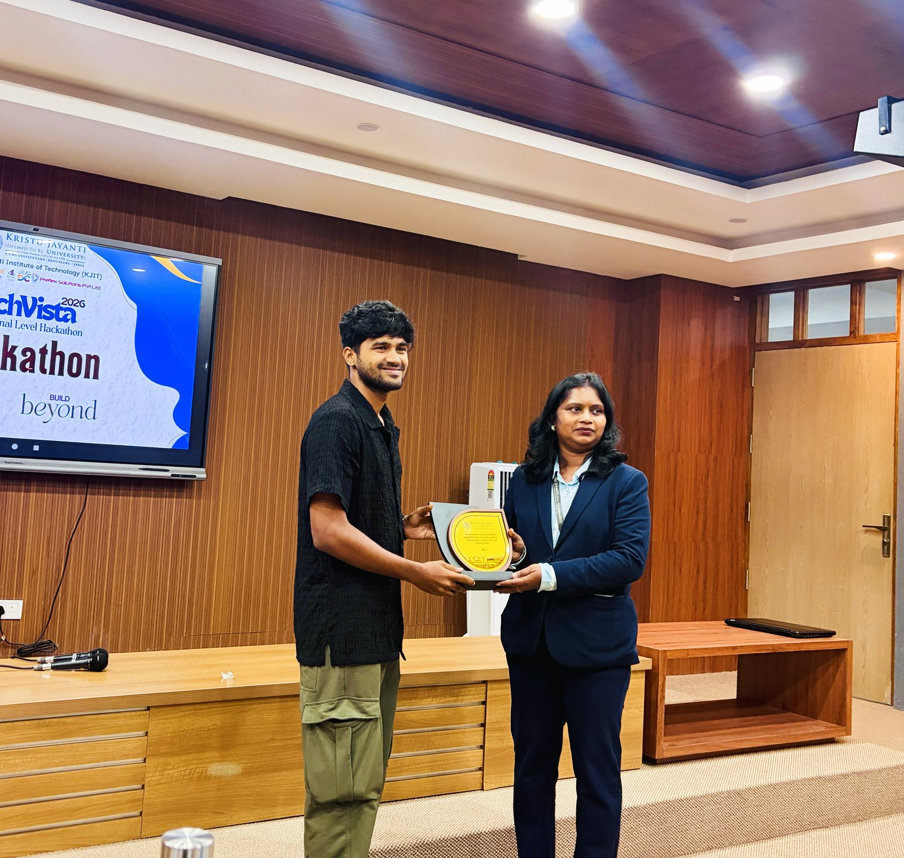
*📸 Photo: `output/assets/event-photos/E24-kristu-jayanti-hackathon-gallery-10.jpg` — Kristu Jayanti University Hackathon — Event Photo 10*

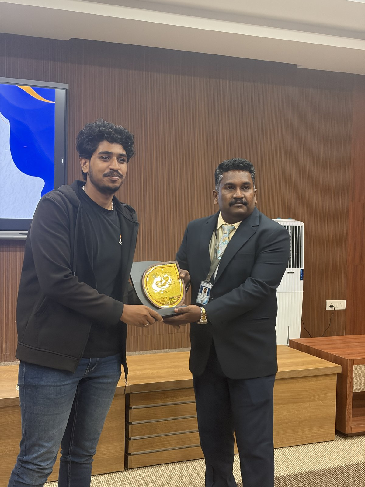
*📸 Photo: `output/assets/event-photos/E24-kristu-jayanti-hackathon-gallery-11.jpg` — Kristu Jayanti University Hackathon — Event Photo 11*

---

### Milestone #24 — October 28, 2026 (`2026-10-28`)
#### E25: Global Dev Wednesdays — How to Become a Better Software Engineer in the Age of AI

- **📅 Date:** October 28, 2026 (`2026-10-28`)
- **📍 Venue / Location:** Online (Hosted by Tamil Nadu JUG) (Online)
- **🔗 LinkedIn Link:** [https://www.linkedin.com/posts/tamil-jug_globaldevwednesdays-tnjug-softwareengineering-activity-7521160082584207360-WiBr](https://www.linkedin.com/posts/tamil-jug_globaldevwednesdays-tnjug-softwareengineering-activity-7521160082584207360-WiBr)
- **🎙️ Speakers:** **Luiz Real** (SouJava JUG Leader, Software Engineering Professional (20+ yrs), Author & Mentor) • **Professor Isidro, PhD** (Java Champion, CEO of IsiAcademy, Researcher & Educator)
- **📝 Overview:** Special joint talk in the Global Dev Wednesdays series exploring why software engineering fundamentals still matter in the age of AI, how to use AI as an engineering partner, building stronger problem-solving and critical-thinking skills, and growing your career.

**📸 Event Posters & Photos (2):**


*🖼️ Poster: `output/assets/posters/E25-global-dev-wednesdays-luiz-real-isidro-poster.jpg` — Global Dev Wednesdays #2 — Happening Today Poster (Luiz Real & Prof. Isidro)*


*🖼️ Poster: `output/assets/posters/E25-global-dev-wednesdays-luiz-real-isidro-banner.jpg` — Global Dev Wednesdays #2 — Session Announcement & Event Banner (Luiz Real & Prof. Isidro)*

---

### Milestone #25 — January 8–9, 2027 (`2027-01-08`)
#### E22: DevCarnival 2027

- **📅 Date:** January 8–9, 2027 (`2027-01-08`)
- **📍 Venue / Location:** Infosys Mahindra City, Chennai (In-Person)
- **🔗 LinkedIn Link:** [https://www.linkedin.com/feed/update/urn:li:activity:7518292598546096130](https://www.linkedin.com/feed/update/urn:li:activity:7518292598546096130)
- **🎙️ Speakers:** **Prof. Kamakoti Veezhinathan** (Director, Indian Institute of Technology Madras (Keynote Speaker)) • **Samir Kamerkar** (Canonical) • **Mutheeshwaran S** (Infosys)
- **📝 Overview:** Major upcoming 2-day developer conference in Chennai (Jan 8–9, 2027 at Infosys Mahindra City) bringing together 100+ projects across 8+ tracks, with Tamil Nadu JUG as official Community Partner. Keynote by Prof. Kamakoti Veezhinathan (Director, IIT Madras). Call for Papers (CFP) extended to November 6, 2026.

**📸 Event Posters & Photos (6):**

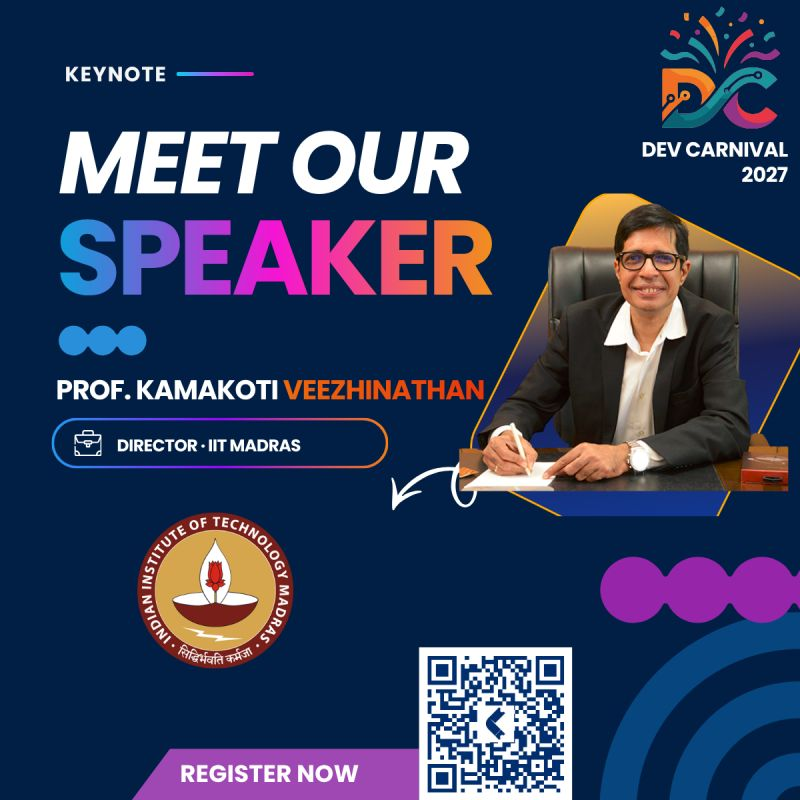
*🖼️ Poster: `output/assets/posters/E22-devcarnival-2027-keynote-kamakoti-veezhinathan-poster.jpg` — DevCarnival 2027 — Keynote Speaker Announcement: Prof. Kamakoti Veezhinathan (Director, IIT Madras)*


*🖼️ Poster: `output/assets/posters/E22-devcarnival-2027-cfp-extended-tnjug-poster.jpg` — DevCarnival 2027 — Call for Papers Extended (TNJUG Community Notice)*

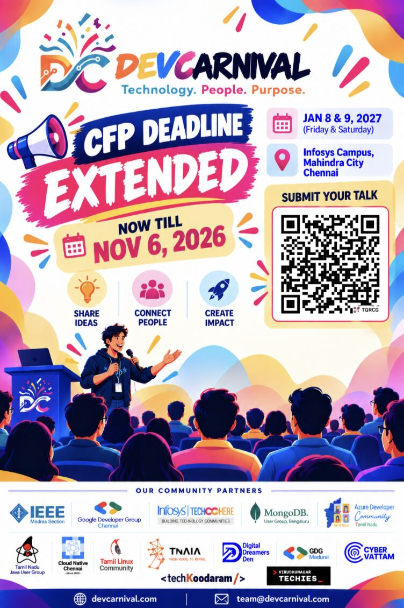
*🖼️ Poster: `output/assets/posters/E22-devcarnival-2027-cfp-extended-official-poster.jpg` — DevCarnival 2027 — Call for Papers Extended to Nov 6, 2026*

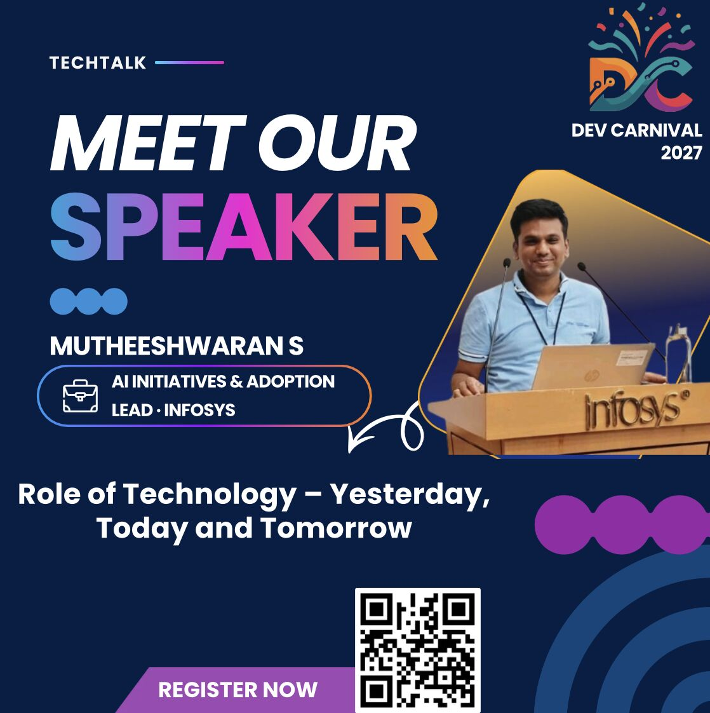
*🖼️ Poster: `output/assets/posters/E22-devcarnival-2027-speaker-mutheeshwaran-s-poster.jpg` — DevCarnival 2027 — Speaker Announcement: Mutheeshwaran S (Infosys)*


*🖼️ Poster: `output/assets/posters/E22-devcarnival-2027-speaker-samir-kamerkar-poster.jpg` — DevCarnival 2027 — Speaker Announcement #01: Samir Kamerkar (Canonical)*


*🖼️ Poster: `output/assets/posters/E22-devcarnival-2027-poster.jpg` — E22: DevCarnival 2027 (January 8–9, 2027)*

---

## 📜 PART 2: Complete LinkedIn Posts Timeline (First to Last — #1 to #83)

| # | Date | Post Title / Opening Line | Events | Media | LinkedIn Link |
| :-: | :--- | :------------------------ | :----: | :---: | :------------ |
| **#1** | **2025-10-27** | Greetings, Tamilnadu JUG - November meetup, 2025 happening in Thoughtworks , Coimbatore. Fin... | E03 | 1 | [View on LinkedIn](https://www.linkedin.com/company/tamil-jug/posts/?feedView=all) |
| **#2** | **2025-11-02** | ✨ Ink of Inspiration — A New Chapter at JAVAFEST ✨ As a community-driven conference, JAVAFES... | E02 | 1 | [View on LinkedIn](https://www.linkedin.com/company/tamil-jug/posts/?feedView=all) |
| **#3** | **2025-11-02** | What an incredible meetup! [ Tamilnadu JUG ] The November Meetup at Thoughtworks, Coimbatore... | E03 | 1 | [View on LinkedIn](https://www.linkedin.com/company/tamil-jug/posts/?feedView=all) |
| **#4** | **2025-11-04** | Tamilnadu JUG (TNJUG) Community Tickets for JavaFest are SOLD OUT! We are pleased to share t... | E01 | 1 | [View on LinkedIn](https://www.linkedin.com/company/tamil-jug/posts/?feedView=all) |
| **#5** | **2025-11-06** | We’re thrilled to welcome Sri Eshwar College of Engineering Coimbatore, as a proud sponsor o... | E02 | 1 | [View on LinkedIn](https://www.linkedin.com/company/tamil-jug/posts/?feedView=all) |
| **#6** | **2025-11-07** | 🎉 JAVAFEST'25 Tickets has been Officially SOLD OUT! 🎉  A massive #THANKYOU to everyone who... | E02 | 1 | [View on LinkedIn](https://www.linkedin.com/company/tamil-jug/posts/?feedView=all) |
| **#7** | **2025-11-10** | As part of the Tamilnadu JUG , our organizer Hari Nikesh R and Kishore G arranged a special ... | E02 | 1 | [View on LinkedIn](https://www.linkedin.com/company/tamil-jug/posts/?feedView=all) |
| **#8** | **2025-12-10** | ~ December Online meetup ~ We’re super excited to announce that our December Online Meetup i... | E04 | 1 | [View on LinkedIn](https://www.linkedin.com/company/tamil-jug/posts/?feedView=all) |
| **#9** | **2025-12-15** | Tamil Nadu Java User Group’s — December Online Meetup is happening on December 20th, 10am— a... | E04 | 1 | [View on LinkedIn](https://www.linkedin.com/company/tamil-jug/posts/?feedView=all) |
| **#10** | **2025-12-18** | 🔈 Hey everyone! We’re really happy to let you know that our #December #meetup is happening ... | E04 | 1 | [View on LinkedIn](https://www.linkedin.com/company/tamil-jug/posts/?feedView=all) |
| **#11** | **2026-01-13** | ~ Spring AI Workshop – Chennai - Kickstarting 2026 with Hands-On Learning We’re excited to b... | E05 | 1 | [View on LinkedIn](https://www.linkedin.com/company/tamil-jug/posts/?feedView=all) |
| **#12** | **2026-01-17** | Vanakkam everyone 🙏 This Pongal brings us a very special piece of good news — something we ... | E05, E06 | 2 | [View on LinkedIn](https://www.linkedin.com/company/tamil-jug/posts/?feedView=all) |
| **#13** | **2026-01-20** | Spring AI Workshop – Chennai Hey everyone!  We’re starting 2026 with a hands-on Spring AI Wo... | E05 | 1 | [View on LinkedIn](https://www.linkedin.com/company/tamil-jug/posts/?feedView=all) |
| **#14** | **2026-01-30** | We’re happy to share that Venkat Subramaniam will be visiting Sri Eshwar College of Engineer... | E06 | 1 | [View on LinkedIn](https://www.linkedin.com/company/tamil-jug/posts/?feedView=all) |
| **#15** | **2026-01-31** | How many of you came today thinking, “Let’s just listen”… and ended up thinking, “Why is my ... | E05 | 1 | [View on LinkedIn](https://www.linkedin.com/company/tamil-jug/posts/?feedView=all) |
| **#16** | **2026-02-01** | Recordings of the Spring AI workshop will be shared shortly. The video recordings will be se... | E05 | 1 | [View on LinkedIn](https://www.linkedin.com/company/tamil-jug/posts/?feedView=all) |
| **#17** | **2026-02-03** | நீங்கள் பிப்ரவரி 7 ஆம் தேதி கோயம்புத்தூர் பகுதியில் இருந்தால், தமிழ்நாடு ஜாவா சந்திப்பில் எங... | E06 | 1 | [View on LinkedIn](https://www.linkedin.com/company/tamil-jug/posts/?feedView=all) |
| **#18** | **2026-02-05** | We warmly welcome you to our event, Venkat Subramaniam . Thank you for joining us in Coimbat... | E06 | 1 | [View on LinkedIn](https://www.linkedin.com/company/tamil-jug/posts/?feedView=all) |
| **#19** | **2026-02-06** | Those who all are attending venkat’s event https://lnkd.in/gAu_Zdmz Please join here for spe... | E06 | 1 | [View on LinkedIn](https://www.linkedin.com/company/tamil-jug/posts/?feedView=all) |
| **#20** | **2026-02-07** | We are going live for Venkat's event - Those who missed the session to come in person. you c... | E06 | 1 | [View on LinkedIn](https://www.linkedin.com/company/tamil-jug/posts/?feedView=all) |
| **#21** | **2026-02-08** | We successfully hosted a memorable and highly engaging community event at Sri Eshwar College... | E06 | 1 | [View on LinkedIn](https://www.linkedin.com/company/tamil-jug/posts/?feedView=all) |
| **#22** | **2026-02-14** | Tamilnadu JUG (TNJUG) is proud to introduce the #Re -Session Initiative. 🌱 Some of you may ... | — | 0 | [View on LinkedIn](https://www.linkedin.com/company/tamil-jug/posts/?feedView=all) |
| **#23** | **2026-02-24** | #Java – AI Day (March Edition) - Coimbatore Hosted at EPAM Systems , Coimbatore The Tamilnad... | E07 | 1 | [View on LinkedIn](https://www.linkedin.com/company/tamil-jug/posts/?feedView=all) |
| **#24** | **2026-02-25** | Speaker Spotlight: Samir Kamerkar - Canonical We are excited to welcome Samir Kamerkar from ... | E07 | 1 | [View on LinkedIn](https://www.linkedin.com/company/tamil-jug/posts/?feedView=all) |
| **#25** | **2026-02-27** | Workshop Speaker: Muthukumaran Navaneethakrishnan Software Engineer at KLA We are excited to... | E07 | 1 | [View on LinkedIn](https://www.linkedin.com/company/tamil-jug/posts/?feedView=all) |
| **#26** | **2026-02-27** | Excited to welcome Gireesh Punathil, IBM Master Inventor, to speak at Java – Speaker announc... | E07 | 1 | [View on LinkedIn](https://www.linkedin.com/company/tamil-jug/posts/?feedView=all) |
| **#27** | **2026-02-28** | Excited to have SHAAMA M lead our Spring AI Workshop at EPAM Systems Coimbatore! Shaama is a... | E07 | 1 | [View on LinkedIn](https://www.linkedin.com/company/tamil-jug/posts/?feedView=all) |
| **#28** | **2026-02-28** | Java AI Day – March Edition - Coimbatore We’re excited to welcome Dinesh Kumar Ilangovan as ... | E07 | 1 | [View on LinkedIn](https://www.linkedin.com/company/tamil-jug/posts/?feedView=all) |
| **#29** | **2026-03-02** | 🎉 Quiz Announcement – Java AI Day (March 7, 2026) - Coimbatore As part of Java AI Day – Mar... | E07 | 1 | [View on LinkedIn](https://www.linkedin.com/company/tamil-jug/posts/?feedView=all) |
| **#30** | **2026-03-02** | Tamilnadu JUG is proud to successfully complete the second round of the Open Source Lab, an ... | E08 | 4 | [View on LinkedIn](https://www.linkedin.com/company/tamil-jug/posts/?feedView=all) |
| **#31** | **2026-03-06** | At Tamilnadu JUG , we strongly believe that knowledge should be accessible to everyone. As p... | E07 | 1 | [View on LinkedIn](https://www.linkedin.com/company/tamil-jug/posts/?feedView=all) |
| **#32** | **2026-03-06** | We are about to close the registration for Java AI Day, March Edition event EPAM Systems , C... | E07 | 1 | [View on LinkedIn](https://www.linkedin.com/company/tamil-jug/posts/?feedView=all) |
| **#33** | **2026-03-08** | TN JUG community: you provided rare insights in this event.! speakers create the content, bu... | E07 | 1 | [View on LinkedIn](https://www.linkedin.com/company/tamil-jug/posts/?feedView=all) |
| **#34** | **2026-03-08** | Java AI Day - March Edition 2026 @ EPAM Systems What an amazing day it has been! Today we ha... | E07 | 3 | [View on LinkedIn](https://www.linkedin.com/company/tamil-jug/posts/?feedView=all) |
| **#35** | **2026-03-28** | We’re excited to share our very first Tamilnadu JUG 's YouTube video — starting with the Ven... | E06 | 1 | [View on LinkedIn](https://www.linkedin.com/company/tamil-jug/posts/?feedView=all) |
| **#36** | **2026-04-30** | 🎤 Venkat Subramaniam — Ask Me Anything (AMA) is now live! We had an amazing interactive ses... | E06 | 1 | [View on LinkedIn](https://www.linkedin.com/company/tamil-jug/posts/?feedView=all) |
| **#37** | **2026-05-03** | After a month of intensive online sessions, we’re excited to take the next step—in person. T... | E11 | 1 | [View on LinkedIn](https://www.linkedin.com/company/tamil-jug/posts/?feedView=all) |
| **#38** | **2026-05-04** | WE really excited to share something special that we recently initiated as part of the Tamil... | E10 | 1 | [View on LinkedIn](https://www.linkedin.com/company/tamil-jug/posts/?feedView=all) |
| **#39** | **2026-05-13** | Upcoming Tamilnadu JUG Chennai Meetup: Local LLMs with Java + Ollama ☕🤖 Exciting news for t... | E14 | 1 | [View on LinkedIn](https://www.linkedin.com/company/tamil-jug/posts/?feedView=all) |
| **#40** | **2026-05-18** | 📢 Speaker Announcement: TNJUG Chennai Meetup! We are thrilled to welcome Sai Mounik , Softw... | E14 | 1 | [View on LinkedIn](https://www.linkedin.com/company/tamil-jug/posts/?feedView=all) |
| **#41** | **2026-05-22** | We are excited to officially kickstart preparations for JAVAFEST 2026! JAVAFEST continues to... | E21 | 1 | [View on LinkedIn](https://www.linkedin.com/company/tamil-jug/posts/?feedView=all) |
| **#42** | **2026-05-23** | Get Ready, #Java Folks! 🚀 Big thanks to the amazing team — Tejesh R , Aditya Sharma , Hari ... | E21 | 1 | [View on LinkedIn](https://www.linkedin.com/company/tamil-jug/posts/?feedView=all) |
| **#43** | **2026-05-24** | 📢 Speaker Announcement: TNJUG Chennai Meetup! We are thrilled to welcome Yagapriyan G , SDE... | E14 | 1 | [View on LinkedIn](https://www.linkedin.com/company/tamil-jug/posts/?feedView=all) |
| **#44** | **2026-05-26** | Mark your calendars! The Tamil Nadu Java User Group (TNJUG) is hosting a meetup in Chennai! ... | E14 | 1 | [View on LinkedIn](https://www.linkedin.com/company/tamil-jug/posts/?feedView=all) |
| **#45** | **2026-06-02** | The Tamilnadu JUG 's Chennai May Meetup, held on May 30th at Contentstack , was truly an enr... | E14 | 1 | [View on LinkedIn](https://www.linkedin.com/company/tamil-jug/posts/?feedView=all) |
| **#46** | **2026-06-25** | Building a Stronger Innovation Ecosystem, Together. The Tamilnadu JUG is proud to collaborat... | E13 | 1 | [View on LinkedIn](https://www.linkedin.com/company/tamil-jug/posts/?feedView=all) |
| **#47** | **2026-07-07** | 🚀 Registrations are now open for the Java AI Hackathon 2026! Are you passionate about Java,... | E12 | 1 | [View on LinkedIn](https://www.linkedin.com/company/tamil-jug/posts/?feedView=all) |
| **#48** | **2026-07-08** | We’re thrilled to share that Banfico is hosting the Java AI Hackathon 2026 — a unique opport... | E12 | 1 | [View on LinkedIn](https://www.linkedin.com/company/tamil-jug/posts/?feedView=all) |
| **#49** | **2026-07-10** | Tamilnadu JUG Presents: Identifying and Fixing Issues in Code Using AI-Based Tools What's re... | E15 | 1 | [View on LinkedIn](https://www.linkedin.com/company/tamil-jug/posts/?feedView=all) |
| **#50** | **2026-07-14** | If you are in or around Coimbatore, please join me at the Tamil Nadu Java Users Group on Aug... | E15 | 1 | [View on LinkedIn](https://www.linkedin.com/company/tamil-jug/posts/?feedView=all) |
| **#51** | **2026-07-23** | We’re truly grateful for the kind words, Gireesh Punathil 🙌 From Open Source discussions to... | E07 | 1 | [View on LinkedIn](https://www.linkedin.com/company/tamil-jug/posts/?feedView=all) |
| **#52** | **2026-07-28** | We would be delighted to host you and meet you in person again. We will do our best to make ... | E15 | 1 | [View on LinkedIn](https://www.linkedin.com/company/tamil-jug/posts/?feedView=all) |
| **#53** | **2026-08-06** | Finding and Fixing Issues with Legacy Code using AI What an incredible evening of learning, ... | E15 | 1 | [View on LinkedIn](https://www.linkedin.com/company/tamil-jug/posts/?feedView=all) |
| **#54** | **2026-08-14** | Welcoming a New Chapter of Leadership at Tamilnadu JUG ! We are proud to announce Dr. M Geet... | — | 0 | [View on LinkedIn](https://www.linkedin.com/company/tamil-jug/posts/?feedView=all) |
| **#55** | **2026-08-21** | Tamilnadu JUG is delighted to collaborate with Anna University in conducting a 5-Day Online ... | E16 | 1 | [View on LinkedIn](https://www.linkedin.com/company/tamil-jug/posts/?feedView=all) |
| **#56** | **2026-08-23** | One challenge we consistently observe while conducting #Java meetups in engineering colleges... | — | 0 | [View on LinkedIn](https://www.linkedin.com/company/tamil-jug/posts/?feedView=all) |
| **#57** | **2026-08-26** | We had a fantastic discussion at Tamilnadu JUG yesterday! We reached out to Venkat Subramani... | E17 | 1 | [View on LinkedIn](https://www.linkedin.com/company/tamil-jug/posts/?feedView=all) |
| **#58** | **2026-09-05** | We had a fantastic DevCarnival Kick-Off discussion today at Ramakrishna Math Chennai . Commi... | E18 | 1 | [View on LinkedIn](https://www.linkedin.com/company/tamil-jug/posts/?feedView=all) |
| **#59** | **2026-09-10** | Tamilnadu JUG successfully completed a 5-day online Advanced Java Workshop in collaboration ... | E16 | 1 | [View on LinkedIn](https://www.linkedin.com/company/tamil-jug/posts/?feedView=all) |
| **#60** | **2026-09-13** | A New Look for Tamilnadu JUG ! [ https://tamilnadujug.org ] We’re excited to share that the ... | — | 0 | [View on LinkedIn](https://www.linkedin.com/company/tamil-jug/posts/?feedView=all) |
| **#61** | **2026-09-13** | 📢 Tamilnadu JUG – September Meetup Modern Java Concurrency: What’s New and Why It Matters W... | E19 | 1 | [View on LinkedIn](https://www.linkedin.com/company/tamil-jug/posts/?feedView=all) |
| **#62** | **2026-09-17** | Being a Java Champion isn't just about contributing code — it's about empowering communities... | E09 | 0 | [View on LinkedIn](https://www.linkedin.com/company/tamil-jug/posts/?feedView=all) |
| **#63** | **2026-09-20** | Modern Java Concurrency - September Meetup — Tamil Nadu Java User Group Tamilnadu JUG is pro... | E19 | 1 | [View on LinkedIn](https://www.linkedin.com/company/tamil-jug/posts/?feedView=all) |
| **#64** | **2026-09-24** | DevCarnival 2027 — Call for Proposals is OPEN! We’re excited to take the next step toward De... | E22 | 1 | [View on LinkedIn](https://www.linkedin.com/company/tamil-jug/posts/?feedView=all) |
| **#65** | **2026-09-25** | 🚨Excited news everyone we are planned to come to "Temple city" Madurai to conduct our Octob... | E20 | 1 | [View on LinkedIn](https://www.linkedin.com/company/tamil-jug/posts/?feedView=all) |
| **#66** | **2026-09-29** | Tamilnadu JUG is excited to kick off our Madurai Meetup series in association with the Tamil... | E20 | 1 | [View on LinkedIn](https://www.linkedin.com/company/tamil-jug/posts/?feedView=all) |
| **#67** | **2026-09-30** | Speaker Announcement - TNJUG Madurai Chapter Launch We’re excited to welcome Vaibhav Choudha... | E20 | 1 | [View on LinkedIn](https://www.linkedin.com/company/tamil-jug/posts/?feedView=all) |
| **#68** | **2026-10-01** | Speaker Announcement - TNJUG Madurai Chapter Launch We’re excited to welcome Pawan Chawdhary... | E20 | 1 | [View on LinkedIn](https://www.linkedin.com/company/tamil-jug/posts/?feedView=all) |
| **#69** | **2026-10-01** | Speaker Announcement - TNJUG Madurai Chapter Launch We’re excited to welcome Abdul Salam Moh... | E20 | 1 | [View on LinkedIn](https://www.linkedin.com/company/tamil-jug/posts/?feedView=all) |
| **#70** | **2026-10-02** | Tamilnadu JUG × Dev Carnival We’re proud to collaborate with DevCarnival as a Community Part... | E22 | 1 | [View on LinkedIn](https://www.linkedin.com/company/tamil-jug/posts/?feedView=all) |
| **#71** | **2026-10-03** | Tamilnadu JUG as we successfully hosted our first meetup and officially started the TNJUG Ma... | E20 | 4 | [View on LinkedIn](https://www.linkedin.com/company/tamil-jug/posts/?feedView=all) |
| **#72** | **2026-10-04** | 🚀 Just Announced: DevCarnival is coming to Chennai! Two days. Multiple tech tracks. 100+ ha... | E22 | 1 | [View on LinkedIn](https://www.linkedin.com/company/tamil-jug/posts/?feedView=all) |
| **#73** | **2026-10-07** | Introducing Global Dev Wednesdays by Tamilnadu JUG ! Technology is global. Learning should b... | E23 | 1 | [View on LinkedIn](https://www.linkedin.com/company/tamil-jug/posts/?feedView=all) |
| **#74** | **2026-10-08** | 🎙️ SPEAKER ANNOUNCEMENT #01 — Samir Kamerkar from Canonical | E22 | 1 | [View on LinkedIn](https://www.linkedin.com/feed/update/urn:li:activity:7514014993445691392) |
| **#75** | **2026-10-11** | 🎙️ SPEAKER ANNOUNCEMENT — Mutheeshwaran S from Infosys | E22 | 1 | [View on LinkedIn](https://www.linkedin.com/feed/update/urn:li:activity:7514974090835869696) |
| **#76** | **2026-10-12** | When @Rohan J from Tamilnadu JUG was invited by a reputed #Bengaluru college to speak about ... | — | 0 | [View on LinkedIn](https://www.linkedin.com/posts/tamil-jug_bengaluru-java-jug-activity-7515439740456792064-sRjq) |
| **#77** | **2026-10-14** | You can now attend this event directly on LinkedIn! | E23 | 1 | [View on LinkedIn](https://www.linkedin.com/posts/tamil-jug_tamilnadujavausergroup-globaldevwednesdays-activity-7514886517358538754-YClq) |
| **#78** | **2026-10-15** | 🚨 CALL FOR PAPERS EXTENDED! 🚨 | E22 | 1 | [View on LinkedIn](https://www.linkedin.com/posts/dev-carnival_devcarnival2027-callforpapers-cfp-activity-7516372817399959553-MCvY) |
| **#79** | **2026-10-15** | Call for paper got extended. If you want to grab an opportunity as a speaker this is the sta... | E22 | 1 | [View on LinkedIn](https://www.linkedin.com/posts/tamil-jug_call-for-paper-got-extended-if-you-want-activity-7516373392275443713-l9iK) |
| **#80** | **2026-10-20** | We are delighted and proud to announce Kamakoti Veezhinathan, Director of Indian Institute o... | E22 | 1 | [View on LinkedIn](https://www.linkedin.com/feed/update/urn:li:activity:7518292598546096130) |
| **#81** | **2026-10-25** | Empowering the Next Generation of Builders at Kristu Jayanti University – Airport Road Campus! | E24 | 5 | [View on LinkedIn](https://www.linkedin.com/posts/tamil-jug_tnjug-tamilnadujug-java-activity-7520012068360503296-NMq1) |
| **#82** | **2026-10-28** | 🚨 HAPPENING TODAY - Global Dev Wednesdays — TNJUG 🚨 | E25 | 1 | [View on LinkedIn](https://www.linkedin.com/posts/tamil-jug_globaldevwednesdays-tnjug-softwareengineering-activity-7521160082584207360-WiBr) |
| **#83** | **2026-10-28** | Global Dev Wednesdays - Tamilnadu JUG presents: How to Become a Better Software Engineer in ... | E25 | 1 | [View on LinkedIn](https://www.linkedin.com/posts/tamil-jug_globaldevwednesdays-tnjug-java-activity-7517397051526156288-zzWJ) |

---

### Post #1 — 2025-10-27: Greetings, Tamilnadu JUG - November meetup, 2025 happening in Thoughtworks , Coimbatore. Fin...

- **📅 Date:** `2025-10-27`
- **🔗 LinkedIn Link:** [https://www.linkedin.com/company/tamil-jug/posts/?feedView=all](https://www.linkedin.com/company/tamil-jug/posts/?feedView=all)
- **🎯 Related Event(s):** E03

```text
Greetings, Tamilnadu JUG - November meetup, 2025 happening in Thoughtworks , Coimbatore. Final day is Today!! Register here: https://lnkd.in/gaMe6iEb For any queries please post comment or post a message in inbox, Thanks! #NovemberMeetup2025 #FinalDayToRegister #RegisterNow #JoinTheCommunity #TechEvent2025 #CodingCommunity
```


*File: `output/assets/posters/E03-tamilnadu-jug-november-meetup-2025-poster.jpg`*

---

### Post #2 — 2025-11-02: ✨ Ink of Inspiration — A New Chapter at JAVAFEST ✨ As a community-driven conference, JAVAFES...

- **📅 Date:** `2025-11-02`
- **🔗 LinkedIn Link:** [https://www.linkedin.com/company/tamil-jug/posts/?feedView=all](https://www.linkedin.com/company/tamil-jug/posts/?feedView=all)
- **🎯 Related Event(s):** E02

```text
✨ Ink of Inspiration — A New Chapter at JAVAFEST ✨ As a community-driven conference, JAVAFEST is the outcome of selfless and committed collaboration across working professionals, companies, communities, institutions, and students — all united by their love for Java. This year, we’re adding a new dimension to that collaboration — Book Authors! Through our new initiative, Ink of Inspiration, active participants at JAVAFEST will receive personally autographed copies from authors who continue to inspire the Java community with their work and words. ✍️📖 We’re delighted to start this journey with Muthukumaran Navaneethakrishnan , who has graciously provided copies of his book Spring AI for Your Organization to be gifted to the audience during JAVAFEST sessions. A heartfelt thanks to all our supporters, volunteers, and well-wishers who make this community thrive. ❤️ Seats are filling fast — register now at www.javafest.org and be part of this inspiring experience! 🚀 #JavaFest #JavaCommunity #InkOfInspiration #SpringAI #JUG #OpenSource #CommunityDriven #JavaDevelopers #LearningTogether
```


*File: `output/assets/posters/E02-javafest-25-poster.jpg`*

---

### Post #3 — 2025-11-02: What an incredible meetup! [ Tamilnadu JUG ] The November Meetup at Thoughtworks, Coimbatore...

- **📅 Date:** `2025-11-02`
- **🔗 LinkedIn Link:** [https://www.linkedin.com/company/tamil-jug/posts/?feedView=all](https://www.linkedin.com/company/tamil-jug/posts/?feedView=all)
- **🎯 Related Event(s):** E03

```text
What an incredible meetup! [ Tamilnadu JUG ] The November Meetup at Thoughtworks, Coimbatore was a great success! A heartfelt thanks to Thoughtworks for providing the wonderful venue and to all the enthusiastic participants who made the event lively and insightful. We had engaging and interactive sessions on: Spring AI – Practical Usage Notes Writing Better APIs with Java Special appreciation to our speakers Saravana and Sathish Kumar Thiyagarajan for delivering such interactive and knowledge-packed sessions. A big shout-out to the organizers Hari Nikesh R and Kishore G for putting together this amazing event and ensuring everything ran smoothly. Looking forward to more such opportunities to learn, collaborate, and grow together! #TechCommunity #JavaDevelopers #SpringAI #ThoughtWorks #LearningTogether #CoimbatoreTechMeetup #Collaboration #KnowledgeSharing
```


*File: `output/assets/posters/E03-tamilnadu-jug-november-meetup-2025-poster.jpg`*

---

### Post #4 — 2025-11-04: Tamilnadu JUG (TNJUG) Community Tickets for JavaFest are SOLD OUT! We are pleased to share t...

- **📅 Date:** `2025-11-04`
- **🔗 LinkedIn Link:** [https://www.linkedin.com/company/tamil-jug/posts/?feedView=all](https://www.linkedin.com/company/tamil-jug/posts/?feedView=all)
- **🎯 Related Event(s):** E01

```text
Tamilnadu JUG (TNJUG) Community Tickets for JavaFest are SOLD OUT! We are pleased to share that the limited community passes allocated to TNJUG for the upcoming JavaFest event have been fully booked. This rapid uptake is a testament to the strong engagement and interest within the Tamil Nadu Java developer ecosystem. We look forward to seeing our community members represent TNJUG at the conference. Congratulations to those who secured their spot! ❤️ Still there are 45 ticket left in the conference, feel free to register via https://www.javafest.org website.❤️ #TNJUG #Java #DeveloperCommunity #JavaFest2024 #EventUpdate
```


*File: `output/assets/posters/E01-javafest-2024-tnjug-community-ticket-notice-poster.jpg`*

---

### Post #5 — 2025-11-06: We’re thrilled to welcome Sri Eshwar College of Engineering Coimbatore, as a proud sponsor o...

- **📅 Date:** `2025-11-06`
- **🔗 LinkedIn Link:** [https://www.linkedin.com/company/tamil-jug/posts/?feedView=all](https://www.linkedin.com/company/tamil-jug/posts/?feedView=all)
- **🎯 Related Event(s):** E02

```text
We’re thrilled to welcome Sri Eshwar College of Engineering Coimbatore, as a proud sponsor of JAVAFEST 2025, India’s largest Java conference happening in Infosys Bangalore! A huge thank you to the management, faculty, and students of Sri Eshwar College of Engineering for believing in our vision to build and strengthen India’s Java ecosystem. Let’s code, connect, and create together at #JavaFest2025 in Bangalore! #JavaFest #SriEshwarCollegeOfEngineering #BangaloreJavaUserGroup #JavaCommunity #TechConference #Sponsorship #Innovation #Learning #EngineeringEducation
```


*File: `output/assets/posters/E02-javafest-25-poster.jpg`*

---

### Post #6 — 2025-11-07: 🎉 JAVAFEST'25 Tickets has been Officially SOLD OUT! 🎉  A massive #THANKYOU to everyone who...

- **📅 Date:** `2025-11-07`
- **🔗 LinkedIn Link:** [https://www.linkedin.com/company/tamil-jug/posts/?feedView=all](https://www.linkedin.com/company/tamil-jug/posts/?feedView=all)
- **🎯 Related Event(s):** E02

```text
🎉 JAVAFEST'25 Tickets has been Officially SOLD OUT! 🎉  A massive #THANKYOU to everyone who has registered, volunteers and Organisers who made this possible!  It's the confidence that the community has in us that made every JAVAFEST a Huge success and we are thriving to make it this year too. Again there were lot of challenges this year too, right from starting registration process, picking up the right topic, finding sponsorers, communicating, co-ordinating, etc.., still we made it. It's again strength of the Community that created this magic! Well, WE DID IT! Not only have we filled all the seats, but we also achieved this milestone with days to spare. This success is the result of tireless teamwork and unwavering commitment.  Special thanks to each and every one of you who has supported us till now, namely Hari Nikesh R , Jayashree S Kumar , Sathish Kumar Thiyagarajan , Raja Nagendra Kumar , Tejesh R , Aditya Sharma , Rajasekaran S , Saimanoj Seshagiri , Rajadurai Krishnamoorthy , Vikas Rajput , #ListGoesOn 🙏 Thanks to all sponsors - Infosys Oracle KonfHub Sri Eshwar College of Engineering and all of our #Community partners. Each one of you played a critical role in this #success . This isn’t just a sold-out event, it’s a true #testimony to the power of passion, collaboration, and community spirit.  Let's make JAVAFEST'25 an unforgettable experience for everyone!  Thank you, team! 🙌 Aditya Sharma Jayashree S Kumar Rajadurai Krishnamoorthy Raja Nagendra Kumar Sathish Kumar Thiyagarajan Souvik Das Vaibhav Choudhary Tejesh R Hari Nikesh R #SoldOut , #GetItWhileYouCan , #NoMoreLeft , #HighDemand , #TrendingNow , #MustHave , #ThankYou ,
```


*File: `output/assets/posters/E02-javafest-25-poster.jpg`*

---

### Post #7 — 2025-11-10: As part of the Tamilnadu JUG , our organizer Hari Nikesh R and Kishore G arranged a special ...

- **📅 Date:** `2025-11-10`
- **🔗 LinkedIn Link:** [https://www.linkedin.com/company/tamil-jug/posts/?feedView=all](https://www.linkedin.com/company/tamil-jug/posts/?feedView=all)
- **🎯 Related Event(s):** E02

```text
As part of the Tamilnadu JUG , our organizer Hari Nikesh R and Kishore G arranged a special bus trip from Coimbatore to the Infosys Campus, Bangalore, where the JAVAFEST was held. It was truly an unforgettable experience — during the journey, industrial experts and students came together, collaborated, shared ideas, and had so much fun. There was music, dancing, and a lot of learning through conversations that bridged experience and enthusiasm. A big thanks to Hari Nikesh and Kishore, who took care of every detail — from logistics to coordination — ensuring that everything went smoothly from start to finish. And it wasn’t just #Coimbatore — we also had vehicles arranged from #Madurai and #Chennai , bringing together participants from across Tamil Nadu. It was inspiring to see how the #Java community from different regions came together with one goal — to learn, collaborate, and grow together. This trip wasn’t just about attending #JavaFest ; it was about strengthening our community spirit and expanding the Tamil Nadu Java User Group beyond boundaries — from Tamil Nadu to Bangalore and beyond. So, a big round of applause to all the organizers, volunteers, and participants who made this possible. Let’s keep this momentum going and continue building a stronger, more connected Java community in Tamil Nadu. Thank you, everyone — and let’s keep striving, sharing, and growing together!
```


*File: `output/assets/posters/E02-javafest-25-poster.jpg`*

---

### Post #8 — 2025-12-10: ~ December Online meetup ~ We’re super excited to announce that our December Online Meetup i...

- **📅 Date:** `2025-12-10`
- **🔗 LinkedIn Link:** [https://www.linkedin.com/company/tamil-jug/posts/?feedView=all](https://www.linkedin.com/company/tamil-jug/posts/?feedView=all)
- **🎯 Related Event(s):** E04

```text
~ December Online meetup ~ We’re super excited to announce that our December Online Meetup is happening on December 20th — and this time, we’re diving into Spring Boot 4 New Features! We’re honoured to have Siva Prasad Reddy K , Developer Advocate at JetBrains , as our speaker for this session. He’ll be walking us through the latest updates, performance improvements, and what Spring Boot 4 means for modern Java development. It’s going to be a power-packed session — you don’t want to miss this! Register here: https://luma.com/1hm003j8 Stay tuned! #SpringBoot4 #SpringBoot #JavaDevelopers #JavaCommunity #JetBrains #SpringFramework #BackendDevelopment #SoftwareEngineering #TechMeetup #OnlineMeetup #DevelopersCommunity #JavaEcosystem #LearningTogether
```


*File: `output/assets/posters/E04-december-online-meetup-spring-boot-4-new-features-poster.jpg`*

---

### Post #9 — 2025-12-15: Tamil Nadu Java User Group’s — December Online Meetup is happening on December 20th, 10am— a...

- **📅 Date:** `2025-12-15`
- **🔗 LinkedIn Link:** [https://www.linkedin.com/company/tamil-jug/posts/?feedView=all](https://www.linkedin.com/company/tamil-jug/posts/?feedView=all)
- **🎯 Related Event(s):** E04

```text
Tamil Nadu Java User Group’s — December Online Meetup is happening on December 20th, 10am— and this time, we’re diving into Spring Boot 4 New Features! We’re honoured to have Siva Prasad Reddy K , Developer Advocate at JetBrains , as our speaker for this session. 🎤 He’ll be walking us through the latest updates, performance improvements, and what *Spring Boot 4 means for modern Java development.* It’s going to be a power-packed session — you don’t want to miss this! Meeting started: https://lnkd.in/gaY6NZFb
```


*File: `output/assets/posters/E04-december-online-meetup-spring-boot-4-new-features-poster.jpg`*

---

### Post #10 — 2025-12-18: 🔈 Hey everyone! We’re really happy to let you know that our #December #meetup is happening ...

- **📅 Date:** `2025-12-18`
- **🔗 LinkedIn Link:** [https://www.linkedin.com/company/tamil-jug/posts/?feedView=all](https://www.linkedin.com/company/tamil-jug/posts/?feedView=all)
- **🎯 Related Event(s):** E04

```text
🔈 Hey everyone! We’re really happy to let you know that our #December #meetup is happening online this time! Mark your calendars for December 20th — we’d love to have you join us from wherever you are. We’re putting together the final touches, and registration details, topics, and our speaker list will be shared very soon. Trust us, it’s going to be a good one. 😄 Thanks for being part of the community — can’t wait to catch up with you all! #DecemberMeetup #OnlineMeetup #CommunityEvent #TechCommunity #LearningTogether
```


*File: `output/assets/posters/E04-december-online-meetup-spring-boot-4-new-features-poster.jpg`*

---

### Post #11 — 2026-01-13: ~ Spring AI Workshop – Chennai | Kickstarting 2026 with Hands-On Learning We’re excited to b...

- **📅 Date:** `2026-01-13`
- **🔗 LinkedIn Link:** [https://www.linkedin.com/company/tamil-jug/posts/?feedView=all](https://www.linkedin.com/company/tamil-jug/posts/?feedView=all)
- **🎯 Related Event(s):** E05

```text
~ Spring AI Workshop – Chennai | Kickstarting 2026 with Hands-On Learning We’re excited to begin 2026 with an in-depth, hands-on Spring AI Workshop in Chennai, organized by our developer community. This session is designed for those who want to go beyond the basics and understand how Spring AI is actually used in real-world projects. 📅 Date: Jan 31, 2026 ⏰ Time: 9:00 AM – 2:00 PM 📍 Location: Chennai 🔗 Maps: https://lnkd.in/gn5C2bUB 🎙️ Sessions by industry experts: Broadcom – Udayani v lastminute.com – Thamaraikanni P Ford Motor Company – SHAAMA M Spring AI Book Author – Muthukumaran Navaneethakrishnan 💡 What you’ll gain: Deep dive into Spring AI (advanced concepts, not fundamentals) Real-world use cases with hands-on coding Practical insights into project-level implementation Open discussions to address your real challenges ⚠️ Important: Bring your laptop — this is a fully hands-on workshop. Special thanks to our venue partner Excelencia for supporting this event. ✅ Registration: Free 📝 Register here: https://luma.com/lhkherw6 If you’re serious about Spring + AI, this session will be worth your time. Seats are limited — see you there! #SpringAI #Java #SpringFramework #AIEngineering #HandsOnWorkshop #ChennaiEvents #DeveloperCommunity
```


*File: `output/assets/posters/E05-spring-ai-hands-on-workshop-chennai-poster.jpg`*

---

### Post #12 — 2026-01-17: Vanakkam everyone 🙏 This Pongal brings us a very special piece of good news — something we ...

- **📅 Date:** `2026-01-17`
- **🔗 LinkedIn Link:** [https://www.linkedin.com/company/tamil-jug/posts/?feedView=all](https://www.linkedin.com/company/tamil-jug/posts/?feedView=all)
- **🎯 Related Event(s):** E05, E06

```text
Vanakkam everyone 🙏 This Pongal brings us a very special piece of good news — something we can all be truly proud of. Today, we officially mark the Tamilnadu JUG now recognized as an internationally listed Java User Group community. This is not just a milestone. This is a statement. It tells the world that Tamil Nadu has passionate developers, strong technical culture, and a community that believes in learning, sharing, and growing together. This recognition did not happen overnight — it happened because of consistent effort, trust, and the belief that community matters. And what better way to celebrate this win than by doing what we love the most — learning together. Special thanks for the support and love - Jim Grisanzio Thanks to all the organizers, Volunteers, Chapter leaders for the support. Sathish Kumar Thiyagarajan , Rajadurai Krishnamoorthy , Hari Nikesh R , Rohan J , Prabu Dev , Megala R Ranjith , Geetha Elango To mark this occasion, we are hosting two special events: 📌 Spring AI Workshop 🗓 January 31 at Excelencia , Chennai Register here: https://luma.com/lhkherw6 📌 Modern Programming Paradigms – Venkat Subramaniam Live 🗓 February 7, 2026 at Sri Eshwar College of Engineering , Coimbatore 🎤 Venkat Subramaniam Register here : https://luma.com/646tiqot These events are not just sessions — they are experiences where ideas meet execution, and developers meet developers. At this moment, I would like to take a special moment to thank Jim for his continuous support and guidance. Your encouragement and belief in this community played a key role in helping us reach this international platform. We are grateful, and we look forward to keeping you informed and involved as we grow through these upcoming events. Most importantly, I want to thank each and every one of you — the volunteers, speakers, contributors, and members. This community is not built for us — it is built by us. And we do this for ourselves. Let’s continue to learn, contribute, mentor, and lift each other up. Let’s grow this community together — stronger, smarter, and more inclusive. Thank you all. Happy Pongal 🌾 And welcome to the next chapter of Tamil Nadu JUG Further queries regarding the event, please reach out to Hari Nikesh R / HEMRAJ KUMAR V S / Rohan J #TamilNaduJUG #TNJUG #JavaCommunity #JavaUserGroup #JavaDevelopers #CommunityFirst #ForUsByUs #GrowTogether #DeveloperCommunity #SpringAI #ModernJava #JavaEvents #TechTalks #GlobalJava #JUGCommunity #PongalSpecial
```


*File: `output/assets/posters/E05-spring-ai-hands-on-workshop-chennai-poster.jpg`*


*File: `output/assets/posters/E06-modern-programming-paradigms-with-venkat-subramaniam-pl-poster.jpg`*

---

### Post #13 — 2026-01-20: Spring AI Workshop – Chennai Hey everyone!  We’re starting 2026 with a hands-on Spring AI Wo...

- **📅 Date:** `2026-01-20`
- **🔗 LinkedIn Link:** [https://www.linkedin.com/company/tamil-jug/posts/?feedView=all](https://www.linkedin.com/company/tamil-jug/posts/?feedView=all)
- **🎯 Related Event(s):** E05

```text
Spring AI Workshop – Chennai Hey everyone!  We’re starting 2026 with a hands-on Spring AI Workshop in Chennai, organized by our community. 📅 Jan 31, 2026 ⏰ 9:00 AM – 2:00 PM 📌 Location: https://lnkd.in/g36RMM5i , Chennai Sessions by industry folks from: Broadcom – Udayani v Last Minute – Thamaraikanni P Ford – SHAAMA M Spring AI book author – Muthukumaran Navaneethakrishnan What’s in it for you? •⁠ ⁠Deep dive into Spring AI (not basics) •⁠ ⁠⁠Real-world examples & hands-on coding •⁠ ⁠⁠Learn how Spring AI is actually used in projects •⁠ ⁠⁠Ask questions & discuss your real challenges ⚠️ Bring your laptop – this is a fully hands-on session. If you’re serious about Spring + AI, this will be worth your time. Seats are limited — see you there! Registration free! Register here: https://luma.com/lhkherw6 #TamilNaduJUG #SpringAI #AIWorkshop #ChennaiEvents #HandsOnLearning #TechCommunity #SpringFramework #CodingSessions #IndustryExperts #AIProjects #2026Events
```


*File: `output/assets/posters/E05-spring-ai-hands-on-workshop-chennai-poster.jpg`*

---

### Post #14 — 2026-01-30: We’re happy to share that Venkat Subramaniam will be visiting Sri Eshwar College of Engineer...

- **📅 Date:** `2026-01-30`
- **🔗 LinkedIn Link:** [https://www.linkedin.com/company/tamil-jug/posts/?feedView=all](https://www.linkedin.com/company/tamil-jug/posts/?feedView=all)
- **🎯 Related Event(s):** E06

```text
We’re happy to share that Venkat Subramaniam will be visiting Sri Eshwar College of Engineering , Coimbatore. We’re excited to confirm the meetup schedule on February 7th 10:00 AM – 11:30 AM Session: “OOP vs. Data-Oriented Programming: Which One to Choose?” 11:30 AM – 1:30 PM *Ask Me Anything (AMA) Session Event venue [MAP] : https://lnkd.in/gYssTST2 Register here: https://luma.com/646tiqot During the session, Venkat will also share insights on AI infrastructure and provide a broader perspective on current industry practices and trends. The AMA session is expected to be one of the most engaging parts of the event. It’s open to students and industry professionals, where participants can ask questions across a wide range of topics—going beyond predefined boundaries and learning directly from real-world experience. As a community, we’re looking forward to building a stronger connection with industry experts and international speakers like Venkat. We’re truly glad to have him with us in Coimbatore. A special thanks to Hari Nikesh R , who attended Venkat’s session at KeralaJUG and played a key role in bringing him to Coimbatore for this event. We’re excited to host you and make this a memorable session. For any queries, please contact Hari Nikesh R / Rohan J
```


*File: `output/assets/posters/E06-modern-programming-paradigms-with-venkat-subramaniam-pl-poster.jpg`*

---

### Post #15 — 2026-01-31: How many of you came today thinking, “Let’s just listen”… and ended up thinking, “Why is my ...

- **📅 Date:** `2026-01-31`
- **🔗 LinkedIn Link:** [https://www.linkedin.com/company/tamil-jug/posts/?feedView=all](https://www.linkedin.com/company/tamil-jug/posts/?feedView=all)
- **🎯 Related Event(s):** E05

```text
How many of you came today thinking, “Let’s just listen”… and ended up thinking, “Why is my laptop fan running like a helicopter?” 😄 That itself tells how practical and intense this workshop was. Today, we had the Spring AI workshop conducted here at the Excelencia office, Pinnacle Building, Taramani. It was truly a great event—not just because of the topic, but because of the people who showed up with curiosity, energy, and a real hunger to learn. We didn’t just talk about Spring AI—we worked on it. We explored MCP, security, model security with Spring Boot, and kickstarted Spring AI concepts—all within a single day. That’s not easy. But thanks to the collaborative environment, everyone could follow along, experiment, break things, fix things, and actually learn. One thing I really loved was this: Nobody was just a participant today. Everyone was a learner, a contributor, and a problem-solver. Seeing everyone practice on their own laptops, helping each other, sharing doubts, and discussing ideas—that’s what a real community event looks like. Now, an event like this doesn’t happen magically. It happens because of people who believe in building communities, not just attending workshops. So a special thanks to the organizers: Hari Nikesh R , Rohan J , and HEMRAJ KUMAR V S —for the planning, coordination, follow-ups, and for making sure everything ran smoothly. And of course, a big round of applause for our speakers: Udayani v , Thamaraikanni P , Muthukumaran Navaneethakrishnan , and SHAAMA M . They didn’t just present slides. They shared experience, answered questions patiently, and made complex topics feel approachable. Because of them, Spring AI didn’t feel scary—it felt exciting. And a very special thanks to the Excelencia office for providing such a wonderful venue. A great space creates great conversations, and today is proof of that. To everyone who attended—thank you for showing up, for staying engaged, and for making this workshop lively. You didn’t just attend an event; you made it successful. Let’s continue learning, building, and growing together as a community. Because technology keeps changing—but communities like this are what help us keep up. #TamilNaduJavaUserGroup #TNJUG #SpringAI #SpringBoot #JavaCommunity #DeveloperCommunity #TechWorkshop #HandsOnLearning #AIwithSpring #ModelSecurity #MCP #TechEvents #CommunityDriven #LearnTogether #BuildTogether #Excellencia #JavaDevelopers #FutureOfAI
```


*File: `output/assets/posters/E05-spring-ai-hands-on-workshop-chennai-poster.jpg`*

---

### Post #16 — 2026-02-01: Recordings of the Spring AI workshop will be shared shortly. The video recordings will be se...

- **📅 Date:** `2026-02-01`
- **🔗 LinkedIn Link:** [https://www.linkedin.com/company/tamil-jug/posts/?feedView=all](https://www.linkedin.com/company/tamil-jug/posts/?feedView=all)
- **🎯 Related Event(s):** E05

```text
Recordings of the Spring AI workshop will be shared shortly. The video recordings will be sent directly to the inbox of all registered attendees. Tamilnadu JUG #SpringAI #Workshop #Recordings Also will be posted in the whatsapp community. Please join our community here https://lnkd.in/gnAjzp4j
```


*File: `output/assets/posters/E05-spring-ai-hands-on-workshop-chennai-poster.jpg`*

---

### Post #17 — 2026-02-03: நீங்கள் பிப்ரவரி 7 ஆம் தேதி கோயம்புத்தூர் பகுதியில் இருந்தால், தமிழ்நாடு ஜாவா சந்திப்பில் எங...

- **📅 Date:** `2026-02-03`
- **🔗 LinkedIn Link:** [https://www.linkedin.com/company/tamil-jug/posts/?feedView=all](https://www.linkedin.com/company/tamil-jug/posts/?feedView=all)
- **🎯 Related Event(s):** E06

```text
நீங்கள் பிப்ரவரி 7 ஆம் தேதி கோயம்புத்தூர் பகுதியில் இருந்தால், தமிழ்நாடு ஜாவா சந்திப்பில் எங்களுடன் கலந்துகொள்ள உங்களை அழைக்கிறேன்: https://luma.com/646tiqot மிக்க நன்றி. … more
```


*File: `output/assets/posters/E06-modern-programming-paradigms-with-venkat-subramaniam-pl-poster.jpg`*

---

### Post #18 — 2026-02-05: We warmly welcome you to our event, Venkat Subramaniam . Thank you for joining us in Coimbat...

- **📅 Date:** `2026-02-05`
- **🔗 LinkedIn Link:** [https://www.linkedin.com/company/tamil-jug/posts/?feedView=all](https://www.linkedin.com/company/tamil-jug/posts/?feedView=all)
- **🎯 Related Event(s):** E06

```text
We warmly welcome you to our event, Venkat Subramaniam . Thank you for joining us in Coimbatore. We are honored to have you at our event. Register here: https://luma.com/646tiqot
```


*File: `output/assets/posters/E06-modern-programming-paradigms-with-venkat-subramaniam-pl-poster.jpg`*

---

### Post #19 — 2026-02-06: Those who all are attending venkat’s event https://lnkd.in/gAu_Zdmz Please join here for spe...

- **📅 Date:** `2026-02-06`
- **🔗 LinkedIn Link:** [https://www.linkedin.com/company/tamil-jug/posts/?feedView=all](https://www.linkedin.com/company/tamil-jug/posts/?feedView=all)
- **🎯 Related Event(s):** E06

```text
Those who all are attending venkat’s event https://lnkd.in/gAu_Zdmz Please join here for specific event related content. Updates regarding event and other logistics will be communicated here.
```


*File: `output/assets/posters/E06-modern-programming-paradigms-with-venkat-subramaniam-pl-poster.jpg`*

---

### Post #20 — 2026-02-07: We are going live for Venkat's event - Those who missed the session to come in person. you c...

- **📅 Date:** `2026-02-07`
- **🔗 LinkedIn Link:** [https://www.linkedin.com/company/tamil-jug/posts/?feedView=all](https://www.linkedin.com/company/tamil-jug/posts/?feedView=all)
- **🎯 Related Event(s):** E06

```text
We are going live for Venkat's event - Those who missed the session to come in person. you can join us live on YouTube. https://lnkd.in/gUeHrG_b #venkatsubramanium #youtubelive #modernprogramming #oop #jug Venkat Subramaniam
```


*File: `output/assets/posters/E06-modern-programming-paradigms-with-venkat-subramaniam-pl-poster.jpg`*

---

### Post #21 — 2026-02-08: We successfully hosted a memorable and highly engaging community event at Sri Eshwar College...

- **📅 Date:** `2026-02-08`
- **🔗 LinkedIn Link:** [https://www.linkedin.com/company/tamil-jug/posts/?feedView=all](https://www.linkedin.com/company/tamil-jug/posts/?feedView=all)
- **🎯 Related Event(s):** E06

```text
We successfully hosted a memorable and highly engaging community event at Sri Eshwar College of Engineering , bringing together students, developers, and industry professionals for a day of learning, interaction, and inspiration. We were truly honored to have Venkat Subramaniam , Java Champion and globally respected technologist, join us for this session. His talk was insightful, thought-provoking, and deeply engaging, offering not just technical perspectives but also practical wisdom on software craftsmanship, design thinking, and lifelong learning. The interactive Q&A session that followed reflected the curiosity and enthusiasm of the audience and reinforced the spirit of an active developer community. We would also like to extend our sincere appreciation to Venkat Moncompu from EPAM Systems for his valuable presence, support, and encouragement, which added great strength to the event. Industry participation and leadership involvement play a crucial role in motivating communities, and we are grateful for that support. Our heartfelt thanks to the management, faculty, and coordinators of Sri Eshwar College of Engineering for their excellent hospitality, infrastructure, and continuous support in making this event a success. Their commitment to fostering industry–academia collaboration was evident throughout the event. A special note of appreciation goes to the organizing team and volunteers, whose planning, coordination, and execution ensured a smooth and impactful experience for all participants. In particular, Hari Nikesh R played a key role in coordinating the event end-to-end, hosting the session, and ensuring alignment between the speakers, the institution, and the Tamil Nadu Java User Group community. Most importantly, we thank every attendee — students, professionals, and community members — for your active participation, thoughtful questions, and enthusiasm. Events like these remind us that learning grows stronger when communities come together to share knowledge and experiences. This event stands as a proud moment for the Tamil Nadu Java User Group, reinforcing our mission to connect, learn, and grow together. We look forward to hosting many more such impactful sessions in the future. Thank you all for making this event truly memorable.
```


*File: `output/assets/posters/E06-modern-programming-paradigms-with-venkat-subramaniam-pl-poster.jpg`*

---

### Post #22 — 2026-02-14: Tamilnadu JUG (TNJUG) is proud to introduce the #Re -Session Initiative. 🌱 Some of you may ...

- **📅 Date:** `2026-02-14`
- **🔗 LinkedIn Link:** [https://www.linkedin.com/company/tamil-jug/posts/?feedView=all](https://www.linkedin.com/company/tamil-jug/posts/?feedView=all)

```text
Tamilnadu JUG (TNJUG) is proud to introduce the #Re -Session Initiative. 🌱 Some of you may already be familiar with this initiative from Bangalore Java User Group — for others, here’s what it’s about. Re-Session is a #community -driven effort aimed at supporting: 1. #Professionals who are at risk of losing their job or have recently lost one 2. #Women returning to the workforce after a #career #break The initiative focuses on free #technical #sessions , #guidance , and #referrals to help participants rebuild confidence and restart their careers. 📌 Important note: This is not a placement assistance program. Support is provided only for individuals who fall under the above categories. If you belong to this group and feel this could help you, please reach out to Karthika Keerthivasan for more details. Proud to see the Java community coming together to support one another. 💙 #TNJUG #JavaCommunity #ReSession #CommunitySupport #CareerRestart #WomenInTech
```

---

### Post #23 — 2026-02-24: #Java – AI Day (March Edition) | Coimbatore Hosted at EPAM Systems , Coimbatore The Tamilnad...

- **📅 Date:** `2026-02-24`
- **🔗 LinkedIn Link:** [https://www.linkedin.com/company/tamil-jug/posts/?feedView=all](https://www.linkedin.com/company/tamil-jug/posts/?feedView=all)
- **🎯 Related Event(s):** E07

```text
#Java – AI Day (March Edition) | Coimbatore Hosted at EPAM Systems , Coimbatore The Tamilnadu JUG (TNJUG) is bringing something special to the Java community this March — a full-day immersive Java + AI learning experience. This is not just another workshop. This is a complete AI learning day designed for serious Java developers. What to Expect: ✅ Deep Hands-on Spring AI Workshop ✅ Multiple AI Tech Talks & Architecture Discussions ✅ Real-world AI Integration inside Java systems ✅ Direct interaction with industry engineers ✅ Practical implementation — not hype, not theory If you're a Java developer curious about: - Integrating AI into Spring Boot applications - Building production-ready AI features - Understanding AI architecture patterns - Moving beyond buzzwords into real implementation We’ll focus on how modern Java systems can adopt AI effectively, cleanly, and scalably. 📅 7th March, 2026 📍 EPAM Systems, Coimbatore 🎟️ Register here: https://luma.com/00kwt75i (limited seats) => Full day event and Lunch will be provided at the venue. Let’s build AI-powered Java applications — the right way. #Java #SpringBoot #SpringAI #ArtificialIntelligence #TNJUG #JavaCommunity #Coimbatore #TechMeetup #Developers #AIinJava
```


*File: `output/assets/posters/E07-java-ai-day-march-edition-poster.jpg`*

---

### Post #24 — 2026-02-25: Speaker Spotlight: Samir Kamerkar | Canonical We are excited to welcome Samir Kamerkar from ...

- **📅 Date:** `2026-02-25`
- **🔗 LinkedIn Link:** [https://www.linkedin.com/company/tamil-jug/posts/?feedView=all](https://www.linkedin.com/company/tamil-jug/posts/?feedView=all)
- **🎯 Related Event(s):** E07

```text
Speaker Spotlight: Samir Kamerkar | Canonical We are excited to welcome Samir Kamerkar from Canonical as a featured speaker at Java – AI Day (March 2026) happening at EPAM Systems , Coimbatore. Talk Overview In this session, Samir will explore how #India —once primarily a consumer of open-source software—has evolved into one of the world’s leading contributors, now surpassing the United States in #open -source contributor count. The talk will cover: - India’s rise in global open- #source contributions - Real opportunities for developers to contribute to major projects like #OpenJDK - How to move from being just users of open-source to becoming stakeholders and ecosystem builders - Practical pathways to shape the future of #OSS This session is especially valuable for: * #Java developers * #AI enthusiasts * Open-source #contributors Register here: https://luma.com/00kwt75i It is for community and it is free, but limited seats, Hurry up Tech #professionals aiming to build global impact Join us in #Coimbatore this March to gain deep insights into how you can contribute meaningfully to the open-source ecosystem and position yourself at the forefront of innovation.
```


*File: `output/assets/posters/E07-java-ai-day-march-edition-poster.jpg`*

---

### Post #25 — 2026-02-27: Workshop Speaker: Muthukumaran Navaneethakrishnan Software Engineer at KLA We are excited to...

- **📅 Date:** `2026-02-27`
- **🔗 LinkedIn Link:** [https://www.linkedin.com/company/tamil-jug/posts/?feedView=all](https://www.linkedin.com/company/tamil-jug/posts/?feedView=all)
- **🎯 Related Event(s):** E07

```text
Workshop Speaker: Muthukumaran Navaneethakrishnan Software Engineer at KLA We are excited to have Muthukumaran Navaneethakrishnan lead the Spring AI Hands-on Workshop at Java – AI Day (March 2026) at EPAM Systems #Coimbatore . 👨‍💻 About the Speaker Muthukumaran is a #software #engineer and problem solver with strong experience building both open-source libraries and production-grade systems across: - #Java - Clojure - JavaScript - Python He has a deep focus on Spring AI and #practical AI #system design. He is: - Author of Spring AI for Your #Organization - Creator of the open-source project #mcp -server-bash-sdk - A researcher and practitioner focused on building AI tools that work reliably in real-world production environments Workshop Focus: Spring AI (Hands-on) In this intensive #workshop , participants will: - Learn how to build AI-powered applications using #Spring AI - Integrate #LLMs into Java applications - Understand real-world architectural patterns - Build production-ready AI systems - Avoid common pitfalls in #AI system design This session is not theory-heavy — it is designed to be practical, implementation-focused, and production-oriented. Register here: https://luma.com/00kwt75i Limited seats only. Full day event, Food will be provided.
```


*File: `output/assets/posters/E07-java-ai-day-march-edition-poster.jpg`*

---

### Post #26 — 2026-02-27: Excited to welcome Gireesh Punathil, IBM Master Inventor, to speak at Java – Speaker announc...

- **📅 Date:** `2026-02-27`
- **🔗 LinkedIn Link:** [https://www.linkedin.com/company/tamil-jug/posts/?feedView=all](https://www.linkedin.com/company/tamil-jug/posts/?feedView=all)
- **🎯 Related Event(s):** E07

```text
Excited to welcome Gireesh Punathil, IBM Master Inventor, to speak at Java – Speaker announcement: Gireesh Punathil from IBM JAVA AI Day (March 2026) at EPAM Systems , Coimbatore. 💡 “Java is evolving at an accelerating pace — driven by enterprise demand in the AI era.” In this session, Gireesh will take us through the JEP pipeline, upcoming features, and paradigm shifts shaping Java’s future. With 20+ years of experience building compilers, VMs, and enterprise platforms — and as a member of the Node.js Technical Steering Committee — this is a talk you don’t want to miss. 📅 7th March, 2026 📍 EPAM Systems, Coimbatore 🎟️ Register here: https://luma.com/00kwt75i (limited seats) => Full day event and Lunch will be provided at the venue. #Java #AI #OpenSource #JVM #TNJUG
```


*File: `output/assets/posters/E07-java-ai-day-march-edition-poster.jpg`*

---

### Post #27 — 2026-02-28: Excited to have SHAAMA M lead our Spring AI Workshop at EPAM Systems Coimbatore! Shaama is a...

- **📅 Date:** `2026-02-28`
- **🔗 LinkedIn Link:** [https://www.linkedin.com/company/tamil-jug/posts/?feedView=all](https://www.linkedin.com/company/tamil-jug/posts/?feedView=all)
- **🎯 Related Event(s):** E07

```text
Excited to have SHAAMA M lead our Spring AI Workshop at EPAM Systems Coimbatore! Shaama is a software engineer building scalable, cloud-native systems across frontend and backend platforms. He works with Java (Spring Boot), Python, and Go, and builds modular UIs using React and Vue. He has hands-on experience designing and deploying AI-powered systems using: - Spring AI - RAG - MCP - LangChain - Cloud-native production deployments 📅 7th March, 2026 📍 EPAM Systems, Coimbatore 🎟️ Register here: https://luma.com/00kwt75i (limited seats) => Full day event and Lunch will be provided at the venue. This workshop will be practical, implementation-focused, and designed for developers who want to build real-world AI applications with Java.
```


*File: `output/assets/posters/E07-java-ai-day-march-edition-poster.jpg`*

---

### Post #28 — 2026-02-28: Java AI Day – March Edition | Coimbatore We’re excited to welcome Dinesh Kumar Ilangovan as ...

- **📅 Date:** `2026-02-28`
- **🔗 LinkedIn Link:** [https://www.linkedin.com/company/tamil-jug/posts/?feedView=all](https://www.linkedin.com/company/tamil-jug/posts/?feedView=all)
- **🎯 Related Event(s):** E07

```text
Java AI Day – March Edition | Coimbatore We’re excited to welcome Dinesh Kumar Ilangovan as a featured speaker at Java AI Day – March Edition, organized by Tamil Nadu Java User Group. 🎤 Talk: From Copilot to Autonomous Agent: The Next Evolution of Software Engineering With 20+ years of hands-on experience in digital transformation, Dinesh brings deep expertise across architectural styles and modern technologies. His journey reflects a strong commitment to building high-quality technical solutions while enabling teams to excel. In this session, he will explore how software engineering is evolving — from AI copilots assisting developers to autonomous agents reshaping how systems are built and operated. 📅 7th March, 2026 📍 EPAM Systems , Coimbatore 🎟️ Register here: https://luma.com/00kwt75i (Limited seats) 🍽️ Full-day event | Lunch provided at the venue Join us for a day of deep tech, AI, and the future of Java! #JavaAI #AutonomousAgents #SpringAI #TamilNaduJUG #Coimbatore #AI
```


*File: `output/assets/posters/E07-java-ai-day-march-edition-poster.jpg`*

---

### Post #29 — 2026-03-02: 🎉 Quiz Announcement – Java AI Day (March 7, 2026) | Coimbatore As part of Java AI Day – Mar...

- **📅 Date:** `2026-03-02`
- **🔗 LinkedIn Link:** [https://www.linkedin.com/company/tamil-jug/posts/?feedView=all](https://www.linkedin.com/company/tamil-jug/posts/?feedView=all)
- **🎯 Related Event(s):** E07

```text
🎉 Quiz Announcement – Java AI Day (March 7, 2026) | Coimbatore As part of Java AI Day – March Edition by Tamilnadu JUG , we’re excited to host a special quiz session: Java 25 in Practice Get ready to test your knowledge of the latest Java features and practical use cases — and yes, there are exciting prizes from the speaker awaiting the winners! 🎁 A big shoutout to Souvik Das , Jayashree S Kumar , Vaibhav Choudhary , and Sathish Kumar Thiyagarajan from Bangalore Java User Group for curating wonderful and thought-provoking questions for the session 📅 7th March, 2026 📍 EPAM Systems, Coimbatore 🍽️ Full-day event | Lunch provided Register here: https://luma.com/00kwt75i Bring your Java game on — let’s see who truly practices what Java 25 delivers!
```


*File: `output/assets/posters/E07-java-ai-day-march-edition-poster.jpg`*

---

### Post #30 — 2026-03-02: Tamilnadu JUG is proud to successfully complete the second round of the Open Source Lab, an ...

- **📅 Date:** `2026-03-02`
- **🔗 LinkedIn Link:** [https://www.linkedin.com/company/tamil-jug/posts/?feedView=all](https://www.linkedin.com/company/tamil-jug/posts/?feedView=all)
- **🎯 Related Event(s):** E08

```text
Tamilnadu JUG is proud to successfully complete the second round of the Open Source Lab, an initiative aimed at promoting Java among students through real-world open source contributions. The foundation for this program was laid a few weeks ago by Rohan J and Muthuraman A , who took the lead in identifying opportunities and kickstarting the journey. This week, Hari Nikesh R and Sathish Kumar Thiyagarajan dedicated an entire week to hands-on workshops, actively engaging with students and faculty members. The enthusiasm, curiosity, and commitment shown by everyone involved gave us strong confidence that this initiative will grow far beyond the current participants and create lasting impact. Our heartfelt thanks to Professors Geetha Elango and Gomathi for their constant support, and to Kongu Engineering College KEC for providing the platform to make this happen. People like them are truly invaluable pillars of the ecosystem. Special Thanks for Raghavan alias Saravanan Muthu, Big Data Engineer®, A/CSM®, CSPO®, CAL® , Aditya Sharma , Thamaraikanni P , Rajadurai Krishnamoorthy , and all for initiating and supporting continuously. Together, we don’t just participate — we grow, we contribute, and we WIN. #TamilnaduJUG #OpenSourceLab #JavaCommunity #JavaEcosystem #OpenSourceContribution #StudentDevelopers #FutureOfJava #TechCommunityIndia #DeveloperEcosystem
```


*File: `output/assets/posters/E08-open-source-lab-second-round-poster.jpg`*


*File: `output/assets/event-photos/E08-oslab-inauguration-gce-erode-photo.jpg`*


*File: `output/assets/event-photos/E08-oslab-phase2-session-photo.jpg`*


*File: `output/assets/event-photos/E08-oslab-phase2-team-photo.jpg`*

---

### Post #31 — 2026-03-06: At Tamilnadu JUG , we strongly believe that knowledge should be accessible to everyone. As p...

- **📅 Date:** `2026-03-06`
- **🔗 LinkedIn Link:** [https://www.linkedin.com/company/tamil-jug/posts/?feedView=all](https://www.linkedin.com/company/tamil-jug/posts/?feedView=all)
- **🎯 Related Event(s):** E07

```text
At Tamilnadu JUG , we strongly believe that knowledge should be accessible to everyone. As part of this mission, we conducted a survey within our community to identify the most useful and impactful books for Java developers. Based on the responses, we’ve curated a set of high-quality books — and we’re excited to share them with our meetup participants.  This week’s book distribution includes: • Modern Concurrency in Java by A N M 'Bazlur' Rahman • Clean Code • Database Internals • DSA in Practice Every meetup at TamilnaduJUG is not just about sessions — it’s about learning, growing, and taking something valuable back home. We’re committed to building a strong Java ecosystem where developers continuously level up. Happy Coding! Be there for yet another engaging meetup at TamilnaduJUG. Register here: https://luma.com/00kwt75i #TamilnaduJUG #JavaCommunity #ContinuousLearning #BookGifting #HappyCoding
```


*File: `output/assets/posters/E07-java-ai-day-march-edition-poster.jpg`*

---

### Post #32 — 2026-03-06: We are about to close the registration for Java AI Day, March Edition event EPAM Systems , C...

- **📅 Date:** `2026-03-06`
- **🔗 LinkedIn Link:** [https://www.linkedin.com/company/tamil-jug/posts/?feedView=all](https://www.linkedin.com/company/tamil-jug/posts/?feedView=all)
- **🎯 Related Event(s):** E07

```text
We are about to close the registration for Java AI Day, March Edition event EPAM Systems , Coimbatore. Date: 7th March 2026 Register here: https://luma.com/00kwt75i Spring AI hands-on involved, Don't forget to bring the Laptop. Agenda as follow, Please join Whatsapp group for more update and connect with Experts. Let's learn and help each others. https://lnkd.in/gJ5EfXh5
```


*File: `output/assets/posters/E07-java-ai-day-march-edition-poster.jpg`*

---

### Post #33 — 2026-03-08: TN JUG community: you provided rare insights in this event.! speakers create the content, bu...

- **📅 Date:** `2026-03-08`
- **🔗 LinkedIn Link:** [https://www.linkedin.com/company/tamil-jug/posts/?feedView=all](https://www.linkedin.com/company/tamil-jug/posts/?feedView=all)
- **🎯 Related Event(s):** E07

```text
TN JUG community: you provided rare insights in this event.! speakers create the content, but it is the audience that creates the experience. your attention, the questions and the engagement were extremely professional. you listened like researchers, questioned like reviewers and interacted like collaborators! i have rarely seen engagement at a level that makes a speaker want to bring their absolute best. i have already identified several refinements to my slides and a few ways to change the pitch, despite coming in well prepared! if we were to run a competition for meetup audiences, you would be dangerously close to the top slot! kudos to the organizers for the meticolous execution and the creative thought behind it. wishing you all the very best, continue to grow into one of the most eminent Java communities! 💚 Tamilnadu JUG
```


*File: `output/assets/posters/E07-java-ai-day-march-edition-poster.jpg`*

---

### Post #34 — 2026-03-08: Java AI Day - March Edition 2026 @ EPAM Systems What an amazing day it has been! Today we ha...

- **📅 Date:** `2026-03-08`
- **🔗 LinkedIn Link:** [https://www.linkedin.com/company/tamil-jug/posts/?feedView=all](https://www.linkedin.com/company/tamil-jug/posts/?feedView=all)
- **🎯 Related Event(s):** E07

```text
Java AI Day - March Edition 2026 @ EPAM Systems What an amazing day it has been! Today we had the Java AI Event – March Edition 2026, organized by the Tamilnadu JUG here at EPAM Systems , Coimbatore and honestly it turned out to be a fantastic experience for all of us. We started the day with Samir Kamerkar 's open-source session, which really set the tone for the event. From there, the day just kept getting better and better. We had incredible talks and deep learning sessions from Dinesh Kumar Ilangovan and Gireesh Punathil . It truly felt like a high-energy learning day. The room was filled with curiosity, discussions, questions, and a lot of knowledge sharing. From the morning sessions to the evening workshops, the entire day was fully packed with meaningful conversations, practical insights, and hands-on learning. A special thanks to EPAM Systems for hosting us and providing such a wonderful space for the community to gather and learn together. Events like this happen only because organizations are willing to support and encourage developer communities. I would also like to thank the Tamilnadu JUG organizing team for all the effort behind the scenes to make this event happen. A lot of work goes into organizing something like this, and today is the result of that collective effort. We would also like to extend our thanks to the Bangalore Java User Group , who helped us onboard some of the top-notch speakers for this event. Community collaboration like this is what makes the developer ecosystem stronger. And of course, a huge thanks to all the people who continuously support the community — Souvik Das , Vaibhav Choudhary , Jayashree S Kumar , Samir Kamerkar , Gireesh Punathil , Dinesh Kumar Ilangovan , Ankita Bara , Sathish Kumar Thiyagarajan , Hari Nikesh R , Rohan J , Muthukumaran Navaneethakrishnan , SHAAMA M — for their constant encouragement and contribution. And I want to give a very special thanks to Prasanna Sreenivas GS . When Epam systems stepped in to support us, he was the person who stood right in the middle and coordinated everything, connecting people and making sure things moved forward smoothly. His effort played a huge role in making this event happen. So once again, thank you to everyone who participated, spoke, volunteered, and supported this event. Today was not just an event — it was a celebration of our Java community and the spirit of learning together. And this is just the beginning. We look forward to organizing many more events like this together in the future. Thank you all so much. #Java #JavaDevelopers #JavaCommunity #TamilNaduJUG #BangaloreJUG #AIwithJava #ArtificialIntelligence #DeveloperCommunity #OpenSource #TechTalks #DeveloperMeetup #TechEvents #IndianDevelopers #KnowledgeSharing #Innovation #ModernJava #AIEngineering #DevCommunity #TechCommunity #CommunityLearning
```


*File: `output/assets/posters/E07-java-ai-day-march-edition-poster.jpg`*


*File: `output/assets/event-photos/E07-coimbatore-meetup-epam-sqlbuilder-photo.jpg`*


*File: `output/assets/event-photos/E07-coimbatore-epam-appreciation-photo.jpg`*

---

### Post #35 — 2026-03-28: We’re excited to share our very first Tamilnadu JUG 's YouTube video — starting with the Ven...

- **📅 Date:** `2026-03-28`
- **🔗 LinkedIn Link:** [https://www.linkedin.com/company/tamil-jug/posts/?feedView=all](https://www.linkedin.com/company/tamil-jug/posts/?feedView=all)
- **🎯 Related Event(s):** E06

```text
We’re excited to share our very first Tamilnadu JUG 's YouTube video — starting with the Venkat Subramaniam Meetup! This marks the beginning of our journey to bring you more insightful meetup sessions, knowledge-sharing events, and continuous learning content. Do check it out and support us by subscribing for more such content! A heartfelt thank you to everyone who made this possible: Sri Eshwar College of Engineering Giridharan Rajendran Hari Nikesh R Sathish Kumar Thiyagarajan Rohan J Vijay Raja And a special thanks to Venkat Subramaniam for taking the time to join us — we truly enjoyed and learned a lot from the session #Meetup #Learning #Community #YouTube #TechTalks #KnowledgeSharing Video: https://lnkd.in/ggTt8n3R
```


*File: `output/assets/posters/E06-modern-programming-paradigms-with-venkat-subramaniam-pl-poster.jpg`*

---

### Post #36 — 2026-04-30: 🎤 Venkat Subramaniam — Ask Me Anything (AMA) is now live! We had an amazing interactive ses...

- **📅 Date:** `2026-04-30`
- **🔗 LinkedIn Link:** [https://www.linkedin.com/company/tamil-jug/posts/?feedView=all](https://www.linkedin.com/company/tamil-jug/posts/?feedView=all)
- **🎯 Related Event(s):** E06

```text
🎤 Venkat Subramaniam — Ask Me Anything (AMA) is now live! We had an amazing interactive session where insightful questions met practical, experience-driven answers. If you missed it, here’s your chance to catch up 👇 🔗 https://lnkd.in/gpU6trx8 From career guidance to deep technical discussions, this AMA was packed with valuable takeaways for every developer. A big thank you to Venkat Subramaniam for the engaging and thought-provoking session — we truly enjoyed every moment 🙌 👉 Don’t forget to subscribe for more meetup recordings and learning content! #AMA #VenkatSubramaniam #Java #Community #Learning #TechTalks
```


*File: `output/assets/posters/E06-modern-programming-paradigms-with-venkat-subramaniam-pl-poster.jpg`*

---

### Post #37 — 2026-05-03: After a month of intensive online sessions, we’re excited to take the next step—in person. T...

- **📅 Date:** `2026-05-03`
- **🔗 LinkedIn Link:** [https://www.linkedin.com/company/tamil-jug/posts/?feedView=all](https://www.linkedin.com/company/tamil-jug/posts/?feedView=all)
- **🎯 Related Event(s):** E11

```text
After a month of intensive online sessions, we’re excited to take the next step—in person. Tamilnadu JUG is proud to announce a 10-Day In-Person Workshop on Data Structures & Algorithms → Spring Boot AI This is a hands-on, volunteer-driven program designed to help you: • Build strong problem-solving skills with DSA • Transition into real-world backend development with Spring Boot AI • Learn by doing, collaborating, and shipping real solutions 📍 Rameshwaram 📅 Starting May 10 👥 Limited to 10 seats only We’re keeping this batch intentionally small to ensure deep learning and personal mentorship. We sincerely thank Karthik S. for providing us the wonderful venue Thanks to volunteers Hari Nikesh R Rohan J Sai Mounik If you (or your team) are interested, reach out to Prasanna Sreenivas GS . Let’s learn. Build. Grow—together. … more
```


*File: `output/assets/posters/E11-10-day-in-person-workshop-dsa-to-spring-boot-ai-poster.jpg`*

---

### Post #38 — 2026-05-04: WE really excited to share something special that we recently initiated as part of the Tamil...

- **📅 Date:** `2026-05-04`
- **🔗 LinkedIn Link:** [https://www.linkedin.com/company/tamil-jug/posts/?feedView=all](https://www.linkedin.com/company/tamil-jug/posts/?feedView=all)
- **🎯 Related Event(s):** E10

```text
WE really excited to share something special that we recently initiated as part of the Tamilnadu JUG — our Tech Tour and Coding Camp. This time, instead of staying in our usual comfort zones, we selected a group of passionate volunteers from our community and traveled to #Rameshwaram . The idea was simple — create a learning environment that is real, raw, and different from our everyday routine. During this journey, we didn’t just sit and code. We had deep discussions around #AI , explored research ideas combining AI and #Java , and even contributed to open-source projects. It was a space where learning felt natural, collaborative, and exciting. At the same time, we made sure to enjoy the experience — exploring the local surroundings, connecting with each other, and building strong bonds as a #community . But the most important part of this initiative was mindset. We deliberately chose a dynamic environment with limited resources. Why? Because we wanted to prove to ourselves that growth is not dependent on perfect conditions. It’s not about the tools we have — it’s about how we adapt, how we think, and how we create opportunities in any situation. This Tech #Tour was not just a trip — it was an experience that pushed us, shaped us, and brought us closer as a community. I would like to sincerely thank all the volunteers, organizers, and everyone who joined us in making this journey successful. And this is just the beginning. We are planning to take this initiative across more locations in Tamil Nadu — turning long weekends into powerful opportunities for learning, collaboration, and meaningful connections. Special thanks to Sathish Kumar Thiyagarajan Hari Nikesh R Rohan J Sai Mounik ASHWIN S Anand Babu and all volunteers for making this huge success … more
```


*File: `output/assets/posters/E10-rameswaram-tech-tour-and-coding-camp-poster.jpg`*

---

### Post #39 — 2026-05-13: Upcoming Tamilnadu JUG Chennai Meetup: Local LLMs with Java + Ollama ☕🤖 Exciting news for t...

- **📅 Date:** `2026-05-13`
- **🔗 LinkedIn Link:** [https://www.linkedin.com/company/tamil-jug/posts/?feedView=all](https://www.linkedin.com/company/tamil-jug/posts/?feedView=all)
- **🎯 Related Event(s):** E14

```text
Upcoming Tamilnadu JUG Chennai Meetup: Local LLMs with Java + Ollama ☕🤖 Exciting news for the Java community in Chennai! The Tamil Nadu Java User Group (TNJUG) is back with another insightful meetup focused on the intersection of Java and Artificial Intelligence. 📅 Event Highlights Date: May 30th. Location: Chennai (Specific venue details coming soon!). Core Topic: Local LLMs with Java + Ollama — Learn how to build privacy-focused AI applications without relying on cloud APIs. 🛠 What to Expect - Java & AI Discussions: Deep dives into integrating modern AI workflows with the Java ecosystem. - Technical Knowledge Sharing: Gain insights from community experts on cutting-edge tools like Ollama. - Networking: Connect with fellow developers and tech enthusiasts in the Chennai region. Interactive Sessions: Engaging activities designed to spark collaboration and learning. 📢 Stay Updated We are finalizing the agenda and location. Follow us for the official announcement and registration details coming very soon! 🔥 Speaker: Sai Mounik Title: Local LLMs with Java + Ollama We also have other talks and that will be annouced soon. #TNJUG #Java #Ollama #GenerativeAI #ChennaiTech #SoftwareEngineering #LocalLLM
```


*File: `output/assets/posters/E14-tamilnadu-jug-chennai-may-meetup-java-ai-poster.jpg`*

---

### Post #40 — 2026-05-18: 📢 Speaker Announcement: TNJUG Chennai Meetup! We are thrilled to welcome Sai Mounik , Softw...

- **📅 Date:** `2026-05-18`
- **🔗 LinkedIn Link:** [https://www.linkedin.com/company/tamil-jug/posts/?feedView=all](https://www.linkedin.com/company/tamil-jug/posts/?feedView=all)
- **🎯 Related Event(s):** E14

```text
📢 Speaker Announcement: TNJUG Chennai Meetup! We are thrilled to welcome Sai Mounik , Software Engineer, as our featured speaker for the May Meetup! Topic: Local LLMs with Java + Ollama: Build Privacy-Focused AI Applications Without Cloud APIs Discover how to run powerful AI models completely locally within the Java ecosystem—ensuring data privacy and zero cloud dependencies. 🗓️ Date: May 30, 2026 ⏰ Time: 9:30 AM 📍 Location: Contentstack India Pvt. Ltd. ( https://lnkd.in/gQ9x-FmE ) Register here: https://luma.com/m3k5ag6p Don't miss out on this deep dive and community networking! #TNJUG #Java #Ollama #GenerativeAI #ChennaiTech #Meetup
```


*File: `output/assets/posters/E14-tamilnadu-jug-chennai-may-meetup-java-ai-poster.jpg`*

---

### Post #41 — 2026-05-22: We are excited to officially kickstart preparations for JAVAFEST 2026! JAVAFEST continues to...

- **📅 Date:** `2026-05-22`
- **🔗 LinkedIn Link:** [https://www.linkedin.com/company/tamil-jug/posts/?feedView=all](https://www.linkedin.com/company/tamil-jug/posts/?feedView=all)
- **🎯 Related Event(s):** E21

```text
We are excited to officially kickstart preparations for JAVAFEST 2026! JAVAFEST continues to stay a truly #communitydriven #conference . We build it for the #community , shaped by what the community needs. Here are a few exciting things we have already planned: - JAVAFEST 2026 will be a **2-day event**, so you don’t have to miss great talks happening in parallel tracks. - This year, JAVAFEST moves to a **new city and a new venue**. It was born in Bangalore, but it belongs to every #JUG in India. - No AI gimmicks. AI will remain at the center of knowledge sharing, but expect no black-box magic — only real-world problems, practical insights, and genuine solutions. - Inclusivity matters — A large number of #Java talks today revolve around the #Spring ecosystem. While Spring has contributed tremendously to the Java world, the Java community is much bigger and more diverse than a single framework. we want to responsibly represent that diversity by covering a wider range of frameworks, tools, and approaches including Quarkusio , Micronaut Framework , Javalin , and more.. Communities that would like to be part of the event can reach out to Aditya Sharma . Companies interested in supporting the event can connect with Tejesh R . Before we begin announcing updates, we want to thank every volunteer, every speaker, and most importantly, every participant. You made JAVAFEST what it is today. Vaibhav Choudhary Souvik Das Jayashree S Kumar Rajasekaran S Raja Nagendra Kumar Sathish Kumar Thiyagarajan Bangalore Java User Group Tamilnadu JUG Java User Group, Gujarat KeralaJUG … more
```


*File: `output/assets/posters/E21-javafest-2026-event-preparations-poster.jpg`*

---

### Post #42 — 2026-05-23: Get Ready, #Java Folks! 🚀 Big thanks to the amazing team — Tejesh R , Aditya Sharma , Hari ...

- **📅 Date:** `2026-05-23`
- **🔗 LinkedIn Link:** [https://www.linkedin.com/company/tamil-jug/posts/?feedView=all](https://www.linkedin.com/company/tamil-jug/posts/?feedView=all)
- **🎯 Related Event(s):** E21

```text
Get Ready, #Java Folks! 🚀 Big thanks to the amazing team — Tejesh R , Aditya Sharma , Hari Nikesh R , and Rohan J — for all the hard work and energy behind JAVAFEST 2026. Proud and excited to see fresh minds taking JAVAFEST to new heights! 💙 … more
```


*File: `output/assets/posters/E21-javafest-2026-event-preparations-poster.jpg`*

---

### Post #43 — 2026-05-24: 📢 Speaker Announcement: TNJUG Chennai Meetup! We are thrilled to welcome Yagapriyan G , SDE...

- **📅 Date:** `2026-05-24`
- **🔗 LinkedIn Link:** [https://www.linkedin.com/company/tamil-jug/posts/?feedView=all](https://www.linkedin.com/company/tamil-jug/posts/?feedView=all)
- **🎯 Related Event(s):** E14

```text
📢 Speaker Announcement: TNJUG Chennai Meetup! We are thrilled to welcome Yagapriyan G , SDE II from Arcadia , as our featured speaker for the May Meetup! Topic: Production Engineering Lessons in Spring Boot. 🗓️ Date: May 30, 2026 ⏰ Time: 9:30 AM 📍 Location: Contentstack India Pvt. Ltd. ( https://lnkd.in/gQ9x-FmE ) Register here: https://luma.com/m3k5ag6p Don't miss out on this deep dive and community networking! #TNJUG #Java #ChennaiTech #Meetup
```


*File: `output/assets/posters/E14-tamilnadu-jug-chennai-may-meetup-java-ai-poster.jpg`*

---

### Post #44 — 2026-05-26: Mark your calendars! The Tamil Nadu Java User Group (TNJUG) is hosting a meetup in Chennai! ...

- **📅 Date:** `2026-05-26`
- **🔗 LinkedIn Link:** [https://www.linkedin.com/company/tamil-jug/posts/?feedView=all](https://www.linkedin.com/company/tamil-jug/posts/?feedView=all)
- **🎯 Related Event(s):** E14

```text
Mark your calendars! The Tamil Nadu Java User Group (TNJUG) is hosting a meetup in Chennai! Join us for an evening of deep tech talks, networking, and all things Java + AI. 🗓️ Date: May 30, 2026 📍 Location: Chennai (Venue dropping soon!) Register here: https://luma.com/m3k5ag6p Featured Session: Local LLMs with Java + Ollama 🤖 Build Privacy-Focused AI Applications Without Cloud APIs What you'll learn: •⁠ ⁠How to run powerful open-source models completely locally using Ollama. •⁠ ⁠Seamless integration of local LLMs into the Java ecosystem. •⁠ ⁠How to build highly secure, zero-cloud-dependency AI features. 🤝 Come for the tech, stay for the community networking! ⚠️ Seats are limited. Stay tuned to the group—the RSVP link is coming your way soon! 📌 #TNJUG #Java #Ollama #LocalAI #ChennaiTech
```


*File: `output/assets/posters/E14-tamilnadu-jug-chennai-may-meetup-java-ai-poster.jpg`*

---

### Post #45 — 2026-06-02: The Tamilnadu JUG 's Chennai May Meetup, held on May 30th at Contentstack , was truly an enr...

- **📅 Date:** `2026-06-02`
- **🔗 LinkedIn Link:** [https://www.linkedin.com/company/tamil-jug/posts/?feedView=all](https://www.linkedin.com/company/tamil-jug/posts/?feedView=all)
- **🎯 Related Event(s):** E14

```text
The Tamilnadu JUG 's Chennai May Meetup, held on May 30th at Contentstack , was truly an enriching and memorable experience. Sai Mounik delivered a fascinating session on Ollama, local AI integration, and AI cost optimization. In a world where many of us instinctively reach for cloud services whenever we hear the term "Artificial Intelligence," they demonstrated that powerful AI solutions could be run directly on our local machines. They walked us through practical implementations, architectural considerations, and real-world use cases, proving that innovation does not always have to come with a monthly cloud bill. I think many of us entered the session wondering, "How much will this AI cost me?" and left wondering, "Why didn't I try this earlier?" Their session reminded us that technology is not just about adopting the latest trend; it's about making smart decisions that maximize value while minimizing unnecessary costs. The second session by Anki from Contentstack was equally impactful. He shared a thought-provoking perspective on how traditional Software Development Life Cycle models were evolving in the age of AI. For many of us, SDLC had become second nature. We followed familiar processes because they worked for years. However, Anki challenged us to rethink those assumptions. He presented an AI-driven approach to software development that better aligned with today's rapidly changing technology landscape. Events like these remind us why communities matter. They bring together curious minds, experienced professionals, and passionate learners under one roof. They create opportunities not just to learn from speakers but also to learn from each other. A heartfelt thank you to Contentstack for graciously providing the venue and creating a wonderful environment for learning and networking. A special thanks to the Sankarraman Vedagiri , Hari Nikesh R , Rohan J and the organizing team for their dedication and efforts in bringing such high-quality knowledge-sharing sessions to Chennai. Behind every successful meetup is a team that works tirelessly to make it happen, and their contribution deserves immense appreciation. The energy, engagement, and enthusiasm from the audience made the event even more special. It was inspiring to see so many professionals come together with a shared passion for learning and innovation. We looked forward to many more sessions like this in the future, where learning met community, innovation met practicality, and curiosity continued to drive us forward. #TamilNaduJUG #ChennaiMeetup #JavaCommunity #AI #GenerativeAI #Ollama #LocalAI #AICostOptimization #SDLC #SoftwareEngineering #Contentstack #TechCommunity #KnowledgeSharing #ContinuousLearning #DeveloperLife
```


*File: `output/assets/posters/E14-tamilnadu-jug-chennai-may-meetup-java-ai-poster.jpg`*

---

### Post #46 — 2026-06-25: Building a Stronger Innovation Ecosystem, Together. The Tamilnadu JUG is proud to collaborat...

- **📅 Date:** `2026-06-25`
- **🔗 LinkedIn Link:** [https://www.linkedin.com/company/tamil-jug/posts/?feedView=all](https://www.linkedin.com/company/tamil-jug/posts/?feedView=all)
- **🎯 Related Event(s):** E13

```text
Building a Stronger Innovation Ecosystem, Together. The Tamilnadu JUG is proud to collaborate with TN Startup Thiruvizha , Nanuri Labs, and VET Institute of Arts and Science (Co-ed) College, Erode as we take another step toward building an innovation-driven future. Our recent panel discussion at VET Institute of Arts and Science, represented by our community members Hari Nikesh R , Thiru Murugan , Sathish Kumar Thiyagarajan , was an inspiring exchange of ideas on how hackathons can bridge the gap between academia and industry. At Tamil Nadu Java User Group, we believe that technology becomes truly meaningful when it solves real-world problems. By bringing together students, startups, industry experts, mentors, and educational institutions, we are creating opportunities for young innovators to build solutions that contribute to a more sustainable and impactful society. This hackathon is more than just a competition—it is a platform to learn, collaborate, innovate, and create lasting impact. We extend our heartfelt gratitude to Rohan J , Sai Mounik Addepalli , Aravindh Sivalingam and every volunteer, mentor, speaker, partner, and community member who has supported Tamil Nadu Java User Group throughout this journey. Your passion, commitment, and belief in community-driven learning continue to inspire everything we do. To everyone who has been part of our journey—and to those who wish to contribute in the future—we warmly welcome you. Together, we can build an even stronger developer ecosystem for Tamil Nadu and beyond. This is only the beginning. Our vision is to grow this initiative into a national-level hackathon, connecting students, developers, startups, researchers, and industry leaders from across India to solve meaningful challenges and shape the future through technology. Communities build people. People build innovation. Innovation transforms society. Let's build that future together. #TamilNaduJUG #JavaUserGroup #Hackathon #TNStartup #NanuriLabs #VET #DeveloperCommunity #Students #Innovation #OpenSource #Technology #Sustainability #Community #Leadership #FutureOfTech
```


*File: `output/assets/posters/E13-innovation-ecosystem-panel-discussion-at-vet-institute-poster.jpg`*

---

### Post #47 — 2026-07-07: 🚀 Registrations are now open for the Java AI Hackathon 2026! Are you passionate about Java,...

- **📅 Date:** `2026-07-07`
- **🔗 LinkedIn Link:** [https://www.linkedin.com/company/tamil-jug/posts/?feedView=all](https://www.linkedin.com/company/tamil-jug/posts/?feedView=all)
- **🎯 Related Event(s):** E12

```text
🚀 Registrations are now open for the Java AI Hackathon 2026! Are you passionate about Java, AI, and FinTech? This is your opportunity to build innovative banking solutions using Banking APIs, Java, Spring Boot, and AI. 🏆 Prize Pool: ₹85,000 🥇 Winner – ₹50,000 🥈 Runner-up – ₹25,000 🥉 Second Runner-up – ₹10,000 👥 Register as a team of 4 or individually (we'll help you find a team!). Participants will also receive: ✅ Banking API access ✅ Complimentary Claude AI access ✅ Technical guidance throughout the hackathon 📅 Date: 25 July 2026 Ready to build the future of banking with AI? Register here : https://lnkd.in/gNEJXubq
```


*File: `output/assets/posters/E12-java-ai-hackathon-2026-banfico-hosted-poster.jpg`*

---

### Post #48 — 2026-07-08: We’re thrilled to share that Banfico is hosting the Java AI Hackathon 2026 — a unique opport...

- **📅 Date:** `2026-07-08`
- **🔗 LinkedIn Link:** [https://www.linkedin.com/company/tamil-jug/posts/?feedView=all](https://www.linkedin.com/company/tamil-jug/posts/?feedView=all)
- **🎯 Related Event(s):** E12

```text
We’re thrilled to share that Banfico is hosting the Java AI Hackathon 2026 — a unique opportunity for developers, students, and innovators to explore the intersection of Java, AI, and FinTech. As a community that believes in learning by building, we encourage Java enthusiasts across Tamil Nadu to participate, collaborate, and create impactful solutions using modern Java technologies, Banking APIs, Spring Boot, and AI. Prize Pool: ₹85,000 Whether you’re an experienced developer or just starting your journey, hackathons like these are where ideas turn into products, friendships become teams, and learning happens at its best. A big appreciation to Banfico for creating a platform that empowers developers to innovate and grow. Let’s build, learn, and shape the future of AI-powered banking together! ☕ #TamilNaduJavaCircle #JavaAIHackathon #Java #SpringBoot #ArtificialIntelligence #FinTech #DeveloperCommunity #Hackathon #Banfico #JavaDevelopers #BuildWithJava … more
```


*File: `output/assets/posters/E12-java-ai-hackathon-2026-banfico-hosted-poster.jpg`*

---

### Post #49 — 2026-07-10: Tamilnadu JUG Presents: Identifying and Fixing Issues in Code Using AI-Based Tools What's re...

- **📅 Date:** `2026-07-10`
- **🔗 LinkedIn Link:** [https://www.linkedin.com/company/tamil-jug/posts/?feedView=all](https://www.linkedin.com/company/tamil-jug/posts/?feedView=all)
- **🎯 Related Event(s):** E15

```text
Tamilnadu JUG Presents: Identifying and Fixing Issues in Code Using AI-Based Tools What's really hiding in your codebase? A memory leak? A race condition? An unnoticed security vulnerability? A quiet violation of function purity? Maintaining code written by others is hard — and these defects don't always announce themselves. That's why we're thrilled to host Venkat Subramaniam , Java Champion, for a hands-on session exploring how AI-based tools can help us detect these issues faster and apply automated fixes — with real code examples and thoughtful reasoning behind every change. 📅 Date: August 6 🕠 Time: 5:30 PM 📍 Venue: Thoughtworks , Coimbatore 🎙️ Speaker: Venkat Subramaniam 🤝 Hosted by: Tamil Nadu Java User Group (TNJUG) Whether you're an experienced engineer or early in your career, this is a great opportunity to learn practical techniques for writing safer, more reliable software — and to connect with the local developer community. 👉 We invite all local developers in and around #Coimbatore to join us! Limited seats please register here: https://luma.com/uc832cgi Follow us for more updates: 🔗 WhatsApp: https://lnkd.in/gnAjzp4j #TNJUG #Java #ArtificialIntelligence #SoftwareEngineering #CodeQuality #Coimbatore #DeveloperCommunity #ThoughtWorks #TechTalk
```


*File: `output/assets/posters/E15-finding-and-fixing-issues-in-code-using-ai-based-tools-poster.jpg`*

---

### Post #50 — 2026-07-14: If you are in or around Coimbatore, please join me at the Tamil Nadu Java Users Group on Aug...

- **📅 Date:** `2026-07-14`
- **🔗 LinkedIn Link:** [https://www.linkedin.com/company/tamil-jug/posts/?feedView=all](https://www.linkedin.com/company/tamil-jug/posts/?feedView=all)
- **🎯 Related Event(s):** E15

```text
If you are in or around Coimbatore, please join me at the Tamil Nadu Java Users Group on August 6th: https://luma.com/uc832cgi … more
```


*File: `output/assets/posters/E15-finding-and-fixing-issues-in-code-using-ai-based-tools-poster.jpg`*

---

### Post #51 — 2026-07-23: We’re truly grateful for the kind words, Gireesh Punathil 🙌 From Open Source discussions to...

- **📅 Date:** `2026-07-23`
- **🔗 LinkedIn Link:** [https://www.linkedin.com/company/tamil-jug/posts/?feedView=all](https://www.linkedin.com/company/tamil-jug/posts/?feedView=all)
- **🎯 Related Event(s):** E07

```text
We’re truly grateful for the kind words, Gireesh Punathil 🙌 From Open Source discussions to the hands-on Spring AI workshop, the energy in the room made the event special. Speakers bring the knowledge, but the community creates the experience — and this time the engagement was simply outstanding. Thanks again to everyone who joined, supported, and contributed to making this event memorable. And special thanks to the Bangalore Java User Group helping bring such wonderful speakers to the community. More learning. More collaboration. More Java ahead! #TNJUG #JavaCommunity #Java #SpringAI #DeveloperCommunity #OpenSource
```


*File: `output/assets/posters/E07-java-ai-day-march-edition-poster.jpg`*

---

### Post #52 — 2026-07-28: We would be delighted to host you and meet you in person again. We will do our best to make ...

- **📅 Date:** `2026-07-28`
- **🔗 LinkedIn Link:** [https://www.linkedin.com/company/tamil-jug/posts/?feedView=all](https://www.linkedin.com/company/tamil-jug/posts/?feedView=all)
- **🎯 Related Event(s):** E15

```text
We would be delighted to host you and meet you in person again. We will do our best to make it a memorable experience, filled with meaningful conversations, valuable learning, and great memories together.
```


*File: `output/assets/posters/E15-finding-and-fixing-issues-in-code-using-ai-based-tools-poster.jpg`*

---

### Post #53 — 2026-08-06: Finding and Fixing Issues with Legacy Code using AI What an incredible evening of learning, ...

- **📅 Date:** `2026-08-06`
- **🔗 LinkedIn Link:** [https://www.linkedin.com/company/tamil-jug/posts/?feedView=all](https://www.linkedin.com/company/tamil-jug/posts/?feedView=all)
- **🎯 Related Event(s):** E15

```text
Finding and Fixing Issues with Legacy Code using AI What an incredible evening of learning, collaboration, and community! A heartfelt thank you to Thoughtworks for hosting the Tamilnadu JUG Coimbatore meetup and for being such a wonderful venue partner. Your hospitality and support made this event a great success. A special thank you to Venkat Subramaniam for delivering an insightful session on "Finding and Fixing Issues with Legacy Code using AI." The session beautifully demonstrated how AI can help developers navigate, understand, and modernize legacy codebases while reinforcing the importance of engineering fundamentals. A big shout-out to Hari Nikesh R and team for organizing this meetup on short notice and ensuring everything came together seamlessly. At the Tamil Nadu Java User Group (TNJUG), we are proud to have Venkat as part of our extended community. His continued support and willingness to engage with developers in Coimbatore inspire us to keep building a stronger Java ecosystem through collaborative learning. Thank you to everyone who joined us, participated in the discussions, and made the evening memorable. The energy, curiosity, and enthusiasm of the community are what make these meetups truly special. We're excited for many more collaborations and learning opportunities in Coimbatore and across Tamil Nadu! #TamilNaduJUG #Java #LegacyCode #ArtificialIntelligence #DeveloperCommunity #Coimbatore #Thoughtworks #VenkatSubramaniam #ContinuousLearning #JavaCommunity
```


*File: `output/assets/posters/E15-finding-and-fixing-issues-in-code-using-ai-based-tools-poster.jpg`*

---

### Post #54 — 2026-08-14: Welcoming a New Chapter of Leadership at Tamilnadu JUG ! We are proud to announce Dr. M Geet...

- **📅 Date:** `2026-08-14`
- **🔗 LinkedIn Link:** [https://www.linkedin.com/company/tamil-jug/posts/?feedView=all](https://www.linkedin.com/company/tamil-jug/posts/?feedView=all)

```text
Welcoming a New Chapter of Leadership at Tamilnadu JUG ! We are proud to announce Dr. M Geetha Elango from Kongu Engineering College , Perundurai as the Head of Chapter Leaders – Tamil Nadu Java User Group (TNJUG). This recognition comes in appreciation of her active participation, consistent contribution, and commitment to strengthening the technology community. As a student community leader, Geetha will play an important role in: - Empowering students through community initiatives - Building stronger industry–academia connections - Encouraging open-source participation - Creating opportunities to learn from industry experts - Helping students connect, collaborate, and grow beyond the classroom We believe that strong communities are built when passionate individuals step forward and create opportunities for others. Congratulations, Geetha! 🎉 We look forward to seeing you inspire more students, build stronger chapters, and contribute to the growth of the technology ecosystem across Tamil Nadu. Together, let's build. Let's connect. Let's grow. #TNJUG #TamilNaduJavaUserGroup #Java #CommunityLeadership #StudentLeadership #OpenSource #IndustryAcademia #DeveloperCommunity #TechCommunity #KonguEngineeringCollege
```

---

### Post #55 — 2026-08-21: Tamilnadu JUG is delighted to collaborate with Anna University in conducting a 5-Day Online ...

- **📅 Date:** `2026-08-21`
- **🔗 LinkedIn Link:** [https://www.linkedin.com/company/tamil-jug/posts/?feedView=all](https://www.linkedin.com/company/tamil-jug/posts/?feedView=all)
- **🎯 Related Event(s):** E16

```text
Tamilnadu JUG is delighted to collaborate with Anna University in conducting a 5-Day Online #Java Workshop for students across Tamil Nadu. 📅 26th August – 30th August 💻 Online Workshop This marathon community effort is supported by Raghavan alias Saravanan Muthu, Big Data Engineer®, A/CSM®, CSPO®, CAL® , Geetha Elango , Haripriya K , Ragul G , and Kruba Sagari S . A special thanks to our speakers Hari Nikesh R (Quinbay) and Rohan J (SAP Labs) for sharing their valuable time, knowledge, and experience with the student community. For more details and registration information, please contact Dr. Sree Sharmila T from Anna University Chennai #TamilnaduJUG #Java #AnnaUniversity #JavaWorkshop #StudentCommunity #LearnJava
```


*File: `output/assets/posters/E16-five-day-online-advanced-java-workshop-with-anna-univer-poster.jpg`*

---

### Post #56 — 2026-08-23: One challenge we consistently observe while conducting #Java meetups in engineering colleges...

- **📅 Date:** `2026-08-23`
- **🔗 LinkedIn Link:** [https://www.linkedin.com/company/tamil-jug/posts/?feedView=all](https://www.linkedin.com/company/tamil-jug/posts/?feedView=all)

```text
One challenge we consistently observe while conducting #Java meetups in engineering colleges is that many faculty members are still teaching Java using approaches that were relevant a decade ago. While the fundamentals remain important, the Java ecosystem has evolved significantly, and educators need opportunities to stay current with modern Java practices. To help address this, Tamilnadu JUG is launching a Faculty Enablement Series on Modern Java. The goal is simple: equip professors with practical knowledge of modern Java so they can confidently bring these concepts into their classrooms and help build stronger Java communities within their institutions. We are excited to kick off the series with a session on Modern Java Concurrency by A N M 'Bazlur' Rahman . A big thank you to Bazlur for supporting this initiative. As a #JavaChampion and organizer of the Bangladesh Java user Group, he has been instrumental in helping developers learn and adopt modern Java practices. We are grateful for his willingness to share his expertise with educators. To ensure meaningful interaction, participation will be limited to 15 faculty members, with a maximum of one participant per institution. If you are a professor teaching Java and would like to be considered for the program, please reach out to Rohan J . Thanks for the support Hari Nikesh R Geetha Elango Haripriya K Raghavan alias Saravanan Muthu, Big Data Engineer®, A/CSM®, CSPO®, CAL® Anand Babu Manohar C Rajadurai Krishnamoorthy Sree Sharmila T Dr. M.Chandran Arokia Paul Rajan Sathish Kumar Thiyagarajan Manickalai Rajan #Java #ModernJava #JavaConcurrency #TamilnaduJUG #JavaChampion #FacultyDevelopment #HigherEducation #SoftwareEngineering #DeveloperCommunity
```

---

### Post #57 — 2026-08-26: We had a fantastic discussion at Tamilnadu JUG yesterday! We reached out to Venkat Subramani...

- **📅 Date:** `2026-08-26`
- **🔗 LinkedIn Link:** [https://www.linkedin.com/company/tamil-jug/posts/?feedView=all](https://www.linkedin.com/company/tamil-jug/posts/?feedView=all)
- **🎯 Related Event(s):** E17

```text
We had a fantastic discussion at Tamilnadu JUG yesterday! We reached out to Venkat Subramaniam to get his perspective on bridging the gap between academia and industry. It was an incredibly insightful session—Venkat addressed every question with depth and gave us a completely fresh, actionable perspective on solving this long-standing challenge. A huge thank you to Samir Kamerkar , Anand Babu , Raghavan alias Saravanan Muthu, Big Data Engineer®, A/CSM®, CSPO®, CAL® , Sathish Kumar Thiyagarajan , Mutheeshwaran S , Sree Sharmila T , Geetha Elango , and Hari Nikesh R for joining the call and driving such an engaging conversation! 👏 Looking forward to translating these insights into impact for our upcoming initiatives! 💡✨
```


*File: `output/assets/posters/E17-community-discussion-with-venkat-subramaniam-on-academi-poster.jpg`*

---

### Post #58 — 2026-09-05: We had a fantastic DevCarnival Kick-Off discussion today at Ramakrishna Math Chennai . Commi...

- **📅 Date:** `2026-09-05`
- **🔗 LinkedIn Link:** [https://www.linkedin.com/company/tamil-jug/posts/?feedView=all](https://www.linkedin.com/company/tamil-jug/posts/?feedView=all)
- **🎯 Related Event(s):** E18

```text
We had a fantastic DevCarnival Kick-Off discussion today at Ramakrishna Math Chennai . Commitment, passion, and hard work can always create wonders. When they are combined with a larger purpose, the possibilities become limitless. It was inspiring to see everyone aligned around a common vision — making technology accessible to everyone. The session began with Arun Prakash M setting the stage, followed by insightful reflections from Dr. BASKARAN RAMACHANDRAN of Anna University who shared his experiences and perspectives on education and mentorship—a fitting contribution on Teacher's Day. Shyam Siddarth then concluded the discussions by highlighting key industry expectations and opportunities for the next generation of technology professionals. Most importantly, it was encouraging to see volunteers, educators, industry professionals, and community leaders all on the same page, united by a shared mission to create meaningful impact through technology. Looking forward to the exciting journey ahead and the many milestones we will achieve together. #DevCarnival #CommunityDriven #TechnologyForEveryone #OpenSource #DeveloperCommunity #TeacherDay #Innovation #Chennai
```


*File: `output/assets/posters/E18-devcarnival-kick-off-discussion-poster.jpg`*

---

### Post #59 — 2026-09-10: Tamilnadu JUG successfully completed a 5-day online Advanced Java Workshop in collaboration ...

- **📅 Date:** `2026-09-10`
- **🔗 LinkedIn Link:** [https://www.linkedin.com/company/tamil-jug/posts/?feedView=all](https://www.linkedin.com/company/tamil-jug/posts/?feedView=all)
- **🎯 Related Event(s):** E16

```text
Tamilnadu JUG successfully completed a 5-day online Advanced Java Workshop in collaboration with Anna University Chennai . Bringing together students from multiple colleges for an online technical program is never easy, and this achievement was made possible by the tireless efforts of our volunteers Geetha Elango ( Kongu Engineering College KEC ), Haripriya K ( PSNA College of Engineering and Technology ), and Dr. Sree Sharmila T ( Anna University ). What stood out most was the enthusiasm of the participants. A few memorable mentions: Prince Ashwin from Government College of Engineering, Bodinayakanur , kept the sessions lively with thoughtful and out-of-the-box questions. Hariharan P actively volunteered during the live coding sessions and contributed to the discussions. Sara Nibo from Delhi Skill and Entrepreneurship University participated actively and brought valuable perspectives to the conversations. A special thanks to our mentors Raghavan alias Saravanan Muthu, Big Data Engineer®, A/CSM®, CSPO®, CAL® , Sathish Kumar Thiyagarajan , Hari Nikesh R , Sai Mounik , Anand Babu , and Rohan J , who generously shared their time and expertise throughout the program. We still have miles to go, but this is a great start toward our mission of taking Java to younger engineers, empowering students with industry-relevant skills, and building the next generation of #java developers. #Java #TamilnaduJUG #AnnaUniversity #AdvancedJava #DeveloperCommunity #JavaCommunity #OpenSource #Learning #Students #SoftwareEngineering
```


*File: `output/assets/posters/E16-five-day-online-advanced-java-workshop-with-anna-univer-poster.jpg`*

---

### Post #60 — 2026-09-13: A New Look for Tamilnadu JUG ! [ https://tamilnadujug.org ] We’re excited to share that the ...

- **📅 Date:** `2026-09-13`
- **🔗 LinkedIn Link:** [https://www.linkedin.com/company/tamil-jug/posts/?feedView=all](https://www.linkedin.com/company/tamil-jug/posts/?feedView=all)

```text
A New Look for Tamilnadu JUG ! [ https://tamilnadujug.org ] We’re excited to share that the Tamilnadu Java User Group (TNJUG) website has been revamped! 🌐 https://tamilnadujug.org The new website brings together what our community is all about — Java, learning, meetups, chapters, community initiatives, and the people who make TNJUG what it is. We’ve also focused on making it easier to discover our upcoming events, explore past meetups, learn about our chapters, and stay connected with the community. But this is not just our website — it belongs to the community. ❤️ So, we’d love to hear from you! 👉 Visit https://tamilnadujug.org 👉 Explore the new site 👉 Check out the content and links 👉 Share anything that is missing, broken, unclear, or could be improved Your feedback will help us make the website better and more useful for everyone in the Tamilnadu Java community. A big thank you to everyone who continues to contribute, participate, speak, mentor, organize, and grow the TNJUG community. 🙌 Built for the community. Improved by the community. #TamilnaduJUG #TNJUG #Java #JavaCommunity #OpenSource #DeveloperCommunity #CommunityDriven #JavaUserGroup
```

---

### Post #61 — 2026-09-13: 📢 Tamilnadu JUG – September Meetup Modern Java Concurrency: What’s New and Why It Matters W...

- **📅 Date:** `2026-09-13`
- **🔗 LinkedIn Link:** [https://www.linkedin.com/company/tamil-jug/posts/?feedView=all](https://www.linkedin.com/company/tamil-jug/posts/?feedView=all)
- **🎯 Related Event(s):** E19

```text
📢 Tamilnadu JUG – September Meetup Modern Java Concurrency: What’s New and Why It Matters We’re excited to invite the Java community to our upcoming Tamilnadu JUG September Meetup, featuring an insightful session on Modern Java Concurrency. 🎯 Topic: Modern Java Concurrency 🎙️ Speaker: A N M “Bazlur” Rahman, Java Champion 🌐 Format: Online Event 📅 Date: September 19, 2026 ⏰ Time: 10:00 AM – 12:00 PM IST 🔗 Register: https://luma.com/zx05vfzh Concurrency has evolved significantly in modern Java, with powerful capabilities that can change how we design, build, and teach concurrent applications. This session is especially valuable for educators, developers, students, and Java enthusiasts who want to understand modern approaches to concurrency and bring current Java practices into their classrooms and projects. Let’s learn, share, and explore what Modern Java has to offer! ☕ #TamilnaduJUG #Java #ModernJava #JavaConcurrency #Concurrency #JavaChampion #JUG #JavaCommunity #TechEducation #FacultyEnablement #Programming
```


*File: `output/assets/posters/E19-september-meetup-modern-java-concurrency-poster.jpg`*

---

### Post #62 — 2026-09-17: Being a Java Champion isn't just about contributing code — it's about empowering communities...

- **📅 Date:** `2026-09-17`
- **🔗 LinkedIn Link:** [https://www.linkedin.com/company/tamil-jug/posts/?feedView=all](https://www.linkedin.com/company/tamil-jug/posts/?feedView=all)
- **🎯 Related Event(s):** E09

```text
Being a Java Champion isn't just about contributing code — it's about empowering communities, sharing knowledge, and inspiring the next generation. Today at Tamilnadu JUG , we had the opportunity to have an incredible discussion with Ken Fogel, who took the time to review our open-source project, SQL Builder, alongside our students and professors. What stood out wasn't just the technical feedback and insights, but Ken's humility and curiosity. Seeing someone who has achieved so much in the industry still demonstrate a genuine desire to keep learning, ask questions, and engage with the community was deeply inspiring for everyone in the room. It was a great reminder that true expertise isn't about knowing everything — it's about staying curious and helping others grow along the way. 💡 Grateful for leaders who continue to elevate communities by lifting others up. Thanks Sathish Kumar Thiyagarajan , Rohan J , Hari Nikesh R , Anand Babu , Geetha Elango , OpenSource Lab , P. Shanthi Saravanan and the Open source students. Special Thanks to Ken Fogel for spending his valuable time un guiding and sharing his experience and his insight. Here is the glimpse of his meeting https://lnkd.in/gBwrfRuN Looking forward to connect often and mutual collaborations. #Java #JavaCommunity #TamilnaduJUG #OpenSource #JavaChampions
```

---

### Post #63 — 2026-09-20: Modern Java Concurrency | September Meetup — Tamil Nadu Java User Group Tamilnadu JUG is pro...

- **📅 Date:** `2026-09-20`
- **🔗 LinkedIn Link:** [https://www.linkedin.com/company/tamil-jug/posts/?feedView=all](https://www.linkedin.com/company/tamil-jug/posts/?feedView=all)
- **🎯 Related Event(s):** E19

```text
Modern Java Concurrency | September Meetup — Tamil Nadu Java User Group Tamilnadu JUG is proud to have hosted A N M 'Bazlur' Rahman , Java Champion, for our September meetup on Modern Java Concurrency. It was an engaging two-hour online session filled with insightful discussions, practical knowledge, and active participation from the Java community. The interaction and enthusiasm from everyone who joined made the session truly special. A heartfelt thank you to Bazlur Rahman for generously spending his time with our community and sharing his expertise and deep knowledge of modern Java concurrency. Your contribution means a lot to the Java community in Tamil Nadu. We also extend our sincere thanks to everyone who joined the session and made it interactive and meaningful. A special shout-out to Hari Nikesh R , Rohan J , Anand Babu , and Sathish Kumar Thiyagarajan for their efforts in organizing and coordinating the meetup. 👏 This is just the beginning. We look forward to bringing many more such knowledge-sharing sessions and meetups to the community in the coming months. Learn. Share. Build. Grow — together. ☕ #TamilNaduJUG #Java #JavaChampion #ModernJava #Concurrency #JavaCommunity #OpenSource #CommunityLearning #TechMeetup
```


*File: `output/assets/posters/E19-september-meetup-modern-java-concurrency-poster.jpg`*

---

### Post #64 — 2026-09-24: DevCarnival 2027 — Call for Proposals is OPEN! We’re excited to take the next step toward De...

- **📅 Date:** `2026-09-24`
- **🔗 LinkedIn Link:** [https://www.linkedin.com/company/tamil-jug/posts/?feedView=all](https://www.linkedin.com/company/tamil-jug/posts/?feedView=all)
- **🎯 Related Event(s):** E22

```text
DevCarnival 2027 — Call for Proposals is OPEN! We’re excited to take the next step toward DevCarnival 2027 — a community-driven technology gathering built around Technology. People. Purpose. 🎤 Call for Proposals is now OPEN! Do you have: 💡 A technical idea worth sharing? 💡A project or experience others can learn from? 💡A practical engineering story? 💡A community or open-source journey? 💡A bold idea for the future of technology? We want to hear from you! Submit your proposal and become part of the DevCarnival 2027 speaker community. 📅 CFP Deadline: October 15, 2026 📍 Venue: Infosys Campus, Machindra City 📆 Event: January 8 & 9, 2027 👉 Submit your CFP: https://lnkd.in/gvmVeFW8 A huge THANK YOU to all the amazing communities joining us and collaborating to make DevCarnival possible. 🤝 Your support, ideas, networks, and enthusiasm are what make a community-driven event truly meaningful. 🌐 Meet the communities behind DevCarnival: https://lnkd.in/g5Rih6vp Google Developer Group Madurai , Google Developer Group Chennai , Tamilnadu JUG , Namma MUG (MongoDB User Group) - Bengaluru , Digital Dreamers Den (D3) , Cybervattam , Tamil Nadu AI Association , techkoodaram , Virudhunagar Techies , Cloud Native Chennai , Azure Developer Community Tamilnadu Special thanks to our sponsors - Azul , Namma MUG (MongoDB User Group) - Bengaluru A heartfelt thank you to our sponsors and partners for believing in the vision of DevCarnival and supporting the developer community. Your contribution helps us create a platform where people can learn, connect, collaborate, and build together. This is more than a conference. It is a celebration of technology, people, ideas, and purpose. Let’s build the DevCarnival 2027 agenda together! #DevCarnival #DevCarnival2027 #CallForProposals #CFP #DeveloperCommunity #Technology #OpenSource #Developers #TechCommunity #CommunityDriven #TechConference #TechnologyPeoplePurpose
```


*File: `output/assets/posters/E22-devcarnival-2027-keynote-kamakoti-veezhinathan-poster.jpg`*

---

### Post #65 — 2026-09-25: 🚨Excited news everyone we are planned to come to "Temple city" Madurai to conduct our Octob...

- **📅 Date:** `2026-09-25`
- **🔗 LinkedIn Link:** [https://www.linkedin.com/company/tamil-jug/posts/?feedView=all](https://www.linkedin.com/company/tamil-jug/posts/?feedView=all)
- **🎯 Related Event(s):** E20

```text
🚨Excited news everyone we are planned to come to "Temple city" Madurai to conduct our October meet up🚨 Date: October 2nd. Type: Inperson (Offline) Venue: Dot Com Infowar [ https://lnkd.in/grRnRUtX ] Join here for more frequent updates. https://lnkd.in/g_5YaAFN Stay tuned, and join the above group for more updates.
```


*File: `output/assets/posters/E20-tnjug-madurai-chapter-launch-first-madurai-meetup-poster.jpg`*

---

### Post #66 — 2026-09-29: Tamilnadu JUG is excited to kick off our Madurai Meetup series in association with the Tamil...

- **📅 Date:** `2026-09-29`
- **🔗 LinkedIn Link:** [https://www.linkedin.com/company/tamil-jug/posts/?feedView=all](https://www.linkedin.com/company/tamil-jug/posts/?feedView=all)
- **🎯 Related Event(s):** E20

```text
Tamilnadu JUG is excited to kick off our Madurai Meetup series in association with the Tamil Nadu AI Association (TNAIA)! Join us on October 2nd at 9:00 AM in #Madurai for a day of learning, discussions, and networking with experts from the Java and AI communities. Hear from speakers sharing insights on the latest developments in the JDK ecosystem and practical applications of AI. A special thanks to Dot Com Infoway for hosting the event and RapL Inc for sponsoring lunch for the community. Looking forward to bringing developers, students, and technology enthusiasts together in Madurai. See you there! Thanks to our Speakers Vaibhav Choudhary Pawan Chawdhary Abdul Salam Mohamed Kani Hari Nikesh R Kanishka S Seats are limited. Register now @ https://luma.com/okjqahv6 #TamilnaduJUG #TNAIA #Java #JDK #AI #ArtificialIntelligence #Madurai #DeveloperCommunity #TechMeetup
```


*File: `output/assets/posters/E20-tnjug-madurai-chapter-launch-first-madurai-meetup-poster.jpg`*

---

### Post #67 — 2026-09-30: Speaker Announcement | TNJUG Madurai Chapter Launch We’re excited to welcome Vaibhav Choudha...

- **📅 Date:** `2026-09-30`
- **🔗 LinkedIn Link:** [https://www.linkedin.com/company/tamil-jug/posts/?feedView=all](https://www.linkedin.com/company/tamil-jug/posts/?feedView=all)
- **🎯 Related Event(s):** E20

```text
Speaker Announcement | TNJUG Madurai Chapter Launch We’re excited to welcome Vaibhav Choudhary as one of the speakers at the Tamilnadu JUG – Madurai Chapter Launch! 🎙️With 20+ years of experience in JVM engineering, Vaibhav has worked deeply with JVM internals, Garbage Collection, JIT, Memory Management, and performance optimization. He is also an OpenJDK Author and brings extensive experience in building and optimizing Java systems at scale.🔥 His Session: JVM Performance At ScaleHow far can the JVM scale with your application?In this session, Vaibhav will take us into the fascinating world of JVM internals, JIT compilation, memory management, and application scaling, exploring how the JVM handles increasingly demanding workloads.💡  What youll take away: - Understand how the JVM works under the hood - Learn how Java applications can scale - Explore the impact of JVM performance on application scaling - Dive deeper into JIT, memory management, and JVM internals 📅 2 October 2026 | 9:30 AM onwards 📍 Dot com Infoway, Madurai [ https://lnkd.in/dFHhVE7Q ] Thanks Dot Com Infoway for providing the venue for this opportunity. Join here for more updates: https://lnkd.in/g_5YaAFN This is part of our TNJUG Madurai Chapter Launch, in collaboration with @TNAIA, bringing together developers, JVM enthusiasts, AI engineers, students, and technology communities for a full-day experience of talks, hands-on sessions, and networking. Madurai, get ready for a deep dive into the JVM! ☕ #TNJUG #Madurai #Java #JVM #OpenJDK #JVMinternals #JavaPerformance #PerformanceEngineering #JIT #GarbageCollection #SoftwareEngineering #DeveloperCommunity #TNIA #TechCommunity
```


*File: `output/assets/posters/E20-tnjug-madurai-chapter-launch-first-madurai-meetup-poster.jpg`*

---

### Post #68 — 2026-10-01: Speaker Announcement | TNJUG Madurai Chapter Launch We’re excited to welcome Pawan Chawdhary...

- **📅 Date:** `2026-10-01`
- **🔗 LinkedIn Link:** [https://www.linkedin.com/company/tamil-jug/posts/?feedView=all](https://www.linkedin.com/company/tamil-jug/posts/?feedView=all)
- **🎯 Related Event(s):** E20

```text
Speaker Announcement | TNJUG Madurai Chapter Launch We’re excited to welcome Pawan Chawdhary as a speaker at the Tamilnadu JUG – Madurai Chapter Launch! 🎙️ With 15 years of experience as a Principal Engineer, Pawan has worked across Java engineering, DevOps, cloud-native platforms, production systems, platform modernization, secure containerized deployments, and observability. He is also a patent holder and Java community speaker, with a strong focus on AI-assisted engineering productivity. ☕ Session: Java Memory Management and Garbage Collection for Modern Applications How does the JVM manage memory? And how do you choose the right Garbage Collector for your application? Pawan will take us through the fundamentals of JVM memory management and Garbage Collection, while comparing Serial, Parallel, CMS, G1, and ZGC and the trade-offs involved in choosing a collector for different workloads. 💡 What you'll learn - Understand JVM memory areas and GC fundamentals - Compare different Garbage Collectors - Evaluate throughput, latency, and memory trade-offs - Validate GC choices through measurements - Understand how GC decisions impact modern Java applications 📅 2 October 2026 ⏰ 9:30 AM onwards 📍 Dot Com Infoway , Madurai [ https://lnkd.in/grRnRUtX ] Join here for more updates https://lnkd.in/g_5YaAFN This session is part of the TNJUG Madurai Chapter Launch, in collaboration with Tamil Nadu AI Association (TNAIA) , featuring a full day of technical talks, hands-on sessions, and community networking. Special thanks for the Venue partners Dot Com Infoway If you work with Java or are beginning your journey into JVM internals, this is a session worth joining! Register here: https://luma.com/okjqahv6 #TNJUG #Madurai #Java #JVM #GarbageCollection #MemoryManagement #JavaPerformance #G1GC #ZGC #DevOps #CloudNative #DeveloperCommunity #TNIA #TechCommunity
```


*File: `output/assets/posters/E20-tnjug-madurai-chapter-launch-first-madurai-meetup-poster.jpg`*

---

### Post #69 — 2026-10-01: Speaker Announcement | TNJUG Madurai Chapter Launch We’re excited to welcome Abdul Salam Moh...

- **📅 Date:** `2026-10-01`
- **🔗 LinkedIn Link:** [https://www.linkedin.com/company/tamil-jug/posts/?feedView=all](https://www.linkedin.com/company/tamil-jug/posts/?feedView=all)
- **🎯 Related Event(s):** E20

```text
Speaker Announcement | TNJUG Madurai Chapter Launch We’re excited to welcome Abdul Salam Mohamed Kani, Engineering Director, as one of the speakers at the Tamilnadu JUG – Madurai Chapter Launch! 🎙️ With 20+ years of experience in financial services technology, Salam has led engineering across banking and enterprise finance platforms, working extensively with high-volume data processing, distributed systems, resilience, and mission-critical platforms. Today, his work sits at the intersection of enterprise platforms and applied AI, with a focus on agentic systems, multi-agent workflows, and bringing autonomy into regulated environments without compromising reliability and accountability. 🤖 Workshop: Trust, but Verify Building AI Agents Your Startup Can Actually Delegate To Every startup can build an AI demo. The real challenge is building an AI system you can trust enough to run in the real world. In this 90-minute hands-on workshop, Salam will take participants through building a production-shaped agentic workflow that can: 🔹 Accept messy, real-world input 🔹 Decide what action to take 🔹 Invoke tools 🔹 Produce structured output 🔹 Verify its results before the system acts on them The workshop will also explore some of the most important questions when building reliable AI agents: 💡 When should you use an agent vs deterministic code? 💡 How do you design workflows for non-determinism and silent failures? 💡 How do you evaluate an agent before trusting it with real business processes? 💡 How do you introduce autonomy without losing reliability and accountability? 🎯 What you'll take away A working agentic workflow A production-shaped reference architecture An agent vs deterministic-code delegation framework A reusable evaluation harness A practical failure-mode checklist 📅 2 October 2026 ⏰ 9:30 AM onwards 📍 Dot Com Infoway , Madurai [ https://lnkd.in/gDksMtYq ] Register here: https://luma.com/okjqahv6 This workshop is part of the TNJUG Madurai Chapter Launch, in collaboration with TNIA, bringing together developers, students, engineers, AI builders, and technology enthusiasts for a full day of talks, hands-on learning, and community networking. Come ready to build, experiment, and rethink what we can safely delegate to AI agents. #TNJUG #Madurai #TNIA #AI #AIAgents #AgenticAI #GenerativeAI #SoftwareEngineering #AIEngineering #Java #TechCommunity #DeveloperCommunity #HandsOnWorkshop #AIWorkshop
```


*File: `output/assets/posters/E20-tnjug-madurai-chapter-launch-first-madurai-meetup-poster.jpg`*

---

### Post #70 — 2026-10-02: Tamilnadu JUG × Dev Carnival We’re proud to collaborate with DevCarnival as a Community Part...

- **📅 Date:** `2026-10-02`
- **🔗 LinkedIn Link:** [https://www.linkedin.com/company/tamil-jug/posts/?feedView=all](https://www.linkedin.com/company/tamil-jug/posts/?feedView=all)
- **🎯 Related Event(s):** E22

```text
Tamilnadu JUG × Dev Carnival We’re proud to collaborate with DevCarnival as a Community Partner! Tamil Nadu Java User Group (TNJUG) is a grassroots community bringing together enterprise software engineers, university professors, campus chapters, and student programmers to promote modern Java, Spring Boot, cloud architecture, and open source across Tamil Nadu. We’re excited to be part of an event that brings together: ⚡ 8+ Parallel Tech Tracks 🎤 50+ Talks & Workshops 🛠️ 100+ Tech Pavilion Projects 🤝 Developers, communities, students, researchers & industry leaders 📅 8–9 January 2027 📍 Infosys, Mahindra City, Chennai [ https://lnkd.in/g_YVvW9m ] Technology. People. Purpose. 🎟️ Register now with a flat 10% off! 🔗 https://lnkd.in/gyyU8BDa Community Partners: Google Developer Group Madurai , Google Developer Group Chennai , Tamilnadu JUG , Namma MUG (MongoDB User Group) - Bengaluru , Digital Dreamers Den (D3) , Cybervattam , Tamil Nadu AI Association techkoodaram , Virudhunagar Techies , Cloud Native Chennai , Azure Developer Community Tamilnadu , AI Geeks Chennai , Namma Flutter | Flutter Chennai , MaduraiOpenTEaCHClub , LaserData Community Sponsors: Infosys • Azul • MongoDB
```


*File: `output/assets/posters/E22-devcarnival-2027-keynote-kamakoti-veezhinathan-poster.jpg`*

---

### Post #71 — 2026-10-03: Tamilnadu JUG as we successfully hosted our first meetup and officially started the TNJUG Ma...

- **📅 Date:** `2026-10-03`
- **🔗 LinkedIn Link:** [https://www.linkedin.com/company/tamil-jug/posts/?feedView=all](https://www.linkedin.com/company/tamil-jug/posts/?feedView=all)
- **🎯 Related Event(s):** E20

```text
Tamilnadu JUG as we successfully hosted our first meetup and officially started the TNJUG Madurai Chapter. What made the event truly special was the energy in the room — a full day of learning, hands-on exploration, meaningful conversations, collaboration, and community building. It was wonderful to see developers, students, engineers, and technology enthusiasts from Madurai and surrounding areas come together with the same curiosity to learn and grow. A very special thank you to our speakers Vaibhav Choudhary , Pawan Chawdhary , and Abdul Salam Mohamed Kani sharing their knowledge and experiences with the community. Glad to collaborate with Tamil Nadu AI Association , A special shout-out to Vaibhav and Pawan for travelling all the way from Bengaluru to Madurai to spend the day with us and share their expertise with the Madurai tech community. Your presence made the launch even more meaningful. 🙏 Thank you, Dot Com Infoway , for providing us with a wonderful space and for the warm hospitality throughout the day. 🍱 A big thank you to RapL Inc for sponsoring the food for the event. Your support helped us spend the entire day focused on learning, discussions, and building connections without interruption. And of course, none of this would have been possible without the incredible TNJUG organisers and volunteers who worked behind the scenes to make everything happen. A special thank you to Hari Nikesh R , Rohan J , Manickalai Rajan , Sathish Kumar Thiyagarajan , and Anand Babu for your efforts in bringing this meetup together. Starting a chapter is not just about conducting one event. It is about creating a consistent space for people to learn, share, collaborate, mentor, build, and grow together. The Madurai Chapter has officially begun. And this is just the beginning. Looking forward to seeing what we can build together with the Madurai developer community. ❤️ #TNJUG #Madurai #MaduraiTechCommunity #Java #JVM #AI #DeveloperCommunity #TechCommunity #OpenSource #CommunityBuilding #TNJUGMadurai #LearningTogether
```


*File: `output/assets/posters/E20-tnjug-madurai-chapter-launch-first-madurai-meetup-poster.jpg`*


*File: `output/assets/event-photos/E20-madurai-chapter-launch-photo-community-group.jpg`*


*File: `output/assets/event-photos/E20-madurai-chapter-launch-photo-session-in-progress.jpg`*


*File: `output/assets/event-photos/E20-madurai-chapter-launch-photo-organizers-volunteers.jpg`*

---

### Post #72 — 2026-10-04: 🚀 Just Announced: DevCarnival is coming to Chennai! Two days. Multiple tech tracks. 100+ ha...

- **📅 Date:** `2026-10-04`
- **🔗 LinkedIn Link:** [https://www.linkedin.com/company/tamil-jug/posts/?feedView=all](https://www.linkedin.com/company/tamil-jug/posts/?feedView=all)
- **🎯 Related Event(s):** E22

```text
🚀 Just Announced: DevCarnival is coming to Chennai! Two days. Multiple tech tracks. 100+ hands-on projects. One massive developer community. DevCarnival brings developers, technology communities, students, researchers and industry leaders together around one idea: Technology. People. Purpose. 📅 January 8–9, 2027 📍 Infosys, Mahindra City, Chennai What to expect: 🤖 AI & Developer Productivity ☁️ Cloud-Native & DevOps 💻 Backend & Full-Stack Engineering 📊 Data & System Design ☕ Java & Emerging Technologies 🛠️ 100+ projects & developer tools at the Tech Pavilion With 8+ parallel tracks, 50+ talks & workshops, and 100+ pavilion projects, DevCarnival is designed to go beyond talks — connecting learning with hands-on technology and real-world engineering. 🎟️ Get your Dev Passport and be part of the carnival. 👉 https://lnkd.in/gi6u7Js2 #DevCarnival #Chennai #Developers #TechCommunity #AI #CloudNative #DevOps #SoftwareEngineering #Java #TechEvents
```


*File: `output/assets/posters/E22-devcarnival-2027-keynote-kamakoti-veezhinathan-poster.jpg`*

---

### Post #73 — 2026-10-07: Introducing Global Dev Wednesdays by Tamilnadu JUG ! Technology is global. Learning should b...

- **📅 Date:** `2026-10-07`
- **🔗 LinkedIn Link:** [https://www.linkedin.com/company/tamil-jug/posts/?feedView=all](https://www.linkedin.com/company/tamil-jug/posts/?feedView=all)
- **🎯 Related Event(s):** E23

```text
Introducing Global Dev Wednesdays by Tamilnadu JUG ! Technology is global. Learning should be too. Over the years, I’ve seen how much developers can learn when they get access to people building, researching, teaching, and experimenting with technology across different parts of the world. That’s the idea behind Global Dev Wednesdays — a new regular online series by Tamil Nadu JUG that brings the global developer community closer to developers in India. Through this series, we’ll explore topics across: ☕ Java, JVM & modern application development 🤖 AI and its real-world impact on developers 💻 Programming languages, frameworks & developer tools ⚙️ Systems, platforms, performance & engineering practices 🌐 Open Source & emerging technologies 🚀 Professional growth, global networking & international opportunities But this is not just about listening to talks. We want to create a space where developers can ask questions, exchange ideas, challenge perspectives, learn from different experiences, and build meaningful connections across borders. 🚀 We’re starting this Wednesday! 📅 October 14, 2026 ⏰ 9:00 PM IST 💻 Online Our first session will feature Nitin Avula , who will kick off the series with: ☕ “Java 26 and 27 in the Trenches: New Features and the Art of Staying Current” Expect practical insights, live code, interactive challenges, and real-world perspectives on keeping up with Java’s rapid release cycle. And this is just the beginning. We’re working on bringing more international speakers and practitioners into the series, and we’ll be announcing upcoming sessions soon. If you’re a developer, student, architect, educator, open-source contributor, or simply someone who loves learning — come be part of the journey. 🌍 Learn globally. Connect globally. Build better. Join our WhatsApp community for upcoming session announcements: https://lnkd.in/gnAjzp4j Join our calendar for more updates https://lnkd.in/gyHiqF4x Website: tamilnadujug.org #TamilNaduJUG #GlobalDevWednesdays #Java #AI #OpenSource #DeveloperCommunity #SoftwareEngineering #TechCommunity
```


*File: `output/assets/posters/E23-global-dev-wednesdays-nitin-avula-banner.jpg`*

---

### Post #74 — 2026-10-08: 🎙️ SPEAKER ANNOUNCEMENT #01 — Samir Kamerkar from Canonical

- **📅 Date:** `2026-10-08`
- **🔗 LinkedIn Link:** [https://www.linkedin.com/feed/update/urn:li:activity:7514014993445691392](https://www.linkedin.com/feed/update/urn:li:activity:7514014993445691392)
- **🎯 Related Event(s):** E22
- **👍 Engagement:** 23 Reactions • 1 Comments

```text
🎙️ SPEAKER ANNOUNCEMENT #01 — Samir Kamerkar from Canonical

We are extremely proud to begin our Dev Carnival 2027 speaker announcements with Samir.


At DevCarnival, we don't want conversations to be decided only by organizers or speakers. The community should have a voice in what it wants to learn, question, and explore.

And one question continues to surface across the developer ecosystem:
What is the future of programming and programming languages?
We are excited to bring this conversation to DevCarnival 2027.

🎤 The Talk
The AI Native Developer: What programming languages will matter tomorrow?
Does your choice of programming language still matter if an AI is writing the code?

The era of vibe coding is here.
Entire applications can now be built, refactored, and deployed with natural language and AI assistants. The traditional definition of a software engineer is evolving rapidly.

So, does the programming language you choose to learn still matter if AI is doing the writing?

Yes — perhaps more than ever.
But the criteria for choosing a language are changing.
Instead of learning a language simply to communicate with a computer, developers increasingly need to understand languages that help them audit, guide, reason about, and collaborate with AI.
Software development is shifting from typing syntax to managing context, systems, and intelligence.

In this thought-provoking session, Samir will explore:
🔹 Why AI gravitates toward languages like TypeScript and Python
🔹 How vibe coding changes when you move from prototypes to massive enterprise systems
🔹 What the rise of AI-native development means for traditional programming skills
🔹 How developers should rethink their learning paths
🔹 Why system engineering, architecture, and critical thinking may become even more valuable

For more details
https://lnkd.in/gsbM-8qt

Join us at DevCarnival 2027 and be part of this conversation.
📅 January 8 & 9, 2027
📍 Infosys Campus, Mahindra City
🌐 devcarnival.com

Don’t just learn to code.
Learn to direct the future.

🌐 Meet the communities behind DevCarnival:

Google Developer Group Madurai, Google Developer Group Chennai, Tamilnadu JUG, Namma MUG (MongoDB User Group) - Bengaluru, Digital Dreamers Den (D3), Cybervattam, Tamil Nadu AI Association, techkoodaram, Virudhunagar Techies, Cloud Native Chennai, Azure Developer Community Tamilnadu

Special thanks to our sponsors - Infosys  Azul, MongoDB 

#DevCarnival2027 #DevCarnival #AI #AIDevelopment #Programming #ProgrammingLanguages #SoftwareEngineering #VibeCoding #AIEngineering #Developers #TechCommunity
```


*File: `output/assets/posters/E22-devcarnival-2027-speaker-samir-kamerkar-poster.jpg`*

---

### Post #75 — 2026-10-11: 🎙️ SPEAKER ANNOUNCEMENT — Mutheeshwaran S from Infosys

- **📅 Date:** `2026-10-11`
- **🔗 LinkedIn Link:** [https://www.linkedin.com/feed/update/urn:li:activity:7514974090835869696](https://www.linkedin.com/feed/update/urn:li:activity:7514974090835869696)
- **🎯 Related Event(s):** E22
- **👍 Engagement:** 24 Reactions • 0 Comments

```text
🎙️ SPEAKER ANNOUNCEMENT — Mutheeshwaran S from Infosys


At DevCarnival, we don't want conversations to be decided only by organizers or speakers. The community should have a voice in what it wants to learn, question, and explore.


🎤 The Talk
Role of Technology – Yesterday, Today and Tomorrow
Technology has always played an important role in human life. It has transformed the way we live, work, communicate, learn and solve problems. From simple tools used by our ancestors to artificial intelligence used today, technology continues to shape our world and will define our future. In this session let’s discover together on the evolution of technology from the past to future forward.

Key Takeaways
- The Evolution of Technology: Trace how technological innovation has evolved from fundamental tools used by our ancestors to artificial intelligence today.
- Transformative Human Impact: Understand the profound ways technology reshapes how we live, work, learn, communicate, and solve complex problems.
- Future Forward: Gain a visionary perspective on where technology is heading next and how technologists can help shape tomorrow’s world.

Target Audience
Developers, engineering practitioners, students, and technology leaders interested in the evolution and future trajectory of technology.

Prerequisites
None. Open to all conference attendees.

For more details
https://lnkd.in/g9XsuXum

Join us at Dev Carnival 2027 and be part of this conversation.
📅 January 8 & 9, 2027
📍 Infosys Campus, Mahindra City
🌐 devcarnival.com

Don’t just learn to code.
Learn to direct the future.

🌐 Meet the communities behind DevCarnival:

Google Developer Group Madurai, Google Developer Group Chennai, Tamilnadu JUG, Namma MUG (MongoDB User Group) - Bengaluru, Digital Dreamers Den (D3), Cybervattam, Tamil Nadu AI Association, techkoodaram, Virudhunagar Techies, Cloud Native Chennai, Azure Developer Community Tamilnadu

Special thanks to our sponsors - Infosys  Azul, MongoDB 

#DevCarnival2027 #DevCarnival #AI #AIDevelopment #Programming #ProgrammingLanguages #SoftwareEngineering #VibeCoding #AIEngineering #Developers #TechCommunity
```


*File: `output/assets/posters/E22-devcarnival-2027-speaker-mutheeshwaran-s-poster.jpg`*

---

### Post #76 — 2026-10-12: When @Rohan J from Tamilnadu JUG was invited by a reputed #Bengaluru college to speak about ...

- **📅 Date:** `2026-10-12`
- **🔗 LinkedIn Link:** [https://www.linkedin.com/posts/tamil-jug_bengaluru-java-jug-activity-7515439740456792064-sRjq](https://www.linkedin.com/posts/tamil-jug_bengaluru-java-jug-activity-7515439740456792064-sRjq)
- **👍 Engagement:** 11 Reactions • 0 Comments

```text
When @Rohan J from Tamilnadu JUG was invited by a reputed #Bengaluru college to speak about Java, someone asked us, “Is it okay for Tamilnadu JUG to visit Bengaluru?” We laughed! 😄

Last year, after JAVAFEST, Tejesh R from Bangalore Java User Group travelled all the way to Coimbatore to address students.

Communities have no boundaries. Neither do we.

#Java is for everyone. So is #JUG! ☕💙

#Java #TamilnaduJUG #BangaloreJUG #CommunityBuilding
```

---

### Post #77 — 2026-10-14: You can now attend this event directly on LinkedIn!

- **📅 Date:** `2026-10-14`
- **🔗 LinkedIn Link:** [https://www.linkedin.com/posts/tamil-jug_tamilnadujavausergroup-globaldevwednesdays-activity-7514886517358538754-YClq](https://www.linkedin.com/posts/tamil-jug_tamilnadujavausergroup-globaldevwednesdays-activity-7514886517358538754-YClq)
- **🎯 Related Event(s):** E23
- **👍 Engagement:** 8 Reactions • 19 Comments

```text
You can now attend this event directly on LinkedIn!

Enroll, join the discussion, ask questions, and connect with fellow tech enthusiasts. Let's come together to share knowledge, exchange ideas, and learn from one another.
A big thank you to Nitin Avula for bringing this wonderful talk to the community and creating an opportunity for everyone to learn and grow together.

Let's connect, collaborate, and keep learning! 

#TamilNaduJavaUserGroup #GlobalDevWednesdays #Java #CommunityLearning #TechTalks #Networking
```


*File: `output/assets/posters/E23-global-dev-wednesdays-nitin-avula-banner.jpg`*

---

### Post #78 — 2026-10-15: 🚨 CALL FOR PAPERS EXTENDED! 🚨

- **📅 Date:** `2026-10-15`
- **🔗 LinkedIn Link:** [https://www.linkedin.com/posts/dev-carnival_devcarnival2027-callforpapers-cfp-activity-7516372817399959553-MCvY](https://www.linkedin.com/posts/dev-carnival_devcarnival2027-callforpapers-cfp-activity-7516372817399959553-MCvY)
- **🎯 Related Event(s):** E22
- **👍 Engagement:** 12 Reactions • 0 Comments

```text
🚨 CALL FOR PAPERS EXTENDED! 🚨
Your ideas deserve a stage. And now, you have more time to share them! 

We're extending the DevCarnival 2027 Call for Papers deadline to November 6, 2026! 

Have an exciting idea, a real-world engineering lesson, an open-source story, or a fresh perspective on technology? We want to hear from you!

Be part of DevCarnival 2027

📅 January 8 & 9, 2027 (Friday & Saturday)
📍 Infosys Campus, Mahindra City
💡 Technology. People. Purpose.
🎤 Share your knowledge. Inspire developers. Help shape conversations that matter.

👉 Submit your proposal:
https://lnkd.in/gr_fAAiY

⏳ New deadline: November 6, 2026.
 Don't miss your chance to be part of the community-driven tech celebration!

Let's build something meaningful, together. 🚀
#DevCarnival2027 #CallForPapers #CFP #TechCommunity #Developers #OpenSource #TechnologyPeoplePurpose
```


*File: `output/assets/posters/E22-devcarnival-2027-cfp-extended-official-poster.jpg`*

---

### Post #79 — 2026-10-15: Call for paper got extended. If you want to grab an opportunity as a speaker this is the sta...

- **📅 Date:** `2026-10-15`
- **🔗 LinkedIn Link:** [https://www.linkedin.com/posts/tamil-jug_call-for-paper-got-extended-if-you-want-activity-7516373392275443713-l9iK](https://www.linkedin.com/posts/tamil-jug_call-for-paper-got-extended-if-you-want-activity-7516373392275443713-l9iK)
- **🎯 Related Event(s):** E22
- **👍 Engagement:** 3 Reactions • 1 Comments

```text
Call for paper got extended. If you want to grab an opportunity as a speaker this is the stage, Hurry up and grab your seats.

Meet our onboarded speakers
https://lnkd.in/gbWRq56w
```


*File: `output/assets/posters/E22-devcarnival-2027-cfp-extended-tnjug-poster.jpg`*

---

### Post #80 — 2026-10-20: We are delighted and proud to announce Kamakoti Veezhinathan, Director of Indian Institute o...

- **📅 Date:** `2026-10-20`
- **🔗 LinkedIn Link:** [https://www.linkedin.com/feed/update/urn:li:activity:7518292598546096130](https://www.linkedin.com/feed/update/urn:li:activity:7518292598546096130)
- **🎯 Related Event(s):** E22
- **👍 Engagement:** 42 Reactions • 2 Comments

```text
We are delighted and proud to announce Kamakoti Veezhinathan, Director of Indian Institute of Technology, Madras, as our esteemed #keynote speaker. His presence is a great honour and an inspiration as we inaugurate our conference.

We extend our heartfelt gratitude to Mutheeshwaran S and the entire Tech Cohere team at Infosys, #Chennai, for their unwavering support and for standing shoulder to shoulder with us in this endeavour.

For more details https://devcarnival.com/

Join us at Dev Carnival 2027 and be part of this conversation.

📅 January 8 & 9, 2027
📍 Infosys Campus, Mahindra City, Chennai

🌐 Meet the communities behind DevCarnival:

Google Developer Group Madurai, Google Developer Group Chennai, Tamilnadu JUG, Namma MUG (MongoDB User Group) - Bengaluru, Digital Dreamers Den (D3), Cybervattam, Tamil Nadu AI Association, techkoodaram, Virudhunagar Techies, Cloud Native Chennai, Azure Developer Community Tamilnadu SheBuilds Code on JVM Chennai Snowflake Chennai User Group

Special thanks to our sponsors - Infosys , Azul, MongoDB 

#DevCarnival2027 #DevCarnival #AI #AIDevelopment #Programming #ProgrammingLanguages #SoftwareEngineering #VibeCoding #AIEngineering #Developers #TechCommunity
```


*File: `output/assets/posters/E22-devcarnival-2027-keynote-kamakoti-veezhinathan-poster.jpg`*

---

### Post #81 — 2026-10-25: Empowering the Next Generation of Builders at Kristu Jayanti University – Airport Road Campus!

- **📅 Date:** `2026-10-25`
- **🔗 LinkedIn Link:** [https://www.linkedin.com/posts/tamil-jug_tnjug-tamilnadujug-java-activity-7520012068360503296-NMq1](https://www.linkedin.com/posts/tamil-jug_tnjug-tamilnadujug-java-activity-7520012068360503296-NMq1)
- **🎯 Related Event(s):** E24
- **👍 Engagement:** 15 Reactions • 0 Comments

```text
Empowering the Next Generation of Builders at Kristu Jayanti University – Airport Road Campus! 

The Tamilnadu JUG was proud to be part of the Hackathon hosted at Kristu Jayanti College, serving as an Organizer and Project Jury member!

Our mission has always been to bridge campus talent with enterprise engineering. During the hackathon, our community leadership addressed the students to share:

The Power of Developer Communities: Why active participation in tech ecosystems, open collaboration, and continuous peer-learning are crucial for career acceleration and long-term engineering growth.

Global Ecosystem Platforms: Introducing Dev Carnival (devcarnival.com) and JAVAFEST (javafest.org) to the students as launchpads for their ideas and craft.
From Hackathon to the Devcarnival Tech Pavilion 🎪.

We were blown away by the depth and quality of the student solutions. Several standout projects were evaluated, shortlisted, and selected to be showcased at the upcoming Devcarnival Tech Pavilion!

📌 Action for Shortlisted Teams: Please ensure your team fills out the confirmation form promptly to receive further instructions and schedule your showcase slot.

A huge thank you to Basavaraja Juttiyavar, Dr. Velmurugan R, and the entire faculty and organizing team at Kristu Jayanti College for their warm hospitality and relentless effort in putting together an inspiring hackathon.
Together, we build. ☕

Special thanks to Hari Nikesh R, Rohan J, Geetha Elango, Tejesh R from Tamilnadu JUG and Bangalore Java User Group for coordinating during the event during the event.

#TNJUG #TamilNaduJUG #Java #DeveloperCommunity #KristuJayantiCollege #Hackathon #Devcarnival #JavaFest #TechPavilion #StudentBuilders #OpenSource
```


*File: `output/assets/event-photos/E24-kristu-jayanti-linkedin-photo-01.jpg`*


*File: `output/assets/event-photos/E24-kristu-jayanti-linkedin-photo-02.jpg`*


*File: `output/assets/event-photos/E24-kristu-jayanti-linkedin-photo-03.jpg`*


*File: `output/assets/event-photos/E24-kristu-jayanti-linkedin-photo-04.jpg`*


*File: `output/assets/event-photos/E24-kristu-jayanti-linkedin-photo-05.jpg`*

---

### Post #82 — 2026-10-28: 🚨 HAPPENING TODAY | Global Dev Wednesdays — TNJUG 🚨

- **📅 Date:** `2026-10-28`
- **🔗 LinkedIn Link:** [https://www.linkedin.com/posts/tamil-jug_globaldevwednesdays-tnjug-softwareengineering-activity-7521160082584207360-WiBr](https://www.linkedin.com/posts/tamil-jug_globaldevwednesdays-tnjug-softwareengineering-activity-7521160082584207360-WiBr)
- **🎯 Related Event(s):** E25
- **👍 Engagement:** 39 Reactions • 0 Comments

```text
🚨 HAPPENING TODAY | Global Dev Wednesdays — TNJUG 🚨

🤖 How to Become a Better Software Engineer in the Age of AI
AI can write code. But can it replace the fundamentals, critical thinking, and engineering judgment that make a great software engineer?
Join us today at 9:00 PM IST for a special joint talk with two inspiring voices from the software engineering community!

🎙️ Luiz Real
Software engineering professional with 20+ years of experience, SouJava JUG Leader, podcast co-host, author, and mentor.
🔗 LinkedIn: https://lnkd.in/gHrNFkri

🎙️ Professor Isidro
Java Champion, CEO of IsiAcademy, researcher, educator, and advocate for strong programming fundamentals.
🔗 LinkedIn: https://lnkd.in/g8dVYW_i

💡 What will we explore?
✅ Why software engineering fundamentals still matter
✅ How to use AI as an engineering partner
✅ Building stronger problem-solving and critical-thinking skills
✅ Growing your career in the age of AI

📅 Date: Wednesday, 28 October 2026
⏰ Time: 9:00 PM IST
🌐 Format: Online
☕ Hosted by: Tamil Nadu Java User Group (TNJUG)

Whether you're a student, a beginner, or an experienced developer, this session is for you!

📢 Don't miss it — join us today and be part of the conversation!

Join the TNJUG WhatsApp community for updates:
https://lnkd.in/gNjKBURM

#GlobalDevWednesdays #TNJUG #SoftwareEngineering #ArtificialIntelligence #Java #DeveloperCommunity #ProgrammingFundamentals #AI
```


*File: `output/assets/posters/E25-global-dev-wednesdays-luiz-real-isidro-poster.jpg`*

---

### Post #83 — 2026-10-28: Global Dev Wednesdays | Tamilnadu JUG presents: How to Become a Better Software Engineer in ...

- **📅 Date:** `2026-10-28`
- **🔗 LinkedIn Link:** [https://www.linkedin.com/posts/tamil-jug_globaldevwednesdays-tnjug-java-activity-7517397051526156288-zzWJ](https://www.linkedin.com/posts/tamil-jug_globaldevwednesdays-tnjug-java-activity-7517397051526156288-zzWJ)
- **🎯 Related Event(s):** E25
- **👍 Engagement:** 28 Reactions • 10 Comments

```text
Global Dev Wednesdays | Tamilnadu JUG presents: How to Become a Better Software Engineer in the Age of AI

AI can generate code. But what does it take to become a better software engineer?

As AI transforms the way we build software, strong fundamentals, critical thinking, and problem-solving skills matter more than ever.

Join us for a special joint talk featuring two incredible voices in the software engineering community:

🎙️ Luiz Real— Software Engineering Professional with 20+ years of experience, SouJava JUG Leader, podcast co-host, author, and mentor.
🎙️ Professor Isidro PhD — Java Champion, CEO of IsiAcademy, researcher, educator, and advocate for strong programming fundamentals.

Together, they will explore how developers can strengthen their engineering foundations, use AI effectively, and continue growing in an industry that is evolving faster than ever.

📅 Date: Wednesday, October 28, 2026
⏰ Time: 9:00 PM IST
🌐 Format: Online
🎯 Who should attend? Students, aspiring developers, experienced engineers, and anyone looking to grow as a software professional.

Whether you're just starting your coding journey or have years of experience, this is an opportunity to rethink what it means to be a great software engineer in the age of AI.

💡 Fundamentals. Critical Thinking. AI-Powered Engineering.
📢 Follow Tamil Nadu Java User Group (TNJUG) for updates and join our community WhatsApp group:
https://lnkd.in/gNjKBURM

🔗 Connect with our speakers:
Luiz Real: https://lnkd.in/gHrNFkri
Professor Isidro: https://lnkd.in/g8dVYW_i

Let's learn, connect, and grow together! ☕💻
#GlobalDevWednesdays #TNJUG #Java #SoftwareEngineering #ArtificialIntelligence #AI #DeveloperCommunity #ProgrammingFundamentals
```


*File: `output/assets/posters/E25-global-dev-wednesdays-luiz-real-isidro-banner.jpg`*

---
